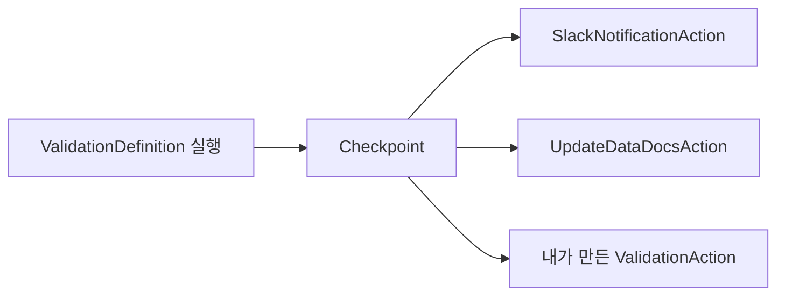
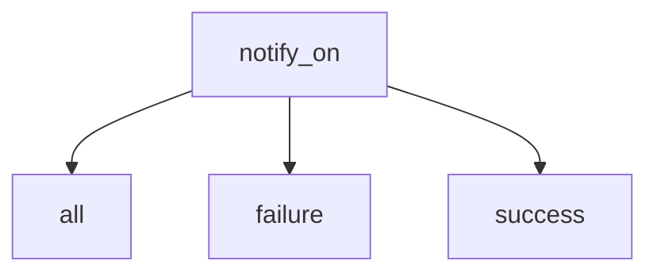

# GX 사용자 정의 Action

> Great Expectations의 Checkpoint는 검증 뒤에 실행할 액션 목록을 가진다. 기본 액션(슬랙 알림, Data Docs 갱신)이 아닌 동작이 필요하면 `ValidationAction`을 상속해 직접 만든다.

## 쉽게 말하면
시험이 끝난 뒤 "결과를 칠판에 붙이고 선생님께 알림을 보낸다"는 후속 조치를 직접 정의하는 것이다.

## 자세히
(great_expectations 1.25.0 휠 소스를 하위 에이전트가 읽은 노트 기준. 문서 사이트는 열지 않았다.)
- **구성**: `ValidationDefinition(name, data=BatchDefinition, suite)`의 `.run(..., result_format=SUMMARY)`. `Checkpoint(name, validation_definitions, actions=[], result_format=SUMMARY)`.
- **`ValidationAction`**: type과 name을 가진 pydantic 모델이고 `run(checkpoint_result, action_context) -> dict`를 구현한다. 하위 클래스는 **type으로 자동 등록**된다.
- **기본 액션**: `SlackNotificationAction`(slack_webhook, `notify_on` 기본 "all"), `UpdateDataDocsAction`(site_names).
- **`notify_on`**: `Literal["all","success","failure","info","warning","critical"]`. 뒤의 세 값은 1.25.0에서 심각도 값이다.
- **설계(제안)**: 실패 시에만 티켓 생성, 결과를 사내 DB에 적재하는 액션 등을 만들고, 비밀 키는 환경 변수로 관리.

## 그림으로 보기



## 예시
```python
class SaveToDbAction(ValidationAction):
    type: Literal["save_to_db"] = "save_to_db"
    def run(self, checkpoint_result, action_context):
        return {"saved": True}
```
- 교육 활용: 검증 실패 시 이메일을 보내는 액션 설계 토론.

## 헷갈리는 것과 비교
| 개념 | 차이 |
|---|---|
| ValidationDefinition | 데이터+기대 묶음 실행 |
| Checkpoint | 검증 + 액션 묶음 |
| Action | 검증 후 동작 |

## 더 읽을거리
- [great_expectations (PyPI)](https://pypi.org/project/great-expectations/) — 1.25.0 소스 기준.
