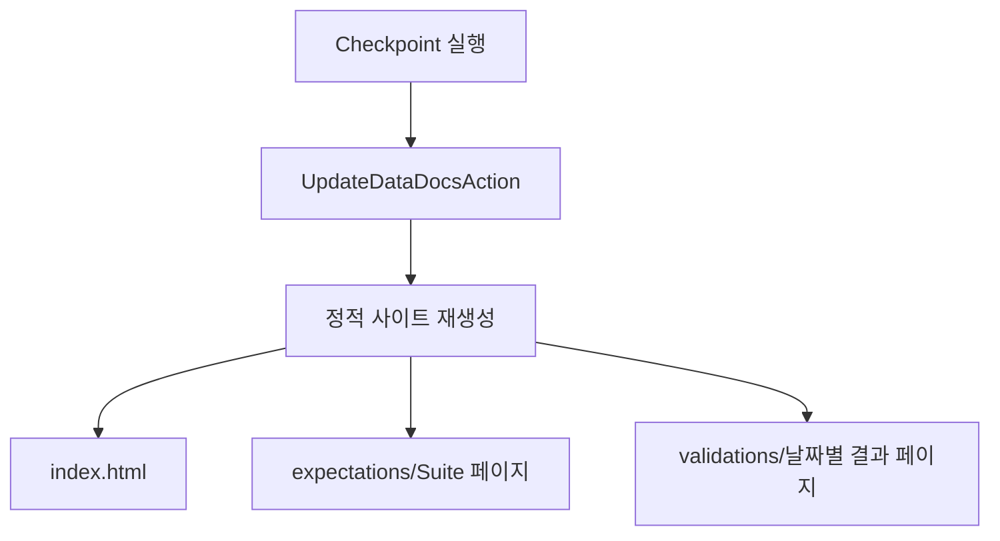
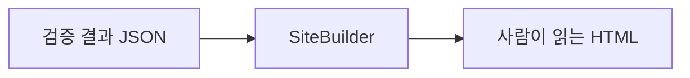

# GX Data Docs

> Data Docs는 Great Expectations가 Expectation, 검증 결과, 메타데이터를 **사람이 읽는 정적 웹페이지**로 만들어 주는 기능이다. 비개발자도 "어떤 규칙이 있고 어느 것이 실패했는지"를 브라우저로 볼 수 있다.

## 쉽게 말하면
검수원이 매번 쓰는 검사 결과 보고서를 자동으로 웹 문서로 인쇄해 사내 게시판에 올려 주는 기능이다. 규칙 목록 페이지와 날짜별 검사 결과 페이지가 쌓인다.

## 자세히
(공식 문서 doc.greatexpectations.io의 Data Docs 설정 페이지를 읽고, 이 세션에서 great_expectations 1.25.0의 **파일 컨텍스트로 Checkpoint를 실행해 생성된 파일을 직접 확인**했다.)
- **공식 문서 요지**: Data Docs는 Expectation·검증 결과·기타 메타데이터를 사람이 읽는 문서로 바꿔 정적 웹페이지로 저장하며, 데이터 테스트에서 다시 컴파일하면 최신 상태로 유지된다. 요구: Python 3.10~3.14, GX Core, **File Data Context**.
- **설정**: `site_config` 딕셔너리에 `class_name: SiteBuilder`, `site_index_builder: DefaultSiteIndexBuilder`, `store_backend`(`TupleFilesystemStoreBackend`, `base_directory`)를 넣고 `context.add_data_docs_site(site_name=..., site_config=...)`로 등록. 기본 `base_directory`는 `uncommitted/data_docs/local_site/`. 사이트 이름은 컨텍스트 안에서 유일해야 하며 다른 키는 지원되지 않고 향후 제거될 수 있다고 문서가 경고한다.
- **빌드와 열기**: 수동은 `context.build_data_docs(site_names=...)`, 자동은 Checkpoint에 `UpdateDataDocsAction`을 넣어 `run()` 끝에 재빌드, 열기는 `context.open_data_docs()`. 문서는 로컬·네트워크 파일시스템만 다루고 클라우드 저장소 설정은 설명하지 않는다.
- **직접 실행한 결과(이 세션)**: `unique(customer_id)` 하나를 담은 Suite로 Checkpoint(`UpdateDataDocsAction`) 실행 → 실패(success False). 생성된 구조:
  - `uncommitted/data_docs/local_site/index.html` (목차)
  - `.../expectations/s.html` (Expectation Suite 페이지)
  - `.../validations/s/__none__/<실행시각>/pd-c.html` (검증 결과 페이지)
  - `uncommitted/validations/.../*.json` (원본 결과 JSON)
  - 검증 페이지 본문에 Status: Failed, Evaluated 1·Successful 0·Unsuccessful 1·Success Percent 0%, GX 버전 1.25.0, 실행 시각, 배치 마커(`pandas_data_fingerprint`) 등이 표시되었다.
- **운영 주의(해석)**: 결과 페이지에는 데이터 일부 값이 노출될 수 있으므로 민감 데이터가 있는 프로젝트는 접근 권한을 정해야 한다. `uncommitted/` 폴더는 이름 그대로 버전 관리에서 제외하는 것이 기본 관행이다.

## 그림으로 보기

## 예시
- 데이터 팀이 매일 Checkpoint 실행 후 Data Docs를 내부 웹서버에 올려 기획자가 실패 항목을 직접 확인.
- 교육 소재: 같은 데이터에서 성공·실패 결과 페이지를 나란히 열어 보며 "데이터 품질 보고서" 읽는 법을 연습.

## 헷갈리는 것과 비교
| 개념 | 차이 |
|---|---|
| Data Docs | 사람이 읽는 결과 웹페이지 |
| 검증 결과 JSON | 기계가 읽는 원본 |
| [GX Checkpoint와 Action](#gx-checkpoint-actions) | Data Docs를 갱신하는 실행 단위 |
| [Great Expectations](#great-expectations) | 전체 도구 |

## 더 읽을거리
- [GX: Configure Data Docs](https://docs.greatexpectations.io/docs/core/configure_project_settings/configure_data_docs/) — 사이트 설정·빌드(직접 확인).
- [GX Core GitHub](https://github.com/great-expectations/great_expectations) — 설치·라이선스(직접 확인).
