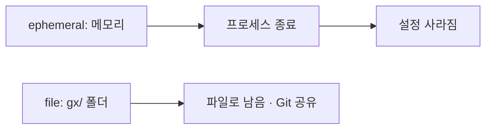
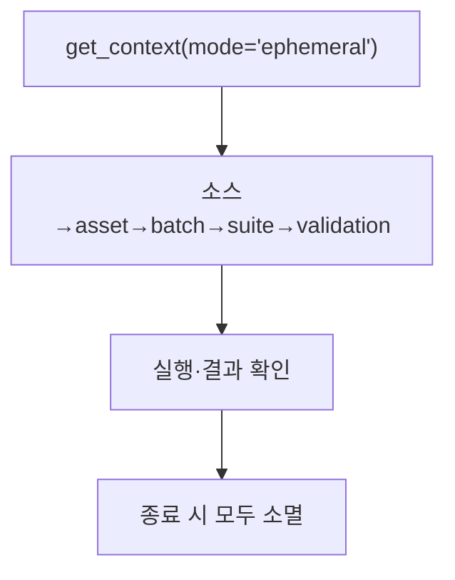

# GX 임시 컨텍스트

> Great Expectations의 **임시(ephemeral) 데이터 컨텍스트**는 설정과 규칙을 **파일로 저장하지 않고 프로세스 메모리에서만** 쓰는 모드다. 빠른 실험에 편하지만, 프로그램이 끝나면 데이터 소스·스위트·검증 정의가 모두 사라진다.

## 쉽게 말하면
칠판에 쓴 메모다. 수업 중에는 마음껏 쓰고 지울 수 있지만, 교실을 나가면 사라진다. 나중에 다시 쓰려면 공책(파일 컨텍스트)에 옮겨 적어야 한다.

## 자세히
(이 세션에서 great_expectations **1.25.0**을 가상환경에 설치해 `gx.get_context(mode="ephemeral")`를 **직접 실행**했다. 공식 문서 본문은 열리지 않았다.)
- **생성(실행 결과)**: `gx.get_context(mode="ephemeral")`는 **`EphemeralDataContext`** 객체를 돌려주고 `root_directory`는 **None**이다(디스크 위치가 없다).
- **사용(실행 결과)**: 같은 프로세스에서 pandas 데이터 소스 → asset → batch definition → 스위트 → validation definition을 만들고 `run(...)`까지 정상 동작했다(결측이 있는 데이터에서 `success=False`).
- **저장 여부(실행 결과)**: 실행 후 작업 디렉터리에 **생성된 파일이 없었다**(`os.listdir` 빈 목록). 같은 프로세스 안에서는 `ctx.suites.all()`에 스위트 `s`가 보였다.
- **재시작 후(실행 결과)**: **새 파이썬 프로세스**에서 다시 임시 컨텍스트를 만들면 스위트 목록이 **빈 리스트**, 데이터 소스도 **빈 목록**이었다. 즉 이전 설정은 전혀 남지 않는다.
- **언제 쓰나(해석)**: 노트북에서 규칙을 시험하거나 CI 스크립트가 매번 코드에서 규칙을 만들 때. 설정을 팀이 공유·리뷰하려면 파일 컨텍스트를 쓴다. → [GX 파일 데이터 컨텍스트](#gx-file-data-context)
- **주의(해석)**: 임시 모드에서는 검증 결과나 Data Docs가 디스크에 남지 않으므로 이력이 필요하면 결과를 직접 저장해야 한다. (결과 저장의 세부는 이 노드에서 시험하지 않았다.)

## 그림으로 보기

## 예시
- 노트북에서 컬럼 규칙을 몇 개 시험해 보고 마음에 들면 같은 코드를 파일 컨텍스트로 옮겨 저장.
- 교육 활동: 임시 컨텍스트로 만든 스위트가 새 세션에서 사라지는 것을 직접 확인.

## 헷갈리는 것과 비교
| 개념 | 차이 |
|---|---|
| 임시 컨텍스트 | 메모리 전용, 종료 시 소멸 |
| [파일 데이터 컨텍스트](#gx-file-data-context) | gx/ 폴더에 저장·공유 |
| [uncommitted 폴더](#gx-uncommitted-folder) | 파일 컨텍스트에서 Git 제외 영역 |
| [GX Data Docs](#gx-data-docs) | 검증 결과 문서(임시 모드에서의 보존은 미확인) |

## 더 읽을거리
- [Great Expectations 문서](https://docs.greatexpectations.io/docs/) — 데이터 컨텍스트 개요(이 노드의 관찰은 직접 실행 결과이며 문서 본문은 근거 아님).
