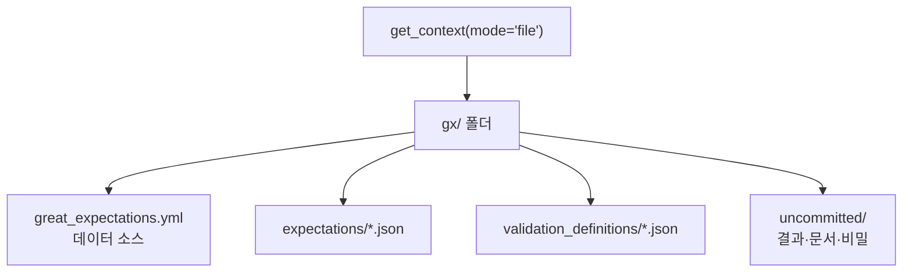
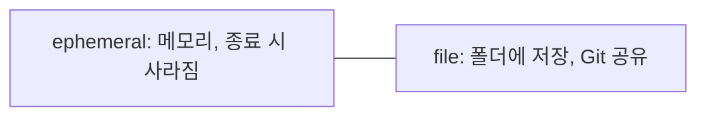

# GX 파일 데이터 컨텍스트

> Great Expectations(GX)의 **File Data Context**는 프로젝트 설정(데이터 소스·기대 규칙·검증 정의)을 **디스크의 `gx/` 폴더 파일로 저장**하는 방식이다. 설정을 Git으로 버전 관리하고 팀이 공유할 수 있다. 저장하지 않는 임시(ephemeral) 컨텍스트와 대비된다.

## 쉽게 말하면
요리 레시피를 머릿속(임시)에만 두면 다음 날 사라지지만, 레시피 카드(파일)로 적어 서랍(폴더)에 넣으면 동료도 같은 레시피로 요리할 수 있다. 파일 컨텍스트는 검증 규칙을 레시피 카드로 남기는 방식이다.

## 자세히
(이 세션에서 great_expectations **1.25.0**을 가상환경에 설치해 `gx.get_context(mode="file", project_root_dir=".")`를 **직접 실행**해 만들어진 폴더를 확인했다. 공식 문서 본문은 열리지 않아 문서가 아닌 실행에 근거한다.)
- **생성되는 구조(실행 결과)**
  ```
  gx/
    great_expectations.yml     # 데이터 소스·스토어 설정(커밋 대상)
    expectations/              # 스위트 JSON (예: s.json)
    validation_definitions/    # 검증 정의 JSON (예: v.json)
    checkpoints/  plugins/     # 체크포인트·확장
    uncommitted/               # config_variables.yml, validations/, data_docs/
    .gitignore                 # 내용: uncommitted/
  ```
- **저장되는 것(실행 결과)**: 데이터 소스와 asset·batch definition은 `great_expectations.yml`의 `fluent_datasources`에 기록되고, 스위트는 `expectations/<이름>.json`, 검증 정의는 `validation_definitions/<이름>.json`으로 저장된다. 검증을 실행하면 결과가 `uncommitted/validations/<스위트>/…/<시각>/…json`에 쌓인다.
- **파일 설정 파일의 주석(실행 결과)**: `great_expectations.yml` 상단 주석이 "이 파일은 저장소에 커밋하도록 의도됐다"고 적혀 있고, 비밀값은 `uncommitted/config_variables.yml`로 치환하도록 안내한다.
- **언제 쓰나(해석)**: 규칙을 팀이 공유·리뷰해야 하거나 CI에서 같은 설정으로 실행할 때. 일회성 탐색은 `mode="ephemeral"`(메모리)이 간편하다.
- **한계**: 이 글은 pandas DataFrame 소스로 만든 최소 예제이며, 클라우드 컨텍스트(GX Cloud)나 SQL 소스의 구성은 확인하지 않았다. 폴더 구조는 버전에 따라 바뀔 수 있다.

## 그림으로 보기



## 예시
- 데이터 팀 저장소에 `gx/`를 커밋하고 CI에서 `get_context(mode="file")`로 같은 규칙을 실행.
- 교육 활동: 빈 폴더에서 파일 컨텍스트를 만들고 생성된 파일을 하나씩 열어 역할을 맞춰 보기.

## 헷갈리는 것과 비교
| 개념 | 차이 |
|---|---|
| 파일 데이터 컨텍스트 | 설정을 폴더 파일로 저장·공유 |
| 임시 컨텍스트 | 메모리에만 존재 |
| [GX uncommitted 폴더](#gx-uncommitted-folder) | 결과·비밀을 Git에서 제외하는 곳 |
| [GX Data Docs](#gx-data-docs) | 검증 결과를 HTML로 보는 문서 |

## 더 읽을거리
- [Great Expectations 문서](https://docs.greatexpectations.io/docs/) — 데이터 컨텍스트 개요(이 노드의 폴더 구조는 직접 실행 결과이며 문서 본문은 근거 아님).
