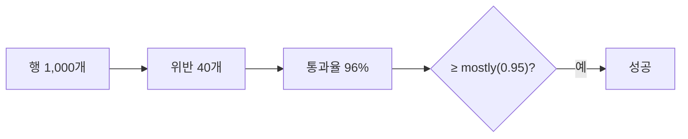
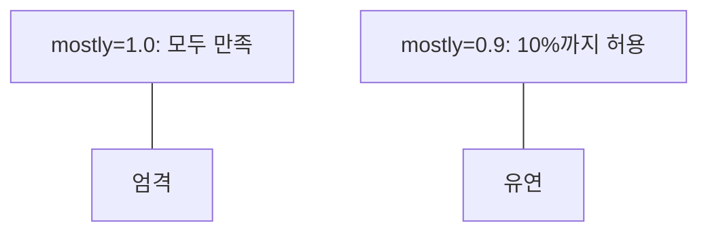

# GX mostly 파라미터

> Great Expectations의 `mostly`는 기대(expectation)가 통과하려면 전체 행 중 몇 비율이 조건을 만족해야 하는지 정하는 0~1 값이다. 일부 위반을 허용하는 임계값이다.

## 쉽게 말하면
"모든 칸이 채워져야 한다" 대신 "95% 이상 채워져 있으면 합격"처럼 현실적인 합격선을 정하는 옵션이다.

## 자세히
(great_expectations 1.25.0 휠 소스를 하위 에이전트가 읽은 노트 기준. 문서 사이트 페이지는 열지 않았다.)
- **정의**: `MostlyField`는 0~1 실수(기본 1). 성공 조건은 **(고려한 행 수 − 예상 밖 행 수) / 고려한 행 수 ≥ mostly**.
- **적용**: `ExpectColumnValuesToNotBeNull(column="email", mostly=0.95)`처럼 map 계열 기대에 사용.
- **의미(제안)**: 결측을 일정 비율까지 허용하되 임계값 아래로 내려가면 알림을 보내는 품질 모니터링에 쓴다([결측 비율 모니터링](#missing-percent-monitoring)). mostly를 너무 낮추면 문제를 가릴 수 있어 이유를 기록한다.

## 그림으로 보기



## 예시
```python
gx.expectations.ExpectColumnValuesToNotBeNull(column="email", mostly=0.95)
```
- 교육 활용: mostly 값을 바꿔 가며 같은 데이터의 성공/실패를 비교.

## 헷갈리는 것과 비교
| 개념 | 차이 |
|---|---|
| mostly | 비율 임계값 |
| 기대 자체 | 조건(널 아님 등) |
| 결과 형식 | 결과 상세 수준(result_format) |

## 더 읽을거리
- [great_expectations (PyPI)](https://pypi.org/project/great-expectations/) — 1.25.0 소스 기준.
