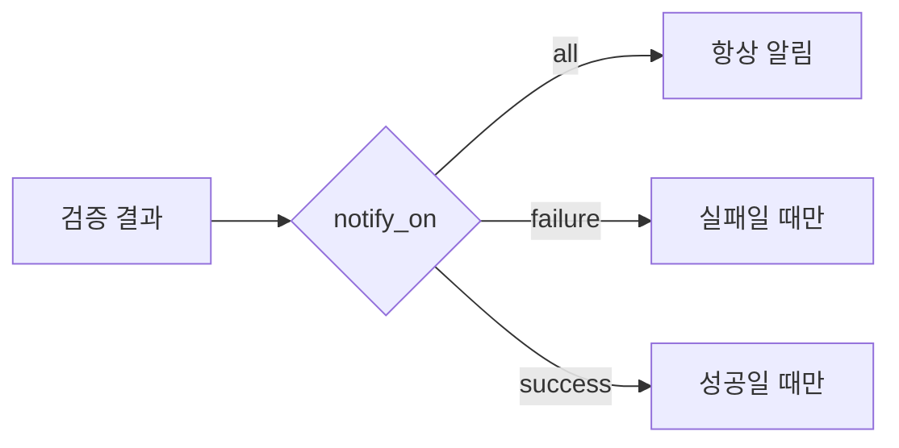
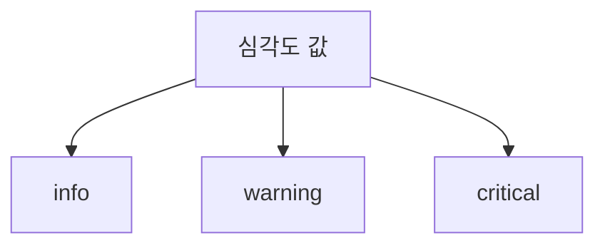

# GX notify_on 조건

> Great Expectations의 알림 액션(예: SlackNotificationAction)에서 어떤 검증 결과일 때 알림을 보낼지 정하는 설정이다. 기본값은 "all"이다.

## 쉽게 말하면
모든 검사 결과를 알림으로 받을지(all), 실패했을 때만 받을지(failure) 정하는 스위치다. 알림 피로를 줄이는 핵심 설정이다.

## 자세히
(great_expectations 1.25.0 휠 소스를 하위 에이전트가 읽은 노트 기준.)
- **`SlackNotificationAction`**: `slack_webhook`과 `notify_on`(기본 `"all"`) 필드를 가진다.
- **허용 값**: `Literal["all","success","failure","info","warning","critical"]`. 1.25.0에서 `info`·`warning`·`critical`은 **심각도(severity) 값**이다.
- **운영(제안)**: 평소에는 `failure`(또는 `critical`)만 알림, 첫 도입 기간에는 `all`로 동작 확인. 중요 테이블은 별도 Checkpoint로 분리해 알림 대상을 다르게 한다.
- **문서 사이트의 설명과 버전별 차이는 확인하지 않았다**(소스 1.25.0 기준).

## 그림으로 보기



## 예시
```python
SlackNotificationAction(name="slack", slack_webhook=url, notify_on="failure")
```
- 교육 활용: 알림 설정에 따른 팀의 알림 피로를 토론.

## 헷갈리는 것과 비교
| 개념 | 차이 |
|---|---|
| notify_on | 알림 조건 |
| [사용자 정의 Action](#gx-custom-action) | 새로운 동작 정의 |
| [mostly](#gx-mostly) | 성공 임계값 |

## 더 읽을거리
- [great_expectations (PyPI)](https://pypi.org/project/great-expectations/) — 1.25.0 소스 기준.
