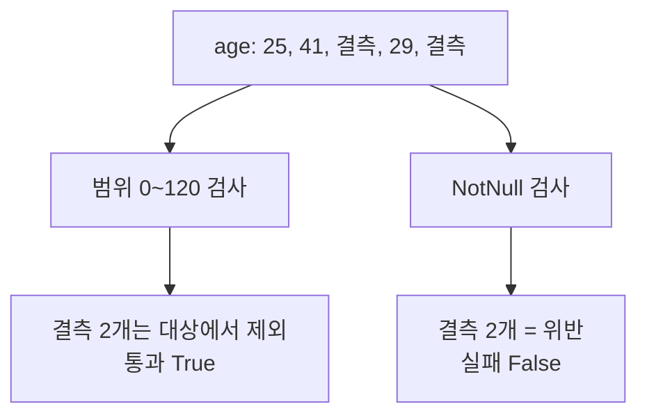
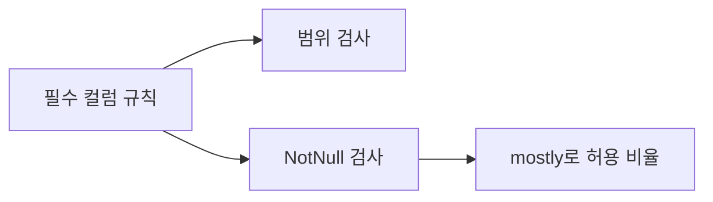

# 결측과 범위 검사의 차이

> Great Expectations의 **범위 검사**(`ExpectColumnValuesToBeBetween`)는 값이 비어 있는(NULL) 행을 **검사 대상에서 빼고 통과로** 본다. 그래서 "나이는 0~120"만 걸어 두면 나이가 전부 비어 있어도 통과한다. 결측은 별도의 Expectation으로 막아야 한다.

## 쉽게 말하면
입장권 검사원이 "연령 제한 12세 이상"만 확인하고, 나이를 안 적은 사람은 "확인할 값이 없으니 문제 없음"으로 통과시키는 것과 같다. 빈 칸 자체를 막으려면 "나이 기재 필수"라는 별도 규칙이 필요하다.

## 자세히
(이 세션에서 great_expectations 1.25.0을 설치해 **직접 실행한 결과**. 공식 갤러리 페이지는 본문이 비어 있어 NULL 처리 설명을 문서로는 확인하지 못했고, 동작은 실행으로 확인했다.)
- **실험 데이터**: `age = [25, 41, None, 29, None]`(5행, 결측 2개).
- **결과**
  - `ExpectColumnValuesToBeBetween(column="age", min_value=0, max_value=120)` → **success=True**, element_count 5, missing_count 2, unexpected_count 0. 결측 2개는 위반으로 세지 않고 `missing_percent`만 40.0%로 보고한다.
  - `ExpectColumnValuesToNotBeNull(column="age")` → **success=False**, unexpected_count 2(40.0%).
  - `ExpectColumnValuesToNotBeNull(column="age", mostly=0.6)` → **success=True**. `mostly`는 비율 허용치로 60% 이상 채워져 있으면 통과.
- **함정과 대응**
  1. 범위·값 집합 같은 값 기반 Expectation은 결측을 건너뛸 수 있다(이 실험 기준).
  2. 필수 컬럼에는 `ExpectColumnValuesToNotBeNull`을 **함께** 둔다.
  3. 일부 결측을 허용하면 `mostly`로 비율을 명시한다.
  4. 결과의 `missing_percent`를 모니터링 지표로 남긴다.
- **한계**: 다른 Expectation·다른 GX 버전에서는 결측 처리가 다를 수 있다. 이 글은 두 Expectation만 실행했고 버전 1.25.0 기준이다.

## 그림으로 보기

## 예시
- 회원 나이 컬럼: 범위 검사와 NotNull(mostly=0.95)을 함께 걸어 "95% 이상 채워지고 모두 0~120"을 보장.
- 교육 소재: 같은 데이터에 규칙 하나만 걸었을 때와 둘을 걸었을 때 결과를 비교하는 실습.

## 헷갈리는 것과 비교
| 개념 | 차이 |
|---|---|
| 범위 검사 | 값이 있는 행만 평가 |
| NotNull 검사 | 빈 칸 자체를 위반으로 |
| mostly | 일부 위반 허용 비율 |
| [GX Checkpoint와 Action](#gx-checkpoint-actions) | 이 검사를 운영에서 실행 |

## 더 읽을거리
- [Great Expectations 문서](https://docs.greatexpectations.io/) — 공식 문서(이 글의 동작은 직접 실행으로 확인).
- [GX Core GitHub](https://github.com/great-expectations/great_expectations) — 설치·라이선스(직접 확인).
