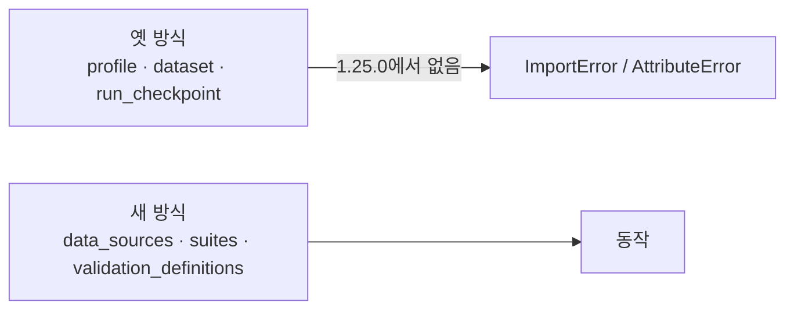
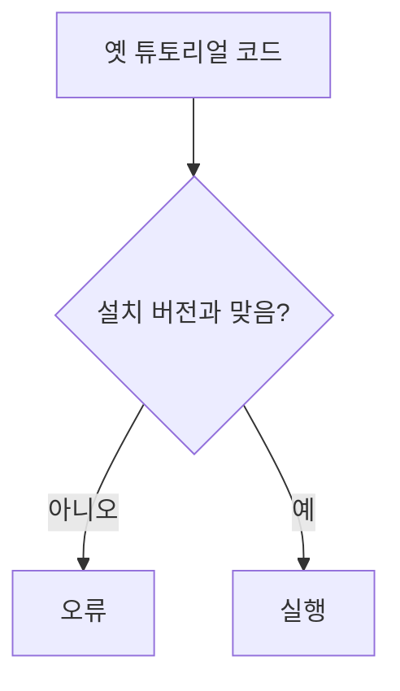

# GX 1.x에서 사라진 기능

> Great Expectations는 0.x에서 1.x로 오면서 API 구조가 크게 바뀌었다. **옛 튜토리얼의 코드가 최신 버전에서 import 오류가 나는 이유**를 이 변화로 설명할 수 있다. 이 노드는 설치한 1.25.0에서 **실제로 확인한 것만** 적는다.

## 쉽게 말하면
스마트폰 OS를 크게 바꾸면 옛 앱이 안 열릴 수 있다. 옛 GX 자료의 코드는 옛 OS용 앱이라, 새 버전에서는 일부가 "찾을 수 없음"으로 실패한다.

## 자세히
(이 세션에서 great_expectations **1.25.0**을 가상환경에 설치해 모듈 import와 객체 속성을 **직접 실행으로 확인**했다. 릴리스 노트·마이그레이션 가이드는 열어 보지 못했으므로 "무엇이 왜 제거됐는지"의 공식 설명은 확인하지 않았다.)
- **import 시험(실행 결과)**
  | 대상 | 결과 |
  |---|---|
  | `great_expectations.profile.user_configurable_profiler` | **ModuleNotFoundError** (`great_expectations.profile` 없음) |
  | `great_expectations.dataset` | **ModuleNotFoundError** |
  | `great_expectations.render`, `.checkpoint`, `.core.batch` | import 성공 |
- **컨텍스트 속성 시험(실행 결과, ephemeral 컨텍스트)**
  | 속성 | 있음? |
  |---|---|
  | `get_validator`, `build_data_docs`, `add_datasource` | 있음 |
  | `data_sources`, `suites`, `validation_definitions`, `checkpoints` | 있음(새 구조) |
  | `run_checkpoint`, `add_checkpoint` | **없음** |
  | `sources` | 없음 |
- **해석**: 옛 방식의 **프로파일러**와 **`Dataset` 래퍼**는 이 버전에 없고, 체크포인트는 `ctx.run_checkpoint(...)` 같은 컨텍스트 메서드가 아니라 `ctx.checkpoints` 컬렉션과 객체로 다루는 구조로 보인다. 다만 `get_validator`는 남아 있어 **Validator 기반 옛 스타일 일부는 동작**한다(`Validator`에 `expect_column_values_to_not_be_null` 메서드가 있음을 확인).
- **새 구조의 중심(실행 결과)**: 데이터 소스 → asset → **batch definition**, 규칙 묶음 **스위트**, 이를 묶는 **validation definition**, 그리고 실행. → [GX 파일 데이터 컨텍스트](#gx-file-data-context)
- **이름 변화(별도 확인)**: 실행 시 파라미터가 `expectation_parameters`로 보인다. → [GX Suite 파라미터](#gx-suite-parameters)
- **한계**: 이 시험은 몇 가지 대표 항목만 본 것이다. 노트북 기반 CLI(`great_expectations init` 등) 존재 여부는 설치된 가상환경에 실행 파일이 없음만 확인했고(`bin/great_expectations` 없음), 이것이 1.x에서의 제거를 뜻하는지는 문서로 확인하지 않았다.

## 그림으로 보기

## 예시
- 블로그의 `from great_expectations.profile.user_configurable_profiler import ...` 코드를 그대로 실행하면 `ModuleNotFoundError`. 설치 버전을 확인하고 새 API 문서를 따른다.
- 교육 활동: `pip install great_expectations==버전`으로 두 버전을 만들어 같은 코드를 돌려 차이를 비교.

## 헷갈리는 것과 비교
| 개념 | 차이 |
|---|---|
| 0.x 방식 | 프로파일러·Dataset 래퍼·context 메서드 중심 |
| 1.x 방식 | data_sources / suites / validation_definitions 컬렉션 |
| [튜토리얼 버전 확인 습관](#tutorial-version-check) | 자료와 설치 버전을 대조 |
| [GX API 버전 차이](#gx-api-version-differences) | 상위 노드 |

## 더 읽을거리
- [Great Expectations 문서](https://docs.greatexpectations.io/docs/) — 공식 문서(이 노드의 표는 직접 실행 결과이며 문서 본문은 근거 아님).
