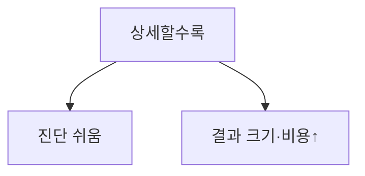

# GX result_format

> Great Expectations 검증 결과에 얼마나 상세한 정보를 담을지 정하는 옵션이다. BOOLEAN_ONLY, BASIC, SUMMARY(기본), COMPLETE 4단계가 있다.

## 쉽게 말하면
시험 결과를 "합격/불합격"만 줄지, 틀린 문제 일부를 보여 줄지, 틀린 문제 전부와 위치까지 줄지 정하는 설정이다.

## 자세히
(great_expectations 1.25.0 소스를 하위 에이전트가 읽은 노트 기준. 키별 표는 미확인.)
- **`ResultFormat` 열거형**: `BOOLEAN_ONLY`, `BASIC`, `SUMMARY`, `COMPLETE`. **기본 SUMMARY**.
- **형식**: 문자열 또는 딕셔너리로 지정하며 기본값으로 `partial_unexpected_count=20`, `include_unexpected_rows=False`가 채워진다.
- **단계별(확인한 것)**: `BOOLEAN_ONLY`는 성공 여부만, `BASIC`은 예상 밖 값과 개수 추가, `SUMMARY`는 기본 요약, `COMPLETE`는 전체 `unexpected_index_list`와 쿼리를 추가.
- **선택(제안)**: 대규모 데이터에서는 COMPLETE가 커서 느려질 수 있으니 SUMMARY로 시작하고, 원인 분석 때만 COMPLETE.

## 그림으로 보기



## 예시
```python
validation_definition.run(result_format="COMPLETE")
```
- 교육 활용: 같은 검증을 4가지 형식으로 돌려 결과 크기를 비교.

## 헷갈리는 것과 비교
| 개념 | 차이 |
|---|---|
| result_format | 결과 상세 수준 |
| [mostly](#gx-mostly) | 성공 임계값 |
| Data Docs | 결과를 읽기 쉬운 페이지로 렌더링 |

## 더 읽을거리
- [great_expectations (PyPI)](https://pypi.org/project/great-expectations/) — 1.25.0 소스 기준.
