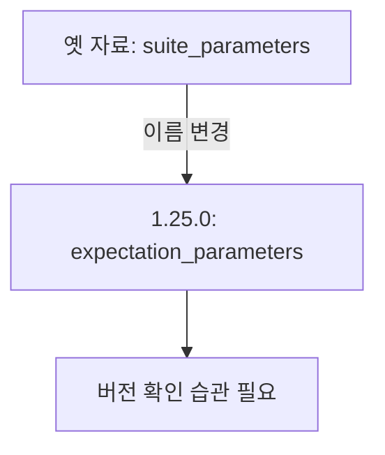

# GX Suite 파라미터

> Great Expectations에서 **규칙 안의 값(예: 최소값)을 고정하지 않고 실행 시점에 넘기는 기능**이다. 규칙에는 `{"$PARAMETER": "이름"}`을 쓰고, 검증을 실행할 때 `expectation_parameters`로 실제 값을 전달한다. (옛 이름 `suite_parameters`가 문서·자료에 남아 있어 헷갈린다.)

## 쉽게 말하면
시험지에 "합격선: ____점"이라고 빈칸을 두고, 시험 보는 날 감독관이 합격선을 불러 주는 방식이다. 같은 시험지로 매번 다른 합격선을 적용할 수 있다.

## 자세히
(이 세션에서 great_expectations **1.25.0**을 가상환경에 설치해 **직접 실행**한 결과. 공식 문서 본문은 열리지 않았고, 동작과 함수 시그니처는 실행·`inspect`로 확인했다. 버전이 다르면 이름이 다를 수 있다.)
- **사용법(실행 결과)**: `ExpectColumnValuesToBeBetween(column="x", min_value={"$PARAMETER": "lo"}, max_value=10)`처럼 값 자리에 `$PARAMETER` 딕셔너리를 넣어 스위트를 만들고, `validation_definition.run(batch_parameters=…, expectation_parameters={"lo": 5})`로 값을 넘겼더니 정상 실행됐다(데이터 [1, 2, 50]에서 범위 5~10 → unexpected_count 3, success False).
- **이름 변화(실행 결과)**: 1.25.0의 `ValidationDefinition.run` 시그니처에는 `suite_parameters`가 아니라 **`expectation_parameters`**가 있다. 시그니처 전체: `checkpoint_id, batch_parameters, expectation_parameters, result_format(기본 SUMMARY), run_id`. 타입 이름은 `SuiteParameterDict`로 남아 있다. 따라서 `suite_parameters`를 쓰는 옛 자료는 1.25.0과 맞지 않을 수 있다. → [GX API 버전 차이](#gx-api-version-differences)
- **쓸모(해석)**: 임계값을 환경별(개발/운영)·날짜별로 바꾸거나, 이전 실행 결과로 기준을 정할 때 규칙 파일을 고치지 않고 값만 주입한다.
- **주의(해석)**: 값을 안 넘기면 어떻게 되는지, 중첩된 표현식(`$PARAMETER` 안의 계산식)이 어떻게 처리되는지는 시험하지 않았다. 규칙 JSON에 `$PARAMETER`가 그대로 저장되므로 호출부에서 반드시 값을 넘겨야 한다(해석).
- **기본 결과 상세도(실행 결과)**: `result_format`의 기본값이 **SUMMARY**로 보인다. → [Data Docs 접근 제어](#data-docs-access-control)에서 본 위반 값 노출이 이 기본값에서의 관찰임을 뒷받침한다.

## 그림으로 보기

## 예시
- 매일 업데이트되는 기준 행 수를 `{"$PARAMETER":"min_rows"}`로 두고 파이프라인이 `expectation_parameters={"min_rows": 1000}`로 전달.
- 교육 활동: 같은 규칙에 값 5와 20을 각각 넘겨 결과가 어떻게 달라지는지 확인.

## 헷갈리는 것과 비교
| 개념 | 차이 |
|---|---|
| suite 파라미터 | 규칙 값을 실행 때 주입 |
| 규칙에 직접 값 | 값 고정. 환경별 변경 시 규칙 수정 필요 |
| [GX Batch Definition](#gx-batch-definition) | 데이터를 어떻게 나눠 읽을지(데이터 쪽) |
| [튜토리얼 버전 확인 습관](#tutorial-version-check) | 자료 버전이 설치 버전과 맞는지 확인 |

## 더 읽을거리
- [Great Expectations 문서](https://docs.greatexpectations.io/docs/) — 개요(이 노드의 동작은 직접 실행 결과이며 문서 본문은 근거 아님).
