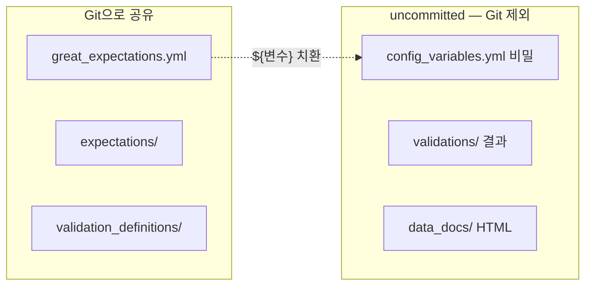
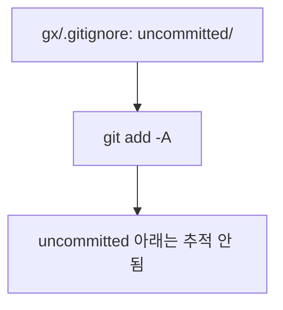

# GX uncommitted 폴더

> Great Expectations 파일 프로젝트의 `gx/uncommitted/` 폴더는 **검증 결과·Data Docs·비밀 설정 변수**를 담고, 프로젝트가 만든 `.gitignore`가 이 폴더를 **버전 관리에서 제외**한다. 규칙(설정)은 공유하고 실행 결과·비밀은 로컬에 둔다는 구분이다.

## 쉽게 말하면
회사 매뉴얼(규칙)은 모두가 보는 공유 서랍에, 매일 쓰는 일지와 금고 열쇠(결과·비밀)는 개인 서랍에 둔다. `uncommitted`는 개인 서랍이고, Git은 이 서랍을 건드리지 않는다.

## 자세히
(이 세션에서 great_expectations **1.25.0**으로 파일 컨텍스트를 만들고 검증·`build_data_docs()`까지 **직접 실행**하고, 임시 폴더에서 `git add -A`로 무엇이 추적되는지 확인했다. 공식 문서 본문은 열리지 않았다.)
- **`.gitignore`(실행 결과)**: 파일 내용이 `uncommitted/` 한 줄이다.
- **들어 있는 것(실행 결과)**
  - `config_variables.yml`: 변수 치환용 파일. 생성된 파일에는 `instance_id` 한 줄과 "환경 변수가 우선하며 비밀을 소스 관리 밖에 두기 위한 치환" 설명 주석이 있다.
  - `validations/<스위트>/<run>/<시각>/<소스>-<asset>.json`: 검증 실행 결과. 메타에 데이터 소스·asset 이름, `ge_load_time`, pandas 데이터 지문(`pandas_data_fingerprint`), GX 버전(1.25.0)이 기록된다.
  - `data_docs/local_site/…`: `build_data_docs()`로 만든 HTML 사이트(정적 이미지 등 포함).
- **Git 추적 확인(실행 결과)**: `git add -A` 후 상태에 `gx/.gitignore`, `expectations/s.json`, `great_expectations.yml`, `validation_definitions/v.json` 등만 추가됐고 **`uncommitted/` 아래 파일은 하나도 안 잡혔다**.
- **설계 의도(설정 파일 주석, 실행 결과)**: `great_expectations.yml`은 "저장소에 커밋하도록 의도"되었고, `${변수}`는 환경 변수나 `config_variables.yml`에서 치환된다. 즉 데이터베이스 비밀번호는 yml 본문이 아니라 uncommitted에 둔다.
- **주의(해석)**: 결과가 uncommitted에 있으니 **팀이 같은 검증 이력을 보려면** 별도 저장소(클라우드·객체 저장소)나 Data Docs 배포가 필요하다. 반대로 비밀을 `great_expectations.yml`에 직접 쓰면 Git에 올라간다.

## 그림으로 보기

## 예시
- DB 비밀번호를 `config_variables.yml`에 두고 yml에는 `${DB_PASSWORD}`만 쓴다. CI에서는 환경 변수로 주입.
- 교육 활동: 임시 폴더에서 컨텍스트를 만들고 `git status`로 추적되는 파일과 안 되는 파일을 구분해 보기.

## 헷갈리는 것과 비교
| 개념 | 차이 |
|---|---|
| uncommitted | 결과·문서·비밀. Git 제외 |
| expectations/ | 규칙 JSON. Git 공유 |
| [GX 파일 데이터 컨텍스트](#gx-file-data-context) | 전체 폴더 구조 |
| [GX Data Docs](#gx-data-docs) | uncommitted에 생성되는 HTML 문서 |

## 더 읽을거리
- [Great Expectations 문서](https://docs.greatexpectations.io/docs/) — 데이터 컨텍스트·Data Docs 개요(이 노드의 내용은 직접 실행 결과이며 문서 본문은 근거 아님).
