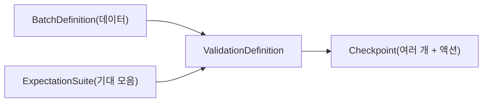
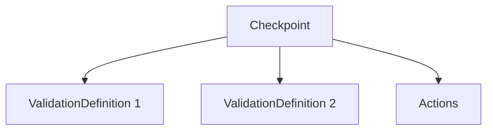

# GX Validation Definition

> Great Expectations 1.x에서 "어떤 데이터(BatchDefinition)를 어떤 기대 모음(Expectation Suite)으로 검증할지"를 묶어 이름을 붙인 객체다. Checkpoint는 여러 Validation Definition을 묶어 실행한다.

## 쉽게 말하면
"이 시험지(데이터)를 이 채점표(기대 모음)로 채점한다"는 한 줄 계약서다. 계약서를 여러 개 묶어 한꺼번에 채점하는 것이 Checkpoint다.

## 자세히
(great_expectations 1.25.0 휠 소스를 하위 에이전트가 읽은 노트 기준. 문서 사이트는 열지 않았다.)
- **구성**: `ValidationDefinition(name, data=BatchDefinition, suite)`.
- **실행**: `.run(..., result_format=SUMMARY)`로 단독 실행 가능([result_format](#gx-result-format)).
- **Checkpoint**: `Checkpoint(name, validation_definitions, actions=[], result_format=SUMMARY)` — 여러 Validation Definition을 실행하고 액션을 수행.
- **설계(제안)**: 테이블·파티션별 Validation Definition을 만들고 파이프라인 단계마다 Checkpoint로 묶어 호출.

## 그림으로 보기



## 예시
```python
vd = gx.ValidationDefinition(name="orders", data=batch_def, suite=suite)
results = vd.run()
```
- 교육 활용: 데이터와 기대 모음을 분리해 재사용하는 설계의 장점 토론.

## 헷갈리는 것과 비교
| 개념 | 차이 |
|---|---|
| Validation Definition | 데이터+기대 모음 묶음 |
| Checkpoint | 여러 Definition + 액션 |
| [Action](#gx-custom-action) | 검증 후 동작 |

## 더 읽을거리
- [great_expectations (PyPI)](https://pypi.org/project/great-expectations/) — 1.25.0 소스 기준.
