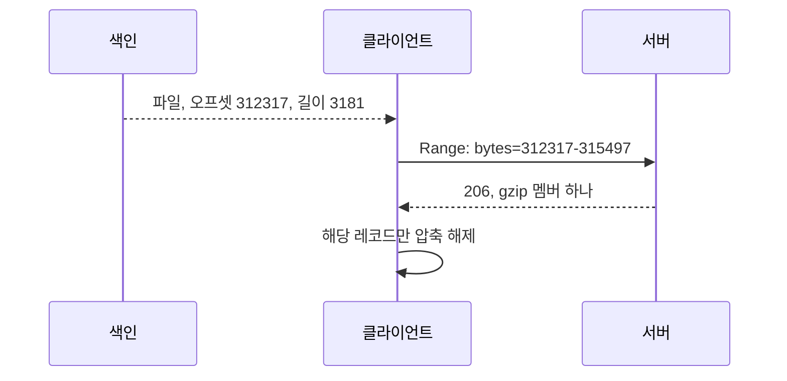

# gzip 멤버 경계

> Common Crawl의 `.warc.gz`·`.warc.wet.gz` 파일은 **레코드마다 따로 압축한 gzip 조각(멤버)을 이어 붙인 형태**다. 그래서 각 멤버의 시작 바이트 위치(오프셋)만 알면 파일 중간의 레코드 하나를 독립적으로 풀 수 있다.

## 쉽게 말하면
책 한 권을 통째로 압축하면 100쪽을 보려 해도 처음부터 풀어야 한다. 쪽마다 따로 봉투에 넣어 이어 붙이면, 100쪽 봉투가 어디서 시작하는지만 알면 그 봉투만 열 수 있다.

## 자세히
- 직접 실험(2026-11-27, `CC-MAIN-2024-10` WET 첫 파일의 앞 2,000,000바이트, 파이썬 `zlib.decompressobj(31)`):
  - 데이터 앞에서부터 멤버를 하나씩 풀어 **완전한 멤버 588개 + 잘린 마지막 멤버 1개**(2,000,000바이트에서 끊겨 692바이트만 남음)를 확인. 첫 멤버(429바이트 → 646바이트)는 `WARC-Type: warcinfo` 레코드였다.
  - 멤버 압축 크기의 중앙값은 약 1.8KB, 세 번째 멤버는 12,429바이트 → 33,884바이트로 풀렸다. 멤버마다 크기가 다르다.
  - **100번째 멤버**는 오프셋 312,317, 길이 3,181바이트였고, 이 3,181바이트만 잘라 풀자 `WARC-Type: conversion`, `WARC-Target-URI: http://agangershome.blogspot.com/…` 레코드가 정상적으로 나왔다. → **오프셋+길이만 알면 Range 요청으로 그 레코드만 받을 수 있다**([HTTP Range 요청](#http-range-request)).
  - 멤버 시작이 아닌 위치(오프셋+5)에서 풀려고 하면 `incorrect header check` 오류가 났다. gzip 헤더(매직 바이트)에서 시작해야 한다.
- 이 구조 덕분에 CDX 색인(URL → 파일·오프셋·길이)과 Range 요청을 결합해 특정 URL의 페이지만 받을 수 있다(일반적으로 알려진 Common Crawl 사용법, 이번 실행에서 색인 서버는 연결 실패로 직접 확인하지 못함).
- 대가: 레코드를 개별 압축하면 전체 압축률이 약간 낮다(추정). 스트리밍 처리에서는 `zcat`이 이어진 멤버를 자동으로 연속해 풀어 주므로 전체를 읽을 때는 불편이 없다.
- 주의: 앞 N바이트만 받으면 마지막 멤버가 잘린다. 잘린 멤버는 버리거나 경계까지 다시 받는다.

## 그림으로 보기



## 예시
```python
rec = zlib.decompressobj(31).decompress(data[off:off+length])
```
- 교육: "압축 방식이 접근 방식을 정한다"는 데이터 포맷 설계 사례.

## 헷갈리는 것과 비교
| 개념 | 차이 |
|---|---|
| 멤버별 gzip | 레코드 단위 임의 접근 가능 |
| 통째 gzip | 처음부터 풀어야 함 |
| zip 파일 | 파일 목록이 끝에 있어 임의 접근 가능(별개 포맷) |

## 더 읽을거리
- [Common Crawl: Get Started](https://commoncrawl.org/get-started) — WARC/WET 설명.
- 직접 실행: 2MB 샘플의 gzip 멤버 해부.
