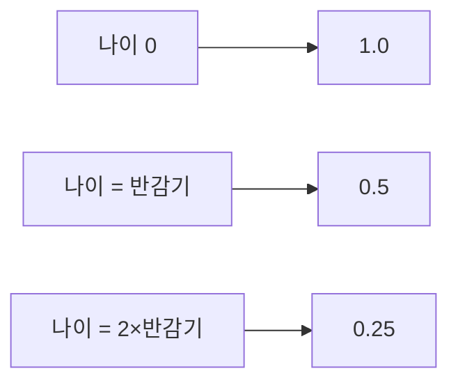
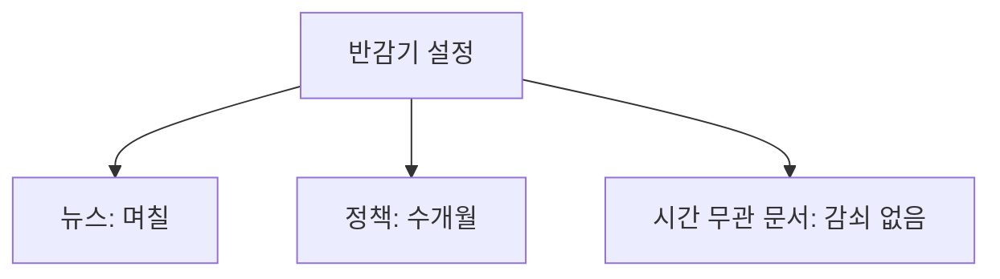

# 반감기 최신성 가중

> 문서의 최신성 점수를 "나이가 반감기만큼 늘 때마다 점수가 절반"이 되는 지수 감쇠로 주는 방식이다. 감쇠 함수에서 decay=0.5로 두면 scale이 곧 반감기가 된다.

## 쉽게 말하면
방사성 원소의 반감기처럼, 뉴스 점수가 7일마다 절반이 되도록 정하는 것이다. 반감기 하나만 정하면 최신성 곡선이 정해진다.

## 자세히
(Elasticsearch function_score의 지수 감쇠 정의에서 유도. 수식은 문서 기준, "반감기" 해석은 이 지도의 풀이이다.)
- **지수 감쇠 정의**: S = exp(λ·d), λ = ln(decay)/scale, d = max(0, |x − origin| − offset). `decay`는 scale 거리에서의 점수이며 기본 0.5.
- **반감기와의 관계**: decay = 0.5이면 d = scale에서 S = exp(ln 0.5) = 0.5이므로 **scale이 점수가 절반이 되는 거리(반감기)** 다. d = 2·scale이면 0.25.
- **offset**: 이 거리 안에서는 감쇠가 없다(점수 1). "최근 3일은 모두 같은 신선도"처럼 쓸 수 있다.
- **설정 기준(제안)**: 뉴스·장애 공지는 반감기 며칠, 정책·가이드는 수개월, 시간 무관 문서(원리·정의)는 감쇠 제외. 날짜 필드가 없는 문서는 감쇠 점수가 1이 되는 점에 유의([시간 감쇠 점수](#temporal-decay-scoring)).
- **검증(제안)**: 골든 질의 세트에서 반감기 값을 바꿔 가며 정답 문서의 순위를 비교한다([골든 질의 세트](#golden-query-set)).

## 그림으로 보기



## 예시
```json
"exp": {"@timestamp": {"origin": "now", "scale": "7d", "decay": 0.5}}
```
- 교육 활용: 반감기 7일일 때 3주 된 문서의 점수(0.125)를 계산.

## 헷갈리는 것과 비교
| 개념 | 차이 |
|---|---|
| 반감기 가중 | 지수 감쇠, 절반이 되는 시간 지정 |
| 선형 감쇠 | 일정하게 감소해 0에 도달 |
| 날짜 필터 | 일정 기간 밖은 제외 |

## 더 읽을거리
- [Elasticsearch function_score 쿼리](https://www.elastic.co/guide/en/elasticsearch/reference/current/query-dsl-function-score-query.html) — 지수 감쇠 정의.
