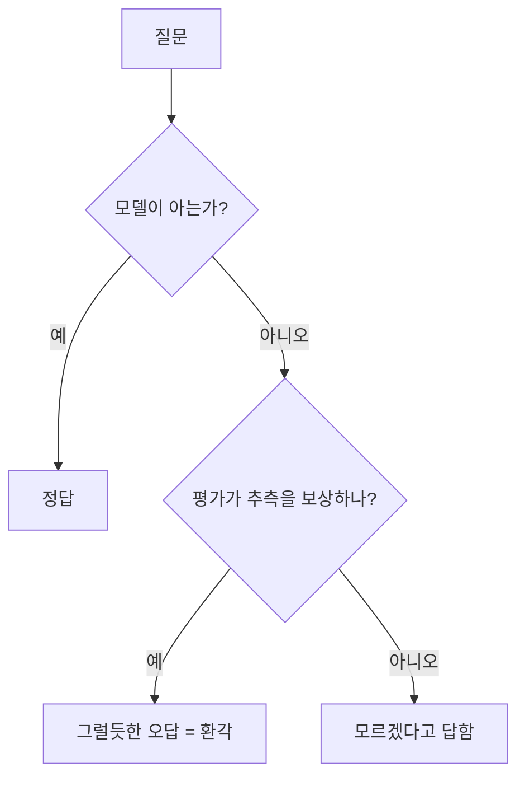
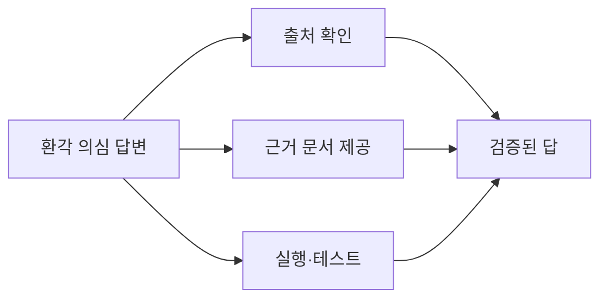

# 환각

> AI가 사실이 아닌 내용을 사실처럼 자신 있게 지어내는 현상. 영어로 hallucination.

## 쉽게 말하면
시험에서 모르는 문제를 빈칸으로 두면 0점이지만, 그럴듯하게 찍으면 맞을 수도 있다. 그래서 학생은 찍는다. AI도 비슷하다. "모르겠다"보다 "그럴듯한 답"이 더 잘 보상받도록 만들어져 있어서, 모를 때도 매끄러운 문장을 내놓는다. 문장이 유창하다고 내용이 맞는 건 아니다.

## 자세히
- **원인(OpenAI 연구진 논문, 2025-09, arXiv 2509.04664 초록 기준)**: ① 훈련·평가가 불확실성을 인정하기보다 추측을 보상한다 ② 사실과 거짓을 분간하지 못하는 통계적 한계는 사전학습 단계에서 자연스럽게 오류를 만든다. 논문의 처방은 벤치마크 채점 방식 자체를 바꿔 "모른다"를 덜 벌주는 것이다.
- **흔한 형태**: 존재하지 않는 논문·판례·URL 인용, 없는 함수·API 이름, 틀린 날짜·수치, 사용자가 준 전제를 그대로 믿고 이어 가기.
- **위험이 큰 곳**: 인용이 필요한 글, 코드(없는 라이브러리), 법·의료·금융.
- **줄이는 방법**: ① 근거 문서를 붙여 주고 "문서에 없으면 모른다고 답해"라고 시키기(RAG) ② 출처 링크를 요구하고 실제로 열어 보기 ③ "확신도와 근거를 같이 말해"라고 요구 ④ 코드는 실행·테스트로 검증([TDD](#tdd)) ⑤ 두 번째 모델·에이전트로 교차 검증.
- **없어지진 않는다**: 줄일 수는 있어도 0으로 만들 수는 없다. 그래서 검증 습관이 [AI 리터러시](#literacy)의 핵심이다.

## 그림으로 보기

## 예시
- 방지 프롬프트: "아래 문서만 근거로 답해. 문서에 없으면 '문서에 없음'이라고만 써. 답마다 해당 문장을 인용해."
- 점검 프롬프트: "방금 답에서 네가 확신하지 못하는 부분을 표시해 줘."
- 코딩: AI가 제안한 함수가 실제로 있는지 공식 문서·`pip show`로 확인.

## 헷갈리는 것과 비교
| 개념 | 차이 |
| --- | --- |
| 환각 | 모델이 지어낸 사실. 의도 없음 |
| 거짓말 | 알면서 속이려는 것. 환각은 "모르는 걸 모른다고 못 하는 것"에 가까움 |
| [편향](#ai-bias-ethics) | 학습 데이터의 치우침에서 오는 일관된 쏠림 |
| 오래된 정보 | 학습 시점 이후를 몰라서 틀린 것. 검색 연결로 해결 |

## 더 읽을거리
- [Why Language Models Hallucinate (arXiv 2509.04664)](https://arxiv.org/abs/2509.04664) — 환각이 평가 방식 때문에 지속된다는 논문
