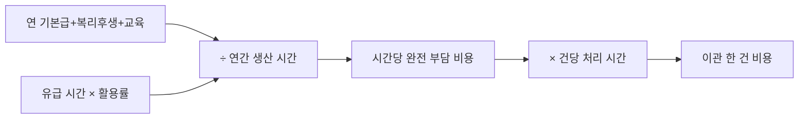
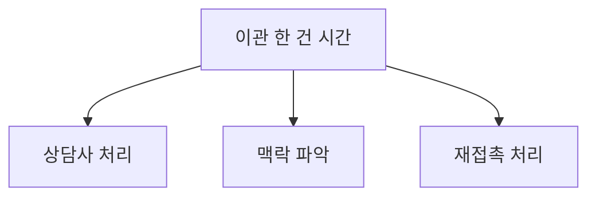

# 건당 처리 비용 추정

> 이관·재작업 한 건에 드는 비용을 "처리 시간 × 시간당 인건비"로 구하는 방법. 시간당 인건비는 월급 환산이 아니라 복리후생·교육을 더하고 실제 생산 시간으로 나눈 "완전 부담(fully loaded)" 값을 쓴다.

## 쉽게 말하면
직원 한 명이 한 시간에 쓰는 진짜 돈은 시급이 아니라, 월급에 복지·교육을 더하고 회의·휴식·결근 시간을 뺀 "일하는 시간"으로 나눈 값이다. 그 값에 한 건에 걸린 분 수를 곱하면 한 건의 비용이다.

## 자세히
- **완전 부담 시간당 비용(HiveDesk 글, 열람)**: (연 기본급 + 복리후생 + 교육비) ÷ 연간 생산 시간. 글의 예: 임금 35,000달러 + 복리후생 12,000 + 교육 2,000 = 49,000달러를 1,560 생산 시간으로 나누면 시간당 31.41달러(임금률은 16.83달러).
- **생산 시간**: 유급 시간(상근 2,080시간)에 생산 활용률(예에서 75%)을 곱한다(2,080×75% = 1,560). 비생산 시간 비율(shrinkage)의 일반 범위는 25~35%로 소개되고, 휴식·교육·회의·무계획 결근·시스템 중단 등이 포함된다. 이 비율은 벤더 글의 경험칙이다.
- **더 넓은 포함 항목**: 검색 요약에는 급여세, 유급휴가, 감독, 이직 비용까지 포함하는 가이드가 있었다.
- **건당 비용**: 총 인건비 ÷ 처리 건수(HiveDesk). 센터 전체 운영비 기준으로는 총 운영비 ÷ 처리 연락 건수(예: 월 42만 달러 ÷ 6만 건 = 건당 7달러, Onclarity 용어집, 열람)이며 완전 부담 기준에는 감독·품질관리 인력, 통신, 기술 라이선스, 시설 간접비가 들어간다. MetricNet 벤치마크로 인용되는 인바운드 건당 평균 약 4.83달러, 중앙값 약 3.73달러는 지역·채널에 따라 다르다.
- **이관·재작업 비용으로 쓰기(이 글의 적용)**: 이관 한 건은 상담사 처리 시간 + 맥락 파악 시간(요약이 나쁘면 증가) + 재접촉 처리 시간을 합한다. 이 시간들은 실측해야 한다.

## 가상 예시(이 글에서 직접 계산한 숫자, 원화)
연 기본급 3,600만 원 + 복리후생 800만 원 + 교육 200만 원 = 4,600만 원. 유급 2,080시간 × 활용률 75% = 1,560 생산 시간.
- 시간당 완전 부담 비용 = 46,000,000 ÷ 1,560 ≈ 29,487원
- 이관 한 건의 상담사 처리 12분 → 29,487 × 12/60 ≈ 5,897원
- 요약이 부실해 맥락 파악 8분 추가(가정) → 20분 → 약 9,829원
→ 요약 품질 개선으로 8분을 줄이면 건당 약 3,932원이 줄어든다(가정 시간 기준).
이 숫자는 가상이며 실제 값은 회사의 급여·활용률·처리 시간으로 바꿔 계산한다.

## 그림으로 보기

## 예시
- 이관 100건 × 건당 9,829원 ≈ 98만 원/일. 요약 개선으로 8분을 줄이면 하루 약 39만 원 절감(가정).
- 교육 실습: 자기 팀 연봉·복지·활용률로 시간당 비용을 계산하고 이관 한 건의 평균 시간을 곱한다.

## 헷갈리는 것과 비교
| 개념 | 차이 |
|---|---|
| 시급(임금률) | 급여만 |
| 완전 부담 시간당 비용 | 복지·교육 포함, 생산 시간으로 나눔 |
| 건당 비용 | 총비용 ÷ 처리 건수 또는 시간당 비용 × 건당 시간 |
| [비용 행렬](#cost-matrix) | 이 값을 "검토" 칸 단가로 사용 |

## 더 읽을거리
- [HiveDesk: Labor cost management call center](https://www.hivedesk.com/blog/contact-center/labor-cost-management-call-center-industry) — 완전 부담 시간당 비용 예(벤더)
- [Onclarity: Cost per contact](https://www.onclarity.com/glossary/cost-per-contact) — 정의와 벤치마크(용어집)
