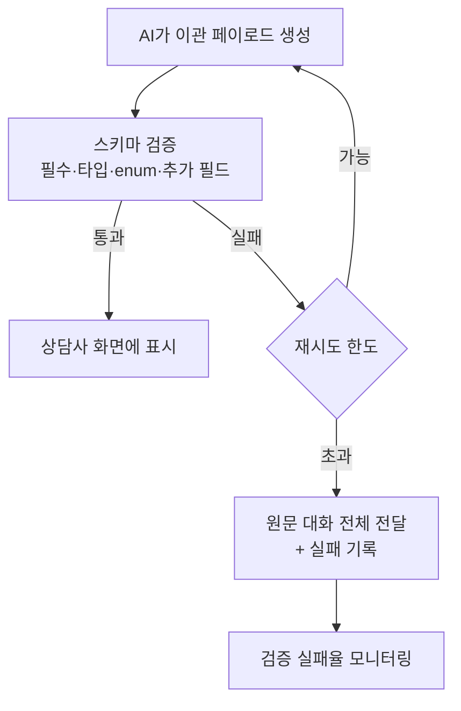

# 이관 경계 검증

> AI와 사람, 또는 시스템 사이로 **데이터가 넘어가는 지점에서 필드 존재·타입·허용값을 기계적으로 검사**하는 것. 이상하면 받아들이지 않고 사람 경로로 돌린다. 프롬프트의 "이 형식으로 써라"는 부탁일 뿐이고 강제가 아니다.

## 쉽게 말하면
택배 접수대에서 송장의 필수 칸이 비었는지, 우편번호가 숫자인지 확인하고 접수하는 것과 같다. 상자 안은 몰라도 송장 형식이 틀리면 받지 않는다.

## 자세히
출처: 검색 결과 요약(JSON Schema·Pydantic 문서, OpenAI 포럼 글; 2026-11-18). 원문을 직접 열지는 못했다. "경계에서 검증" 원칙 자체를 다룬 출처는 이번에 확인하지 못했다.
- **스키마 키워드**: `required`(필수 필드), `enum`(허용값 목록), `type`, `pattern` 등은 검증기가 **강제**한다. 설명(description)은 생성 모델을 유도할 뿐 강제 제약이 아니다(Pydantic 계열 문서 서술).
- **추가 필드 통제**: `additionalProperties`는 `properties`에 없는 키를 허용할지(true/false) 정한다. 알 수 없는 필드를 거부하면 오타나 버전 불일치를 일찍 발견한다. 구조화 출력 API에서는 중첩된 모든 수준에 `additionalProperties: false`를 요구하는 경우가 있다는 포럼 사례.
- **함정**: JSON Schema에서 `"foo.bar"` 같은 점이 들어간 이름은 중첩 경로가 아니라 하나의 문자 그대로의 키다.
- **파이썬 예**: Pydantic 모델에서 `model_validate_json`으로 모델 출력을 파싱하고 `model_json_schema`로 스키마를 만든다.
- **상담 이관에 적용(제안)**: ①이관 페이로드를 스키마로 검증(필수: 고객 ID, 문제 요약, 이관 사유 코드, 우선순위, 스키마 버전) ②`enum`으로 사유 코드·우선순위를 제한([이관 사유 분류](#escalation-reason-taxonomy)) ③검증 실패 시 자동 재시도 한도를 두고 실패하면 원문 대화 전체를 사람에게 전달 ④검증 실패율을 지표로 감시 ⑤검증은 타입·형식만 보장하므로 내용 정확성은 별도로 평가한다([요약 충실도 점수](#summary-faithfulness-score)).
- **한계**: 형식이 맞아도 값이 틀릴 수 있다(예: 올바른 형식의 잘못된 주문번호). 너무 엄격하면 정상 건도 거부해 이관이 늦어진다.

## 그림으로 보기


## 예시
```python
from pydantic import BaseModel
from typing import Literal
class Handoff(BaseModel):
    schema_version: str
    customer_id: str
    reason: Literal["knowledge_gap", "policy", "customer_request", "system_error"]
    priority: int
    summary: str
    model_config = {"extra": "forbid"}
h = Handoff.model_validate_json(payload)   # 실패하면 ValidationError
```
교육 활용: 이관 페이로드 필수 필드 5개와 허용값을 직접 정의하고 일부러 틀린 샘플로 검증을 시험해 보는 실습.

## 헷갈리는 것과 비교
| 개념 | 차이 |
|---|---|
| 경계 검증 | 형식·허용값을 기계가 강제 |
| 프롬프트 지시 | 모델을 유도할 뿐 강제 아님 |
| [스키마 버전 관리](#schema-versioning) | 형식 변경을 추적 |
| 내용 평가 | 값이 사실에 맞는지 |

## 더 읽을거리
- [Pydantic JSON Schema 문서](https://docs.pydantic.dev/latest/usage/schema/) — 스키마 생성과 검증(검색 결과로만 확인)
