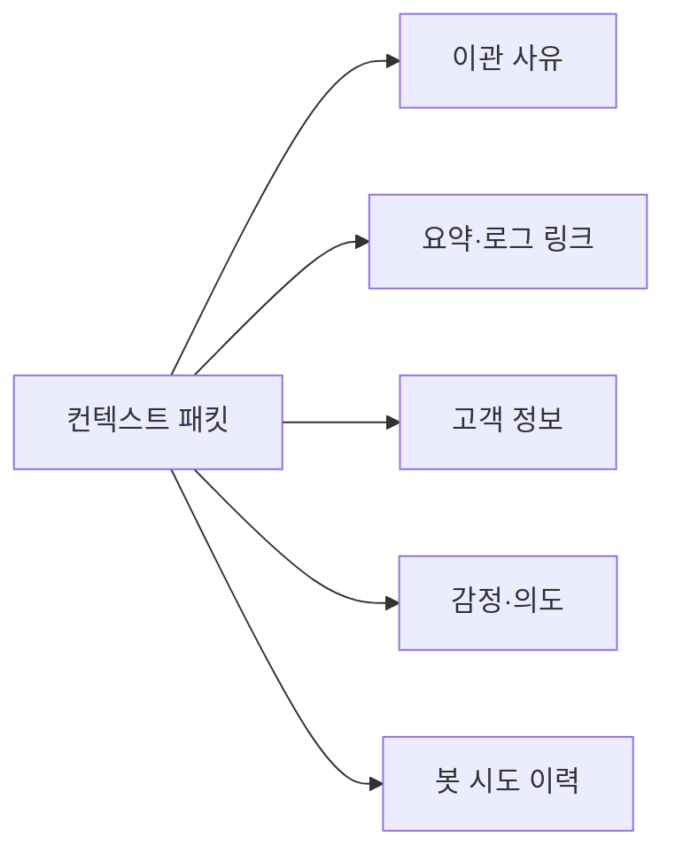

# 이관 컨텍스트 패킷

> 봇이 사람에게 넘길 때 함께 보내는 정보 묶음의 형식. 요약·사유·고객 정보·시도한 조치로 구성된다.

## 쉽게 말하면
인수인계 문서다. 양식이 정해져 있어야 받는 사람이 같은 곳에서 같은 정보를 찾는다.

## 자세히
검색된 업계 글들이 공통으로 꼽는 구성 요소:
1. **이관 사유**(트리거 종류)
2. **대화 요약 + 전체 로그 링크**
3. **고객 데이터**(식별·이력·등급)
4. **감정·의도 감지 결과**
5. **봇이 이미 시도한 것**(조회한 주문, 제안한 답)
- **설계 원칙**: 필드를 고정(JSON 스키마)하고 개인정보는 필요한 만큼만 넘긴다. 요약은 짧게, 원문은 한 번에 열람 가능하게.

## 그림으로 보기


## 예시
```json
{"reason":"refund_exception","summary":"배송 3일 지연, 환불 원함","customer_tier":"gold","sentiment":"negative","bot_actions":["주문 조회"]}
```

## 헷갈리는 것과 비교
| 개념 | 차이 |
|---|---|
| 컨텍스트 패킷 | 넘기는 정보 형식 |
| [웜 이관](#warm-vs-cold-handoff) | 패킷을 쓰는 방식 |
| [이관 트리거](#escalation-triggers) | 시점 |

## 더 읽을거리
- [Twig: How AI escalates to humans](https://www.twig.so/blog/how-does-ai-know-when-to-escalate-to-human-agent) — 이관 흐름(벤더)
- [eesel: AI chat escalation](https://eesel.ai/blog/ai-chat-escalation) — 설정 사례(벤더)
