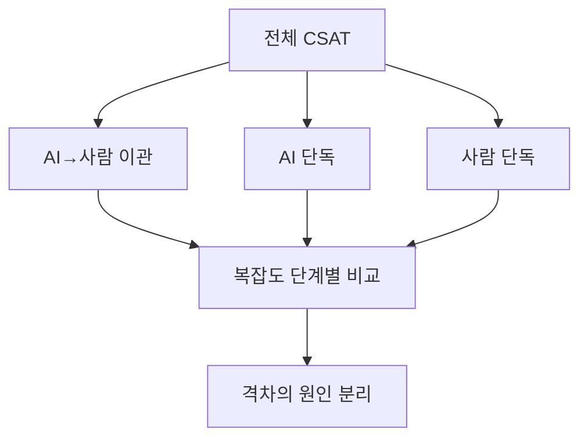
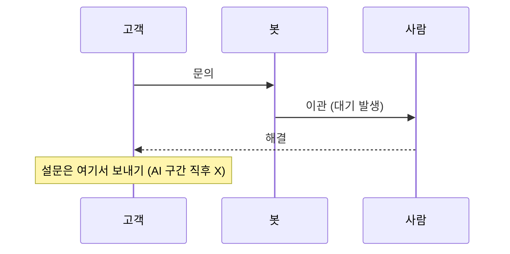

# 이관 건 CSAT 격차

> 사람에게 이관된 대화와 AI가 끝낸 대화의 고객 만족도(CSAT) 점수 차이다. 그냥 평균을 비교하면 이관 건이 더 어려운 문의라서 낮게 나오는 것인지, 이관 설계가 나빠서 낮은 것인지 구분되지 않는다.

## 쉽게 말하면
응급실 환자 만족도와 감기 환자 만족도를 한 줄로 놓고 병원을 평가하면 응급실이 항상 손해 본다. 같은 난이도끼리, 같은 경로끼리 맞붙여 비교해야 공정하다.

## 자세히
(벤더 글 위주. Twig 글은 직접 열어 확인했고, 나머지는 검색 결과 요약이다.)
- **격차 해석의 함정**
  - **집단 구성**: 이관 건은 대체로 더 어려운 문제라 점수가 낮을 수 있다. 문의 복잡도로 통제해야 한다(Twig).
  - **이관 전 대기**: 이관 건의 낮은 점수가 사람 상담원이 아니라 이관 전에 기다린 시간 때문일 수 있다(Fini 글, 검색 결과 요약). 평가는 전체 여정을 포괄한다.
  - **응답 편향**: 아주 만족하거나 아주 불만인 고객이 설문에 더 많이 응답한다. 응답률을 함께 보고한다(Twig).
  - **질문 틀**: "자동 응대에 만족하셨나요?"와 "상담원에게 만족하셨나요?"는 다른 질문이다. 모든 경로에 동일 문구를 쓴다(Twig).
- **비교 방법(Twig 확인)**: 경로별(AI 단독 / AI 보조 후 사람 해결 / 사람 단독)로 나누고, 복잡도 3~4단계 안에서 비교하며, 이관 건은 AI 구간이 아니라 **전체 해결 후** 설문한다. 90일 이상 추세를 본다.
- **같은 의도·채널 안에서 비교**하고, 하나의 지표로 판단하지 않고 7일 내 재접촉·이관 성공률·반복 설명률 같은 전수 지표와 짝지으라는 권고도 있다(검색 결과 기준).
- **벤치마크는 믿지 말 것**: Twig 글의 "5~10점 이내", 응답률 AI 15~25%·사람 25~40%, 주차별 격차 변화는 모두 출처 없는 휴리스틱이다. 4.2 vs 4.1은 가상 예시다.
- 격차가 크면 AI 품질보다 이관 설계 문제일 수 있다는 해석은 [이관 성공률](#transfer-success-rate) 글의 벤더 주장이다.

## 그림으로 보기

## 예시
- 보고서 표: 경로 3개 × 복잡도 3단계 = 9칸에 CSAT, 응답률, n을 함께 표기.
- 이관 건 CSAT가 낮을 때 "이관 전 대기 시간" 구간별로 쪼개 보면 원인이 상담원인지 대기인지 드러난다.

## 헷갈리는 것과 비교
| 개념 | 차이 |
|---|---|
| 이관 건 CSAT 격차 | 경로 간 만족도 차이 |
| [이관 성공률](#transfer-success-rate) | 이관 품질 종합 지표 |
| [첫 유용 응답까지 시간](#time-to-first-useful-response) | 이관 후 응답 속도 |
| 응답 편향 | 설문에 답한 사람이 전체를 대표하지 않음 |

## 더 읽을거리
- [Twig: AI가 CSAT에 미치는 영향 측정](https://www.twig.so/blog/how-to-measure-impact-ai-on-csat-scores) — 경로별 분리·복잡도 통제·설문 시점(직접 열어 확인, 벤더 글, 벤치마크 출처 없음).
- [Fini: 고객 만족도 설문](https://www.usefini.com/blog/customer-satisfaction-surveys) — 이관 전 대기가 점수에 미치는 영향(검색 결과 기준, 본문 미열람).
