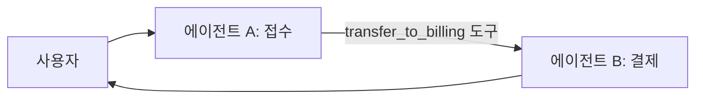
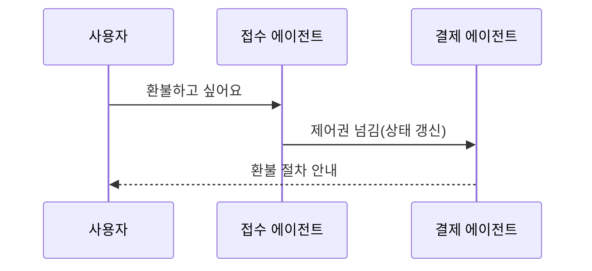

# 핸드오프 패턴

> **핸드오프 패턴**은 에이전트들이 **도구 호출로 상태를 바꿔 제어권을 서로 넘기는** 멀티에이전트 방식이다. 지금 대화를 맡은 에이전트가 사용자와 직접 이야기한다.

## 쉽게 말하면
콜센터에서 상담원이 "결제 문의는 담당 부서로 연결해 드릴게요" 하고 전화를 돌려주는 것과 같다. 전화를 받은 새 담당자가 고객과 바로 통화한다.

## 자세히
(LangChain 멀티에이전트 문서 확인)
- **작동**: 에이전트가 **도구 호출로 상태를 갱신**해 다른 에이전트에게 제어권을 넘긴다.
- **적합**: 여러 단계(multi-hop) 흐름에서 **에이전트가 사용자와 직접 대화**해야 할 때.
- **제한**: 분산 개발과 병렬 실행은 지원하지 않는다.
- **효율**(문서 표, 호출 수·토큰): 단발 3회 호출, 반복 요청(2턴) 합계 5회, 다중 도메인 7회 이상·약 14K+ 토큰. **상태 유지형**(핸드오프·스킬)은 반복 요청에서 호출 수를 약 **40~50%** 줄인다. 다중 도메인에서는 순차 실행이라 서브에이전트·라우터보다 비효율적.
- 대비 개념: [라우터](#router-pattern)는 상태가 없고, [서브에이전트](#supervisor-pattern)는 중앙 에이전트를 거친다.

## 그림으로 보기

## 예시
- 여행 예약 봇: 항공 에이전트가 항공권을 정한 뒤 호텔 에이전트로 넘기고, 호텔 에이전트가 이어서 사용자와 대화.

## 헷갈리는 것과 비교
| 패턴 | 제어 | 상태 | 병렬 |
|---|---|---|---|
| 핸드오프 | 서로 넘김 | 유지 | 불가 |
| [라우터](#router-pattern) | 분류 후 분배 | 없음 | 가능 |
| [서브에이전트](#supervisor-pattern) | 중앙이 지휘 | 없음 | 가능 |
| 스킬 | 한 에이전트가 프롬프트를 로드 | 유지 | 해당 없음 |

## 더 읽을거리
- [LangChain 멀티에이전트 문서](https://docs.langchain.com/oss/python/langchain/multi-agent)
