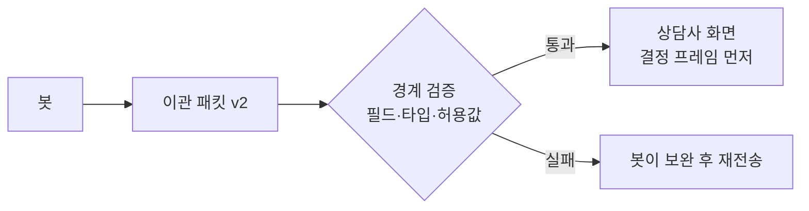
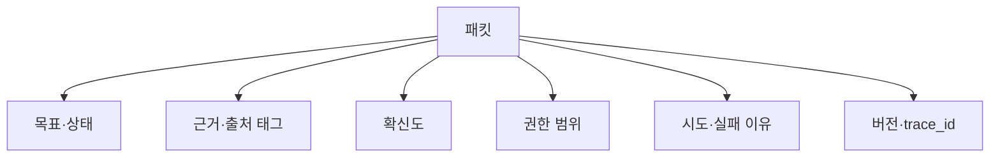

# 이관 패킷 스키마

> 봇이 사람(또는 다른 에이전트)에게 넘기는 정보를 고정 필드의 검증 가능한 계약으로 만든 것. 요약 문장에만 의존하지 않고 필드·버전·검증을 두어 받는 쪽이 처음부터 다시 하지 않게 한다.

## 쉽게 말하면
병원 전원 의뢰서 양식이다. 자유 서술 메모 대신 "환자 정보, 한 일, 남은 질문, 허용된 처치" 칸이 있고 양식 버전이 적혀 있다. 칸이 비면 접수 단계에서 바로 반려된다.

## 자세히
- **핵심 범주(Decagon 용어집)**: 목표·현재 상태 / 근거와 출처(각 사실의 출처 태그: 문서 ID, 시각 있는 도구 응답, 확인 안 된 고객 진술) / 확신도 / 권한 범위(받는 쪽이 할 수 있는 일을 명시) / 시도한 것과 실패 이유. 필수 필드의 공식 목록은 없다.
- **버전**: 페이로드마다 작성에 쓴 스키마 버전을 기록해 보내는 쪽·받는 쪽 릴리스가 달라도 조용히 잘못 읽는 일을 막는다.
- **검증**: 이관 경계에서 필드 존재·타입·허용값을 확인한다. 검증 없는 스키마는 문서화만 되고 시들기 쉽다. 빈 필드가 "사실 없음"으로 읽히는 조용한 실패를 조심한다.
- **3층 구조(Tianpan 글)**: 행동 이력, 사람이 결정해야 할 최소 맥락과 구조화된 문제 진술(결정할 질문과 선택지), 메타데이터(버전, 실행 로그를 잇는 trace_id). 원문 전사 통째 전달("전사 문제")을 피한다.
- **표현층**: 큰 JSON을 상담 중에 훑을 수는 없다. 결정 프레임을 앞에 보여 주고 확신 점수·원시 API 응답은 감사 로그에 둔다.
- **실패 양상**: 순환 이관, 사람 입력 오염, 재개 때 사람의 결정 무시, 만료된 이관의 대비책 없음.
- **측정**: 필드 완성도(구조적)와 받는 쪽이 고객에게 다시 묻는지(행동적).
- 일반론(검색 요약): 모델 출력을 JSON 스키마에 맞추려면 엄격 모드의 구조화 출력 기능을 쓸 수 있다.

## 그림으로 보기

## 예시
- "고객 확인됨" 한 줄 대신 `verified: {method: "otp", at: "...", level: "high"}` 로 적으면 상담사가 재인증하지 않는다.
- 교육 실습: 자기 업무의 이관 패킷 필드를 8개 이내로 정하고 필수·선택을 나눠 본다.

## 헷갈리는 것과 비교
| 개념 | 차이 |
|---|---|
| 이관 패킷 스키마 | 필드·버전·검증 규칙(형식) |
| [이관 컨텍스트 패킷](#handoff-context-packet) | 무엇을 넘길지(내용) |
| [이관 요약 품질](#handoff-summary-quality) | 요약 문장이 맞는지 |
| [웜 vs 콜드 이관](#warm-vs-cold-handoff) | 사람이 사전 브리핑 받는지 |

## 더 읽을거리
- [Decagon: What is an AI agent handoff schema](https://decagon.ai/glossary/what-is-an-ai-agent-handoff-schema) — 범주·버전·검증(벤더)
- [Tianpan: The Escalation Protocol](https://tianpan.co/blog/2026-04-10-escalation-protocol-agent-to-human-handoffs) — 3층 구조와 실패 양상(개인 블로그)
