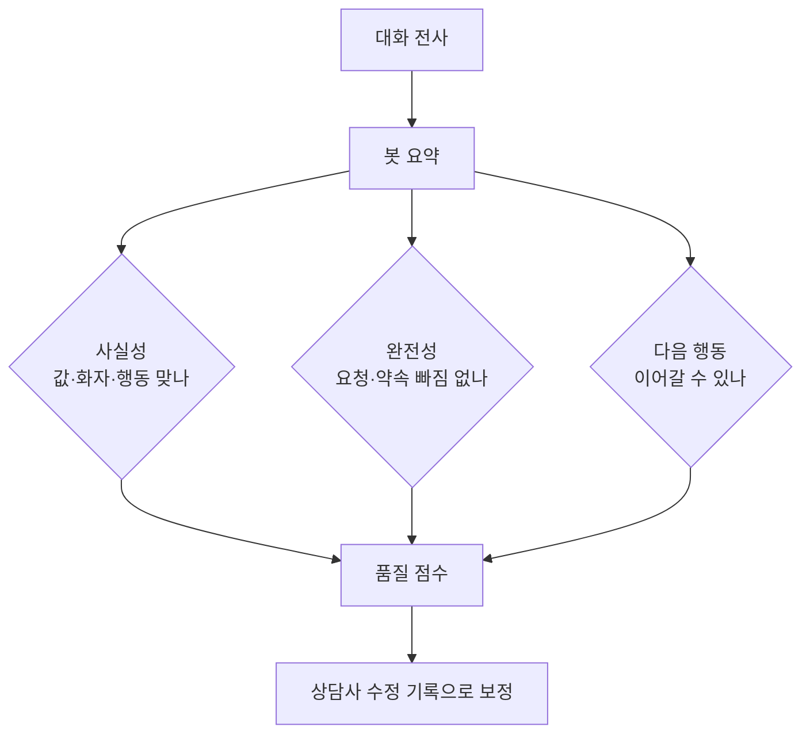
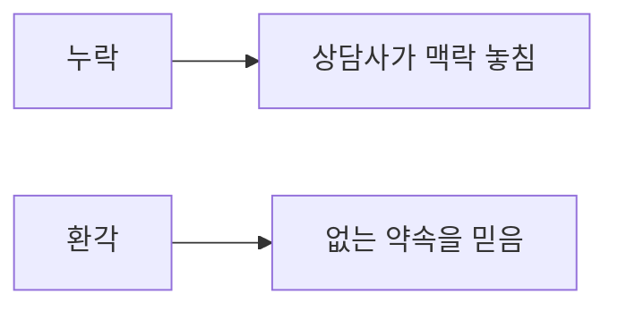

# 이관 요약 품질

> 봇이 상담사에게 넘기는 요약이 대화와 어긋나면 상담사가 오히려 잘못된 방향으로 가게 된다. 요약은 "그럴듯한가"가 아니라 사실성·누락·다음 행동으로 점검한다.

## 쉽게 말하면
교대 근무 인수인계 메모와 같다. 틀린 내용이 적혀 있거나 중요한 한 줄이 빠지면 다음 근무자는 메모를 믿는 만큼 더 크게 틀린다.

## 자세히
- **평가 축(Observe.ai 글)**: 사실성(faithfulness: 값·화자·행동 상태가 맞는가), 완전성(요청·상담사 행동·약속이 빠지지 않았나), 응집성(대화 흐름 순서), 다음 행동 지원, 상담 유형 적합성. 이를 묶은 보정 품질 점수(CQS)를 사용자 피드백으로 조정한다고 설명한다(벤더 주장).
- **누락 문제**: 사실은 맞아도 고객의 망설임·할인 제안이 빠질 수 있다. 여러 주제 통화에서 잦고, 빈칸이 있으면 말하지 않은 다음 단계를 지어내기 쉽다. BLEU·ROUGE 같은 단어 겹침 지표는 이런 공백을 못 잡는다는 주장이다.
- **환각 점수화**: Expedia Group 논문(arXiv 2410.12222)은 요약이 원문과 일치하는지 LLM 판정자가 1~5점으로 매기는 루브릭을 제안하고, GPT-4 판정이 정확하고 설명도 유용하다고 보고했다(여행 도메인 4개 데이터셋). 초록 기준으로 읽었다.
- **운영 팁**: 요약에 날짜·금액·주문번호 같은 값은 원문에서 추적 가능해야 한다. 상담사가 수정한 비율을 피드백으로 모은다. 이관 사유가 요약에 남는지도 본다.
- 주의: 벤더가 낸 환각률 비교 수치(모델별 7.5%, 20% 등)는 자체 측정이라 일반화하지 않는다.

## 그림으로 보기

## 예시
- 요약: "환불 승인됨" ↔ 원문: "환불 가능한지 확인해 보겠다". 행동 상태 오류 → 사실성 감점.
- 교육 실습: 통화 전사 3건에 대해 사실성·완전성을 사람이 체크리스트로 채점해 본다.

## 헷갈리는 것과 비교
| 개념 | 차이 |
|---|---|
| 요약 사실성 | 적힌 내용이 원문과 맞는가 |
| 요약 완전성 | 필요한 내용이 다 있는가 |
| [이관 컨텍스트 패킷](#handoff-context-packet) | 요약 외 구조화 필드 포함 |
| [이관 대기 시간](#handoff-wait-time) | 요약을 대기 중 미리 만드는 맥락 |

## 더 읽을거리
- [Observe.ai: Evaluating LLMs in contact centers](https://www.observe.ai/blog/evaluating-llms-in-contact-centers) — 평가 축과 누락 문제(벤더)
- [On a Scale From 1 to 5: Quantifying Hallucination (arXiv 2410.12222)](https://arxiv.org/abs/2410.12222) — 충실도 루브릭 (초록 열람)
