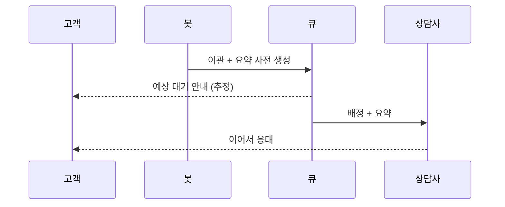
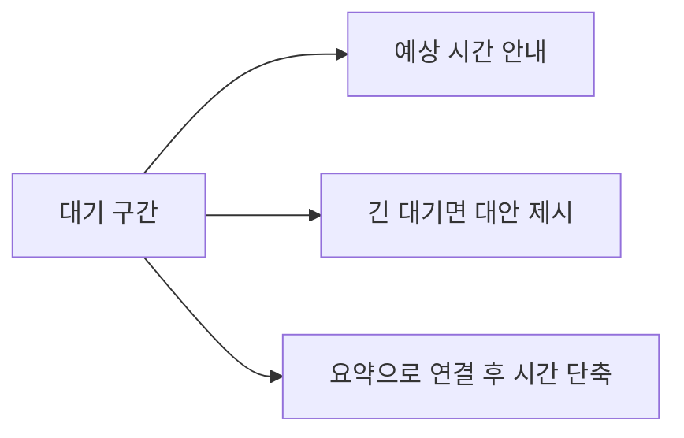

# 이관 대기 시간

> 봇이 사람에게 넘긴 뒤 상담사가 연결될 때까지의 시간. 이 구간을 안내 메시지와 미리 만든 요약으로 채우면 같은 대기도 덜 나쁘게 느껴지고 연결 후 처리도 빨라진다.

## 쉽게 말하면
병원 접수 후 대기실과 같다. "약 15분 걸립니다"라는 안내와 접수 때 쓴 문진표가 있으면 기다림도 견디기 쉽고, 의사도 처음부터 다시 묻지 않는다.

## 자세히
- **대기 안내(Zendesk 문서 기준)**: AI 에이전트가 넘긴 뒤 티켓이 만들어지면 큐 위치와 최근 대기 이력(최근 10분·2시간·3주 중 가용한 창)으로 예상 대기를 계산한다. 트리거로 `@wait_time_min`·`@wait_time_max`를 메시지에 넣고, 상담사 배정 시 후속 메시지도 보낼 수 있다. 문구는 "추정"이라고 쓴다.
- **한계**: 지난 7일 안에 라우팅된 티켓이 큐에 최소 1건 있어야 하고, 급증 시기·데이터 부족·새 큐·불규칙한 인력에서는 정확도가 떨어진다. 타사 봇은 봇이 넘기고 큐에 들어간 뒤에야 발동한다.
- **요약 사전 생성(Twilio)**: 전환 전에 요약을 만들어 상담사가 고객이 도착할 때 이미 보게 한다. 담길 내용은 고객 목표, AI가 시도한 것, 남은 문제. 40턴 전사는 훑어보고 3줄 요약은 읽힌다는 설명이다.
- **측정**: 연결 후 첫 유용한 응답까지의 시간, 같은 설명을 반복한 비율. 이관 후 대기시간 자체도 KPI로 둔다.
- 벤더 글들은 "1분 미만 우수, 5분 미만 허용" 같은 목표를 제시하지만 표준이 아니다. 긴 대기 땐 메시지 남기기 같은 대안을 준다.
- Twilio는 비효율적인 AI가 이관 전 약 81초를 실패 시도에 쓴다는 수치와, 이관 옵션을 원하는 소비자 63% 대 제공 브랜드 47%라는 수치를 인용한다. 원자료는 확인하지 못했다.

## 그림으로 보기

## 예시
- 안내: "현재 예상 대기 약 3~6분입니다(추정). 기다리지 않으려면 메시지를 남겨 주세요."
- 교육 실습: 이관 후 첫 응답까지 시간을 요약 있음/없음으로 나눠 비교하는 측정표 만들기.

## 헷갈리는 것과 비교
| 개념 | 차이 |
|---|---|
| 이관 대기 시간 | 이관 후 연결까지의 시간 |
| [웜 vs 콜드 이관](#warm-vs-cold-handoff) | 맥락을 넘기는 방식 |
| [이관 컨텍스트 패킷](#handoff-context-packet) | 넘기는 내용물 |
| [이관 요약 품질](#handoff-summary-quality) | 미리 만든 요약이 맞는가 |

## 더 읽을거리
- [Zendesk: 메시징 예상 대기 시간 표시](https://support.zendesk.com/hc/en-us/articles/8009787999514-Displaying-estimated-wait-time-in-messaging-conversations) — 계산 방식과 한계(공식 문서)
- [Twilio: AI-to-human handoff that preserves context](https://www.twilio.com/en-us/blog/insights/ai-to-human-handoff-context) — 요약 사전 생성(벤더)
