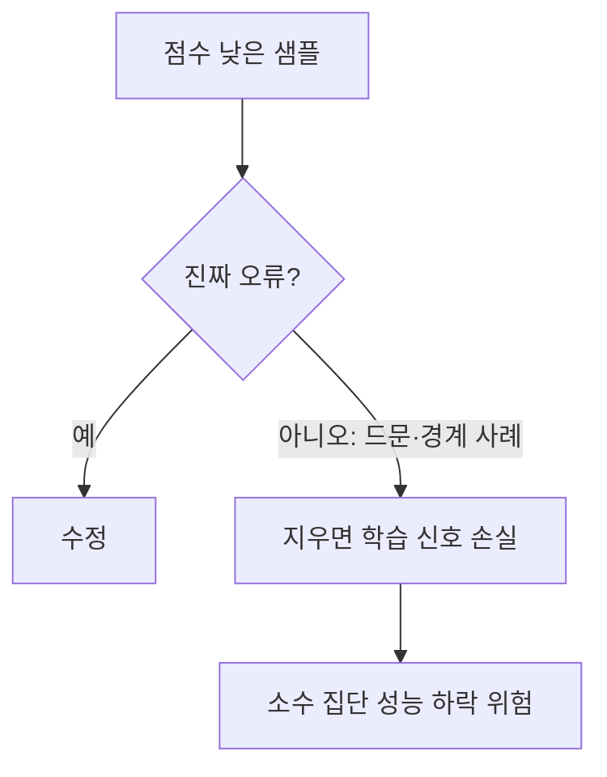
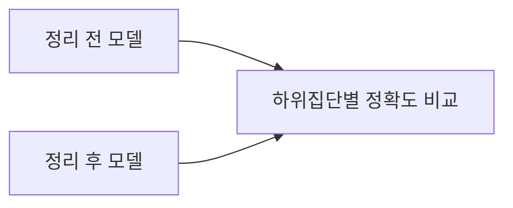

# 하드 샘플 제거의 부작용

> 하드 샘플은 모델이 풀기 어려운 샘플(경계 사례·드문 유형)이다. 라벨 오류 정리 때 "점수가 낮다"는 이유로 하드 샘플을 함께 지우면, 모델이 어려운 경우를 배울 기회가 사라져 일반화가 약해질 수 있다.

## 쉽게 말하면
학생이 틀리는 문제를 "문제가 이상하다"며 시험에서 전부 빼면, 쉬운 문제 점수는 오르지만 실제 어려운 시험에서는 약해진다. 틀린 문제 중에는 정말 오류인 것과 그냥 어려운 것이 섞여 있다.

## 자세히
- **오류와 어려움은 구별하기 어렵다(웹 검색 요약, 직접 확인한 건 아래 논문 초록뿐)**: 검색에서 나온 논문 설명들은 노이즈 라벨 필터링이 드문 하위집단·어려운 샘플을 노이즈로 오분류해 일반화를 해친다고 지적했다. 이 중 내가 초록을 직접 열어 본 [Understanding Instance-Level Label Noise (arXiv 2102.05336)](https://arxiv.org/abs/2102.05336)는 노이즈 처리 기법이 자주 나오는 샘플엔 이득이 크고 드문 샘플엔 이득이 적다고 하며, 빈도가 다른 샘플은 다른 처리가 필요하다고 주장한다.
- **메커니즘(해석)**: 드문 유형은 모델 확률이 낮아 "오류 후보" 점수가 낮게 나온다. 그러나 라벨이 맞다면 지워지는 순간 그 유형의 학습 신호가 사라진다. 평균 정확도는 변하지 않아 보여도 소수 집단 성능만 떨어질 수 있다(해석).
- **대안(해석)**: ① 삭제 대신 사람이 확인([삭제 대신 보류](#quarantine-instead-of-delete)) ② 드문 샘플은 라벨을 추가로 받아 확인 ③ 하위집단별 성능을 정리 전후로 비교 ④ 후보를 일부만 받아 보수적으로 진행([라벨 오류 오탐](#false-positive-label-issues)).
- **확인 방법**: 정리 전·후 모델을 같은 정제 테스트셋에서 전체 정확도뿐 아니라 클래스·하위집단별로 비교한다.

## 그림으로 보기

## 예시
- 이민자 억양 음성 데이터가 적어 모델 확신이 낮다. 이를 오류로 보고 삭제하면 해당 억양 인식률이 더 떨어진다(가정 사례).
- 교육 활용: 클래스별 정확도 표를 보고 "평균은 같은데 누가 손해 봤는가"를 토론한다.

## 헷갈리는 것과 비교
| 개념 | 차이 |
| --- | --- |
| 하드 샘플 | 라벨은 맞지만 어려움 |
| 오류 라벨 | 라벨이 틀림 |
| [라벨 오류 오탐](#false-positive-label-issues) | 정상을 오류로 표시한 현상 |
| [삭제 대신 보류](#quarantine-instead-of-delete) | 지우지 않고 제외만 하는 처리 |

## 더 읽을거리
- [Understanding Instance-Level Label Noise (arXiv 2102.05336)](https://arxiv.org/abs/2102.05336) — 샘플 빈도별로 다른 처리 필요
- [cleanlab filter 문서](https://docs.cleanlab.ai/stable/cleanlab/filter.html) — 보수적으로 받는 옵션
