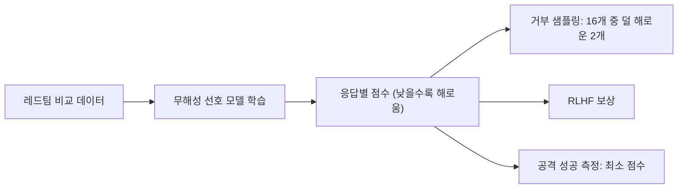
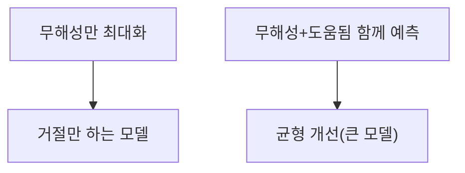

# 무해성 점수

> 선호 모델이 AI 응답 하나에 매기는 수치로, 낮을수록 해롭고 높을수록 덜 해롭다. Anthropic 레드팀 연구에서 공격 성공을 재거나 거부 샘플링·RLHF의 점수로 쓰였다.

## 쉽게 말하면
심사위원이 "이 대답이 얼마나 안전한가"를 점수로 매기는 채점기다. 점수가 낮으면 위험한 대답이라는 뜻이니, 공격이 성공했는지도 점수로 알 수 있다.

## 자세히
(Ganguli 외 arXiv 2209.07858 본문을 직접 읽고 확인.)
- **무엇인가**: 레드팀 공격에서 모은 비교 데이터("두 응답 중 덜 해로운 것")로 2.7B·13B·52B 일반 언어모델을 미세조정해 만든 **무해성 선호 모델**의 출력. **낮은 점수 = 더 해로움**. 논문은 이를 단순히 harmlessness score라 부른다.
- **연구에서의 쓰임**: ① 공격 성공을 재는 지표 중 하나(대화의 **최소 무해성 점수**, 높을수록 안전. 다른 지표는 레드팀 참가자의 자가 보고 성공도) ② **거부 샘플링(RS)**: 응답 16개를 뽑아 점수로 줄 세우고 가장 덜 해로운 2개만 제시(14개 거부) ③ **RLHF**: 이 점수를 보상으로 최대화하도록 강화학습.
- **도움됨과의 긴장**: 거절만 해도 "무해"해질 수 있으므로(저자들은 근본적 긴장이라고 표현) 선호 모델은 **무해성과 도움됨을 함께** 예측하도록 학습했고, 큰 모델에서 이 긴장이 완화되었다고 보고.
- **한계(제안)**: 점수는 선호 모델의 판단이지 객관적 진리가 아니며, 이 점수로 최적화하면 점수만 높이는 응답(보상 해킹)이 나올 수 있다.

## 그림으로 보기

## 예시
- 챗봇 응답 후보 5개를 안전 분류기로 점수화해 가장 안전한 것을 고르는 거부 샘플링 구조.
- 교육 활용: "안전 점수"가 높다고 항상 좋은 답이 아님을 도움됨과 함께 토론.

## 헷갈리는 것과 비교
| 개념 | 차이 |
|---|---|
| 무해성 점수 | 선호 모델의 해로움 수치 |
| 도움됨 점수 | 같은 모델의 다른 목표(유용성) |
| [레드팀 공격 유형](#red-team-attack-types) | 점수를 낮추려는 공격의 종류 |

## 더 읽을거리
- [Red Teaming Language Models to Reduce Harms (arXiv 2209.07858)](https://arxiv.org/abs/2209.07858) — 선호 모델·거부 샘플링·RLHF 설명.
