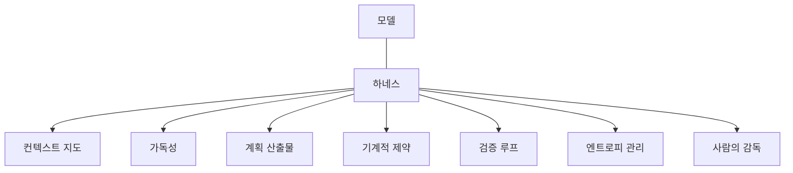
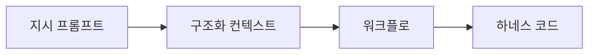

# 하네스 구성 요소

> 하네스는 모델 바깥에서 에이전트가 일하도록 돕는 환경이고, 구성 요소는 컨텍스트 지도·가독성·계획 산출물·기계적 제약·검증 루프·엔트로피 관리·사람의 역할로 나눌 수 있다.

## 쉽게 말하면
신입을 뽑았다면 지식보다 일할 환경이 성과를 좌우한다. 업무 안내서, 시스템 접근 권한, 할 일 목록, 코드 리뷰 규칙, 정기 대청소가 있어야 한다. 모델은 같은 신입이고, 하네스는 그 책상과 규칙 전체다.

## 자세히
OpenAI "Harness engineering"(2026-02-11)의 실천을 일반화한 7요소(사용자 지식 기반 종합, 1차 원문은 OpenAI 글):
1. **컨텍스트 지도**: 100줄 안팎 AGENTS.md는 목차, 상세는 `docs/`에 두는 점진적 공개.
2. **가독성(legibility)**: 에이전트가 앱·로그·화면을 직접 볼 수 있게 한다. 실행 중 못 보는 것은 없는 것이다.
3. **계획 산출물**: 계획·결정 로그를 저장소에 커밋.
4. **기계적 제약**: 레이어 의존 린터·구조 테스트로 불변식을 강제, 린트 에러 메시지가 곧 수정 지침.
5. **검증·피드백 루프**: 에이전트 간 리뷰를 반복하는 루프가 품질 게이트.
6. **엔트로피 관리**: doc-gardening·golden principles·가비지 컬렉션 작업으로 부채를 매일 조금씩 상환.
7. **사람의 역할**: 우선순위·수용 기준·검증·에스컬레이션 판단. "Humans steer, agents execute."
- Lilian Weng(2026-07-04)이 정리한 편집 가능한 7요소는 시스템 프롬프트, 도구 설명, 도구 구현, 미들웨어, 스킬, 서브에이전트 설정, 장기 메모리다.
- 주의: 이 구성 요소는 "모델이 아직 못 한다"는 가정이라 모델이 좋아지면 일부는 만료된다. OpenAI 결과는 해당 저장소 구조에 의존하므로 일반화하지 않는다(원문 단서).

## 그림으로 보기

## 예시
- 내 프로젝트 점검표: CLAUDE.md가 100줄 이내인가 / 테스트·린트가 에이전트에게 실행 가능한가 / 진행 파일이 있는가 / 규칙을 어기면 CI가 막는가.
- 비개발 직군: "같은 모델인데 Claude Code가 채팅보다 일을 잘하는 이유"를 이 7요소로 설명한다.

## 헷갈리는 것과 비교
| 개념 | 차이 |
|---|---|
| 하네스 | 모델 바깥 환경 전체 |
| [프롬프트 엔지니어링](#prompt-engineering) | 지시문 한 덩어리 |
| [컨텍스트 엔지니어링](#context-engineering) | 모델에 넣을 정보 설계, 하네스의 일부 |
| [에이전트 검증](#agent-verification) | 하네스 요소 중 검증 루프 |

## 더 읽을거리
- [OpenAI — Harness engineering](https://openai.com/index/harness-engineering/) — 기준 문서(이번 실행에서는 지식 기반 요약으로 확인, 원문 직접 재열람은 못 함).
- [Lilian Weng — Harness Engineering for Self-Improvement](https://lilianweng.github.io/posts/2026-07-04-harness/) — 7요소·설계 패턴 서베이(지식 기반 요약으로 확인).
