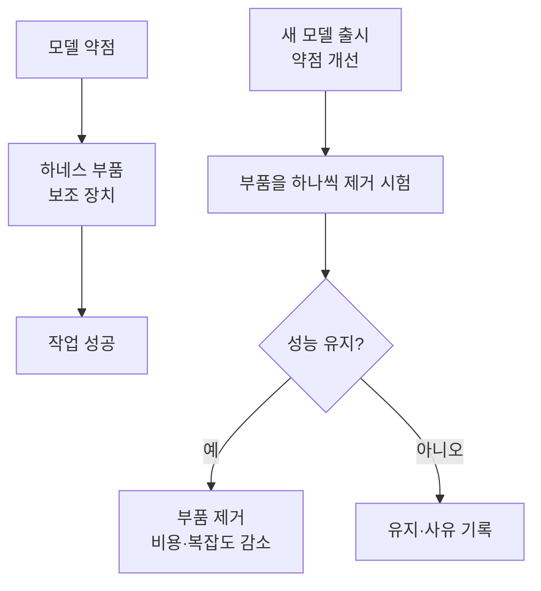
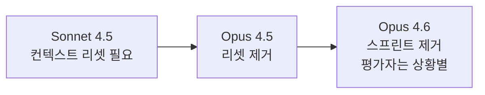

# 하네스 부품의 유통기한

> 에이전트 하네스의 모든 부품(계획 단계, 스프린트 분해, 컨텍스트 리셋, 평가자 등)은 **"모델이 혼자서는 이걸 못한다"는 가정**을 담고 있다. 모델이 좋아지면 그 가정이 **낡아서** 부품이 불필요한 비용·복잡도가 될 수 있으므로, 부품을 하나씩 빼 보며 정기적으로 시험해야 한다.

## 쉽게 말하면
자전거 보조바퀴는 처음엔 필수지만 실력이 늘면 오히려 방해가 된다. 하네스의 안전장치도 모델이 어릴 때(약할 때) 단 보조바퀴라서, 커지면 떼어 내 봐야 한다. 다만 어떤 바퀴가 아직 필요한지는 하나씩 떼어 보기 전에는 모른다.

## 자세히
(Anthropic Engineering, Prithvi Rajasekaran, "Harness design for long-running apps" — 원문을 지식 기반에 저장한 사본으로 확인)
- **원칙**: "하네스의 모든 구성 요소는 모델이 혼자 못 하는 일에 대한 가정을 담고 있으며, 그 가정은 틀렸을 수도 있고 **모델이 개선되면 금방 낡는다**." Anthropic의 "Building Effective Agents"가 말한 **"가능한 가장 단순한 해법을 찾고, 필요할 때만 복잡도를 늘려라"** 와 같은 맥락.
- **사례 1 — 컨텍스트 리셋**: 초기 하네스는 Sonnet 4.5가 컨텍스트 한계가 가까워지면 일을 서둘러 끝내는 **"컨텍스트 불안(context anxiety)"** 을 보였기 때문에, 컨텍스트를 완전히 비우고 인계 문서로 이어 가는 **리셋**을 썼다. Opus 4.5는 이 행동이 크게 줄어 리셋을 **통째로 제거**하고 자동 컴팩션만 쓰는 연속 세션으로 바꿨다(리셋은 컴팩션과 달리 대화를 새 에이전트로 갈아 끼움).
- **사례 2 — 스프린트·평가자**: Opus 4.6이 나오자 계획성·장시간 작업·장문 검색이 좋아졌으므로 **스프린트 분해를 제거**해 보았다. **계획자(planner)는 유지**했다(없으면 생성자가 범위를 작게 잡음). **평가자는 작업 난이도에 따라** 유효했다: 모델 능력 경계 근처의 작업에서는 의미 있는 문제를 잡았지만, 모델이 혼자 잘 처리하는 범위로 들어온 작업에서는 불필요한 오버헤드였다.
- **방법론**: 처음엔 하네스를 과감히 줄였다가 이전 성능을 재현하지 못했고, 어떤 부품이 **하중을 받는지(load-bearing)** 알기 어려워졌다. 그래서 **한 번에 하나씩 제거하고 결과 영향을 검토**하는 체계적 방식으로 전환했다.
- **실무 체크리스트**:
  1. 하네스 부품마다 "어떤 모델 약점을 보완하는가"를 한 줄로 적어 둔다.
  2. 새 모델이 나올 때마다 부품을 **하나씩 끄고** 같은 과제로 비교한다.
  3. 성능 하락이 없으면 영구 제거, 있으면 유지 이유를 기록한다.
  4. 평가자 같은 부품은 **과제 난이도별로** 효과가 달라질 수 있음을 감안한다.
- 한계: 위 사례는 한 팀의 앱 생성 과제에서의 경험이며 모든 하네스에 같은 결론이 나온다는 보장은 없다.

## 그림으로 보기



## 예시
```markdown
# harness-components.md (가정 기록)
| 부품 | 보완하는 모델 약점 | 마지막 시험 | 결과 |
|---|---|---|---|
| 컨텍스트 리셋 | 한계 근처에서 서두름 | 2026-11 새 모델 | 제거해도 동일 |
| 계획 단계 | 범위를 작게 잡음 | 2026-11 | 유지 필요 |
```
- 교육용: "AI 업무 프로세스에 넣은 확인 절차를 반년마다 '아직 필요한가' 점검한다."

## 헷갈리는 것과 비교
| 개념 | 차이 |
|---|---|
| 하네스 부품의 유통기한 | 모델이 개선되며 부품이 불필요해지는 현상 |
| [기계적 제약](#mechanical-constraints) | 일관성 규칙(모델이 좋아져도 유효한 경계가 많음) |
| [초기화·코딩 에이전트 패턴](#initializer-coding-agent) | 세션 인계 하네스의 한 예 |
| [하네스](#harness) | 이런 부품들을 묶은 실행 틀 |

## 더 읽을거리
- [Anthropic: Harness design for long-running apps](https://www.anthropic.com/engineering/harness-design-long-running-apps) — 부품을 하나씩 제거해 본 과정과 사례.
- [Anthropic: Building Effective Agents](https://www.anthropic.com/engineering/building-effective-agents) — "가장 단순한 해법부터" 원칙.
