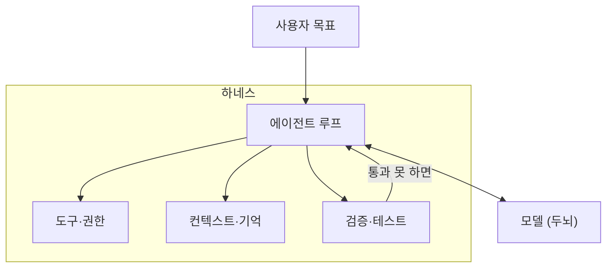
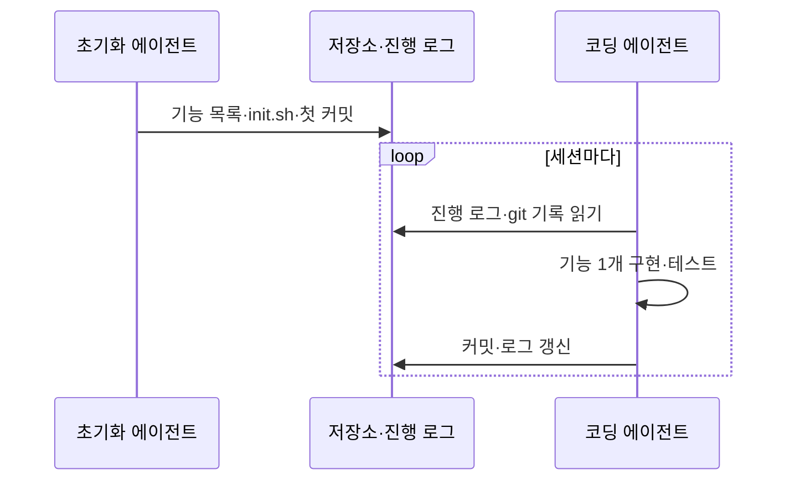

# 하네스

> 하네스(harness)는 AI 모델을 감싸서 루프·도구·기억·권한·검증을 붙여 "실제로 일하는 에이전트"로 만드는 틀이다. 모델은 두뇌, 하네스는 몸과 작업 환경이다.

## 쉽게 말하면
같은 천재 신입사원이라도 책상·사내 위키·업무 체크리스트·결재 규칙이 있어야 일을 한다. 하네스는 그 책상과 규칙 전체다. 신입(모델)을 바꾸지 않고도 환경을 고치면 성과가 달라진다. 그래서 "하네스 엔지니어링"은 모델 바깥을 설계하는 일을 가리킨다.

## 자세히
- **정의(Anthropic, 2025-11-26)**: 모델이 에이전트로 행동하게 하는 스캐폴딩. 루프, 도구, 컨텍스트 관리(압축 등), 프롬프트를 포함한다. Claude Agent SDK를 범용 하네스로 소개한다.
- **구성 요소(OpenAI 글 2026-02-11 요약, 아래 지식 기반 경유)**: ① 컨텍스트 지도(짧은 AGENTS.md + docs/) ② 에이전트가 볼 수 있는 앱·로그 ③ 커밋되는 계획 문서 ④ 린터·구조 테스트 같은 기계적 제약 ⑤ 에이전트 리뷰 루프 ⑥ 낡은 문서·코드를 정리하는 청소 에이전트.
- **긴 작업의 문제**: 에이전트는 세션마다 기억이 비어 있고, 한꺼번에 다 하려 하거나 너무 일찍 "끝났다"고 선언한다.
- **Anthropic의 해법**: 첫 세션에 *초기화 에이전트*가 기능 목록(JSON), `init.sh`, 진행 로그, 첫 커밋을 만들고, 이후 *코딩 에이전트*가 세션마다 기능 하나만 구현·테스트·커밋한다. 기능 목록은 `passes`만 바꿀 수 있게 JSON으로 둔다(마크다운보다 덮어쓰기 위험이 적다는 판단).
- **주의**: 하네스 부품은 "모델이 아직 못 한다"는 가정이라 모델이 좋아지면 불필요해질 수 있다. 주기적으로 덜어내 본다.

## 그림으로 보기

## 예시
- Claude Code 한 프로젝트: `CLAUDE.md`(규칙), 훅(자동 검사), 권한 설정, 서브에이전트가 모두 하네스의 부품이다.
- 프롬프트 습관: "작업 시작 전 progress.md를 읽고, 기능 하나만 끝낸 뒤 테스트하고 커밋해. 테스트를 통과하기 전엔 완료라고 쓰지 마."

## 헷갈리는 것과 비교
| 개념 | 차이 |
| --- | --- |
| [에이전트 루프](#agent-loop) | 하네스의 한 부품(반복 구조). 하네스는 그 주변 전체 |
| [컨텍스트 엔지니어링](#context-engineering) | 모델에 넣을 정보를 설계. 하네스의 일부 영역 |
| [AI 팩토리](#ai-factory) | 하네스를 여러 개 라인으로 묶어 계속 생산하는 규모의 개념 |
| [LangGraph](#langgraph) | 하네스를 코드로 짜게 해 주는 라이브러리 중 하나 |

## 더 읽을거리
- [Effective harnesses for long-running agents (Anthropic, 2025-11-26)](https://www.anthropic.com/engineering/effective-harnesses-for-long-running-agents) — 초기화/코딩 에이전트, 진행 로그
- OpenAI "Harness engineering" (2026-02-11, openai.com/index/harness-engineering) — 직접 열람은 403, 사용자 지식 기반의 정리본 `ai-knowledge/wiki/concepts/harness-engineering.md`를 참고함
