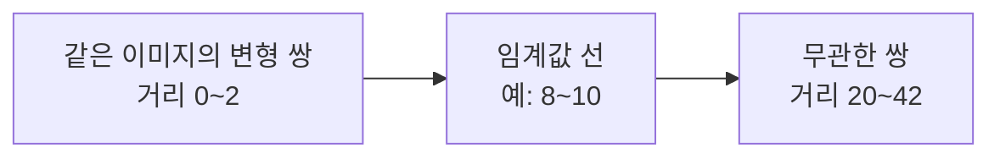
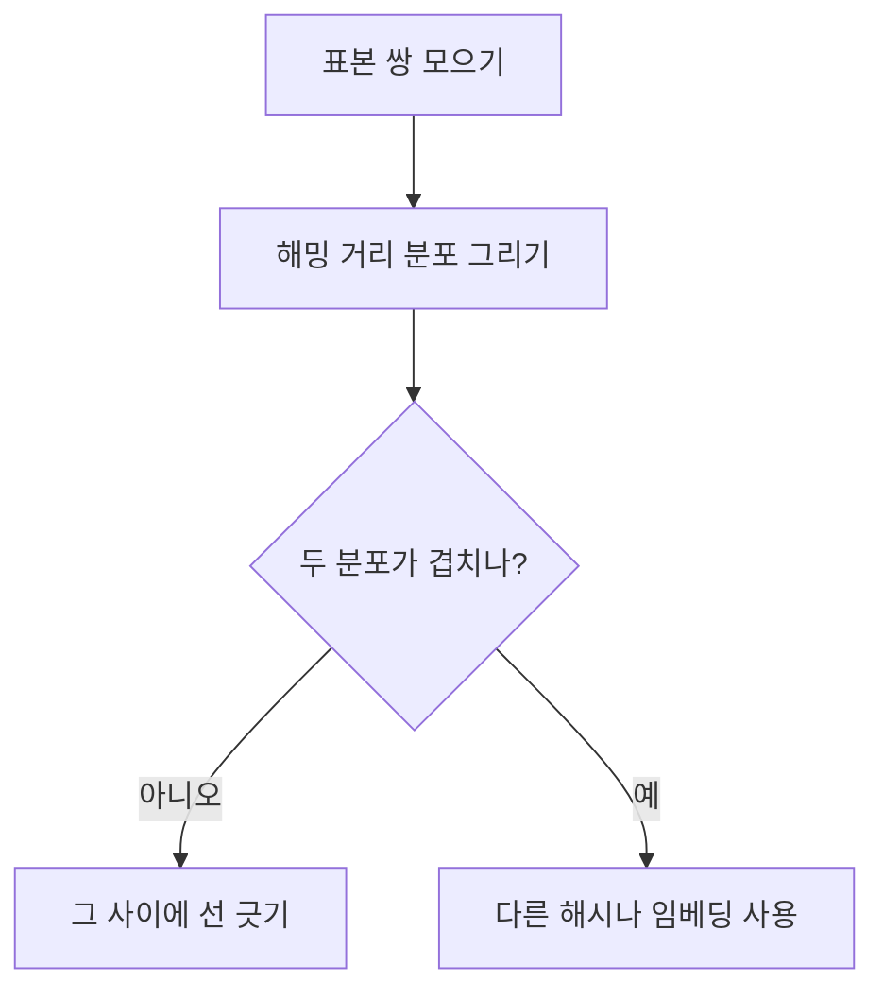

# 해시 임계값 보정

> 지각 해시로 비슷한 이미지를 찾을 때 "해밍 거리 몇 이하면 같은 이미지로 볼까"를 정하는 일이다. 같은 이미지의 변형(축소·압축)이 만드는 거리와 서로 다른 이미지끼리의 거리를 내 데이터로 재서 그 사이에 선을 긋는다.

## 쉽게 말하면
지문 대조에서 "겹치는 점이 몇 개 이상이면 같은 사람"이라는 기준은 실제 같은 사람의 지문 쌍과 다른 사람의 지문 쌍을 많이 재 봐야 정할 수 있다. 기준을 책에서 외운 값으로 쓰면 내 데이터에서는 너무 느슨하거나 너무 엄격할 수 있다.

## 자세히
- **도구(ImageHash 저장소 README, 열람)**: aHash, pHash, dHash, wHash, 색 해시, 크롭 내성 해시를 지원한다. 두 해시를 빼면 해밍 거리(다른 비트 수)가 나오고 작을수록 비슷하다. README도 매칭용 거리 임계값을 직접 정하라고 한다.
- **직접 해 본 실험(합성 이미지 300×300, 64비트 해시, 변형 6종과 서로 무관한 이미지 50쌍)**: 변형 이미지와 원본의 해밍 거리와, 무관한 이미지와의 거리는 다음과 같았다.

| 해시 | 축소 50% | JPEG q30 | 밝기 ×1.3 | 블러 | 20% 크롭 | 15도 회전 | 무관한 이미지(최소·평균·최대) |
| --- | --- | --- | --- | --- | --- | --- | --- |
| aHash | 0 | 0 | 0 | 0 | 22 | 18 | 24 · 32.1 · 42 |
| pHash | 0 | 0 | 2 | 0 | 22 | 26 | 20 · 31.5 · 38 |
| dHash | 0 | 0 | 1 | 0 | 35 | 19 | 20 · 32.6 · 40 |

  축소·압축·밝기·블러 같은 변형은 거리 0~2로 무관한 이미지의 최소(20~24)와 크게 떨어졌다. 그러나 크롭과 회전은 18~35로 무관한 쌍의 분포(20~42)와 겹쳐 지각 해시로 구분되지 않았다. 이 이미지는 부드러운 무늬의 합성 이미지이고 실제 사진은 분포가 다를 수 있다.
- **임계값 정하는 법(해석)**: ① 내 데이터에서 "같음" 쌍(변형)과 "다름" 쌍 표본을 만들거나 사람이 라벨링 ② 해밍 거리 분포를 그려 두 분포가 겹치는 구간을 확인 ③ 놓침과 오탐 중 무엇이 더 나쁜지에 따라 선 긋기(위 실험이면 거리 ≤ 8~10 정도가 변형은 잡고 무관은 거르지만 이 값은 이 실험 한정의 어림) ④ 겹치는 변형(크롭·회전)은 다른 방법을 쓴다([크롭 내성 해시](#crop-resistant-hash)).
- **해시 크기**: 비트 수가 많으면 임계값도 비례해 달라진다. 비율(거리÷비트 수)로 기록하면 이식이 쉽다.

## 그림으로 보기

## 예시
- 코드: `imagehash.phash(Image.open(a)) - imagehash.phash(Image.open(b))`로 거리를 구하고 `<= 8`이면 중복으로 표시한다(8은 예시 값).
- 교육 활용: 같은 사진을 축소·압축·크롭해 거리를 표로 만들어 어떤 변형에 해시가 강한지 직접 본다.

## 헷갈리는 것과 비교
| 개념 | 차이 |
| --- | --- |
| 해밍 거리 | 다른 비트 수 |
| 임계값 보정 | 내 데이터로 기준선 정하기 |
| [크롭 내성 해시](#crop-resistant-hash) | 크롭을 견디는 별도 해시 |
| [이미지 임베딩 유사도](#image-embedding-similarity) | 의미 기반 대안 |

## 더 읽을거리
- [ImageHash (GitHub)](https://github.com/JohannesBuchner/imagehash) — 해시 종류와 해밍 거리 비교
