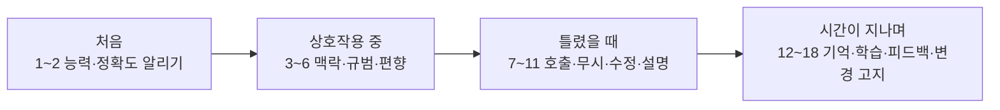

# Microsoft HAX 18개 지침

> Microsoft Research가 CHI 2019에서 발표한 "사람-AI 상호작용 18개 지침". AI 제품이 언제 어떻게 행동해야 사용자가 신뢰하고 쓸 수 있는지를 4단계로 정리했다.

## 쉽게 말하면
새 직원 온보딩 체크리스트다. 처음엔 "나는 이런 걸 할 수 있고 가끔 틀려요"라고 밝히고, 일할 땐 눈치 있게 굴고, 틀리면 쉽게 고치게 해 주고, 시간이 지나면 기억하고 배우되 갑자기 방식을 바꾸지 않는다.

## 자세히
Amershi 외, CHI 2019. 18개 지침은 여러 차례 평가와 디자인 실무자 49명 사용자 연구로 검증됐다.

**처음에(Initially)**
1. 시스템이 무엇을 할 수 있는지 분명히 하라
2. 그 일을 얼마나 잘하는지 분명히 하라

**상호작용 중(During)**
3. 맥락에 맞춰 서비스 시점을 정하라
4. 맥락상 관련 있는 정보를 보여라
5. 관련 사회 규범에 맞춰라
6. 사회적 편향을 완화하라

**틀렸을 때(When wrong)**
7. 효율적인 호출을 지원하라
8. 효율적인 무시(dismiss)를 지원하라
9. 효율적인 수정을 지원하라
10. 불확실하면 서비스 범위를 좁혀라
11. 시스템이 왜 그렇게 했는지 분명히 하라

**시간이 지나며(Over time)**
12. 최근 상호작용을 기억하라
13. 사용자 행동에서 학습하라
14. 신중하게 갱신·적응하라
15. 세분화된 피드백을 받아라
16. 사용자 행동의 결과를 전달하라
17. 전역 제어를 제공하라
18. 변경 사항을 알려라

(원문 제목을 의역함. 정확한 영문은 Microsoft 블로그 참고.) HAX Toolkit은 이 지침에 디자인 패턴·예시 라이브러리를 붙인 도구 모음이다.

## 그림으로 보기

## 예시
- 코드 자동완성: 제안 무시는 키 하나(8), 틀린 제안 수정은 바로 편집(9), 설정에서 학습 끄기(17).
- 지침 2 적용: "이 요약은 가끔 틀릴 수 있습니다"를 한 줄 표시하고 원문 근거 링크(11) 제공.

## 헷갈리는 것과 비교
| 개념 | 차이 |
|---|---|
| HAX 지침 | 상호작용 행동 체크리스트(18개) |
| [Google PAIR 가이드북](#pair-guidebook) | 장별 설계 질문·사례집 |
| [AI 제품 디자인](#ai-product-design) | 두 자료를 포괄하는 상위 주제 |

## 더 읽을거리
- [Microsoft Research: Guidelines for human-AI interaction design](https://www.microsoft.com/en-us/research/blog/guidelines-for-human-ai-interaction-design) — 18개 지침 전문(열어 확인)
- [HAX Toolkit](https://www.microsoft.com/en-us/haxtoolkit/ai-guidelines/) — 4단계 적용 시점 설명
- [CHI 2019 논문](https://www.microsoft.com/en-us/research/publication/guidelines-for-human-ai-interaction/) — 원문
