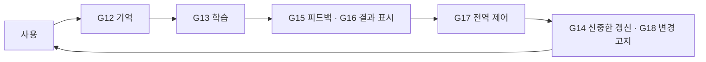

# HAX 시간 경과 7개 지침

> HAX 지침의 "시간이 지나며" 단계 G12~G18은 기억·학습·신중한 갱신·피드백·결과 전달·전역 제어·변경 고지로, AI가 오래 쓰일수록 신뢰를 유지하게 하는 규칙이다.

## 쉽게 말하면
오래 같이 일하는 비서를 떠올리면 된다. 지난 대화를 기억하고, 내 습관을 배우되 갑자기 일하는 방식을 바꾸지 않으며, 바뀌면 알려 주고, 내가 "이건 하지 마"라고 설정할 수 있어야 한다.

## 자세히
Microsoft 원문(MS Research 블로그, 직접 확인):
- **G12 최근 상호작용 기억**: 단기 기억을 유지하고 사용자가 참조하게 한다.
- **G13 사용자 행동에서 학습**: 시간이 지나며 개인화.
- **G14 신중하게 갱신·적응**: 업데이트 때 방해되는 변화를 제한.
- **G15 세밀한 피드백 유도**: 평소 사용 중 선호를 표시할 수 있게.
- **G16 행동의 결과 전달**: 사용자의 행동이 AI의 이후 행동에 미칠 영향을 바로 보여 준다.
- **G17 전역 제어 제공**: AI가 무엇을 관찰하고 어떻게 행동할지 전체 설정.
- **G18 변경 고지**: 기능이 추가·갱신되면 알린다.
- 생성형 AI에 적용하면 메모리 기능(G12·G13·G17)과 모델 업데이트 공지(G14·G18)가 해당한다.

## 그림으로 보기

## 예시
AI 비서가 "이 취향을 기억했어요, 설정에서 끌 수 있어요"라고 알리고(G16·G17), 모델 교체 후 달라진 점을 공지(G18).

## 헷갈리는 것과 비교
| 개념 | 차이 |
|---|---|
| 시간 경과(G12~18) | 장기 사용 신뢰 |
| [틀렸을 때](#hax-when-wrong) | 오류 후 통제 |
| [HAX Toolkit](#hax-toolkit) | 전체 틀 |

## 더 읽을거리
- [Guidelines for Human-AI Interaction (MS Research 블로그)](https://www.microsoft.com/en-us/research/blog/guidelines-for-human-ai-interaction-design) — 18개 지침 원문(직접 확인).
- [HAX Toolkit](https://www.microsoft.com/en-us/haxtoolkit/ai-guidelines/) — 지침·Design Library 안내.
