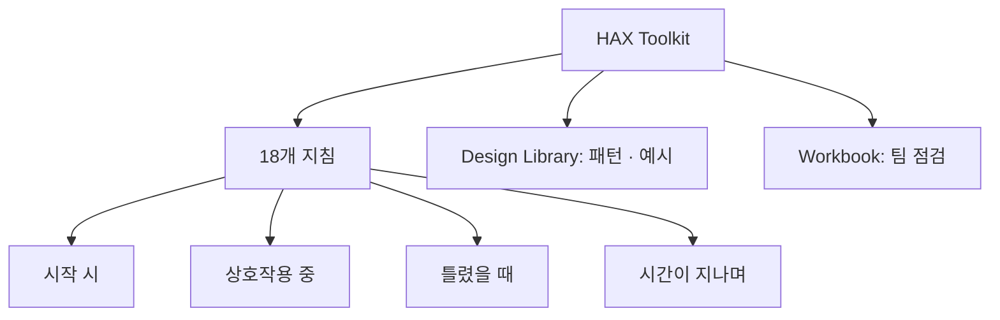

# HAX Toolkit

> HAX Toolkit은 Microsoft가 사람-AI 상호작용 설계를 돕기 위해 만든 도구 모음으로, 18개 지침에 설계 패턴·예시·워크북을 붙인 것이다.

## 쉽게 말하면
요리 원칙 18개만 적어 둔 종이가 아니라, 원칙마다 "이렇게 만든 앱 사례"와 "팀 점검표"까지 묶은 레시피 상자다.

## 자세히
- 뿌리는 「Guidelines for Human-AI Interaction」(Microsoft Research, CHI 2019): 18개 지침을 **사용 시작 시 / 상호작용 중 / 틀렸을 때 / 시간이 지나며** 4단계로 묶었다.
- 구성(Microsoft 사이트 기준): 지침(Guidelines), 지침별 패턴과 실제 제품 예시를 모은 Design Library, 팀이 지침 준수를 점검하는 Workbook, 시나리오 점검용 도구 등.
- 쓰임: AI 기능을 기획할 때 "G10: 불확실하면 모호성 해소"처럼 구체적 질문으로 점검.
- 주의: 비공식 요약 글 중 그룹 경계가 틀린 것이 있었다. 단계 구분은 Microsoft 원문을 기준으로.

## 그림으로 보기

## 예시
사내 챗봇 기획 회의에서 18개 지침을 표로 놓고 각 항목을 "충족/부분/미충족"으로 체크해 개선 우선순위를 정한다.

## 헷갈리는 것과 비교
| 개념 | 차이 |
|---|---|
| HAX Toolkit | 설계 지침+패턴+워크북 묶음 |
| [HAX 틀렸을 때 5개 지침](#hax-when-wrong) | 그중 한 단계 |
| [AI 튜터 가드레일](#ai-tutor-guardrails) | 특정 분야(교육)의 설계 규칙 |

## 더 읽을거리
- [Guidelines for Human-AI Interaction (HAX Toolkit)](https://www.microsoft.com/en-us/haxtoolkit/ai-guidelines/) — 공식 지침 페이지.
- [Microsoft Research 논문 페이지](https://www.microsoft.com/en-us/research/publication/guidelines-for-human-ai-interaction/) — CHI 2019 논문.
- [MLUX 사례 분석](https://medium.com/ml-ux/mlux-case-study-microsoft-researchs-human-ai-experience-hax-toolkit-36fca6b8147) — 툴킷 구성 해설.
