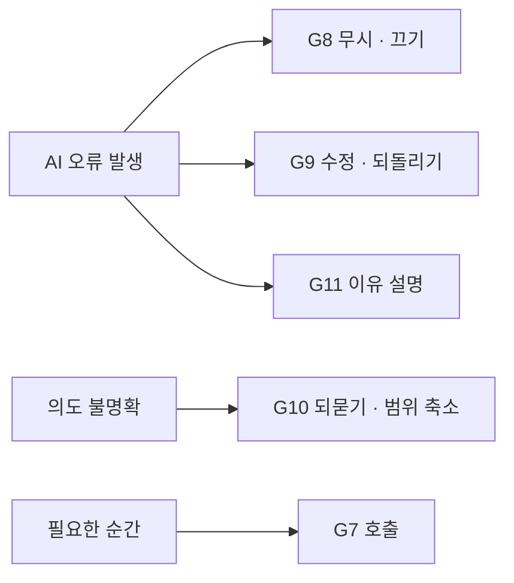

# HAX 틀렸을 때 5개 지침

> HAX 지침 중 "AI가 틀렸을 때" 단계의 G7~G11은 호출·무시·수정·범위 축소·설명으로, AI가 실수해도 사용자가 통제권을 잃지 않게 하는 규칙이다.

## 쉽게 말하면
자동 운전 보조가 틀릴 수 있다면 핸들을 쉽게 잡을 수 있고, 끄기 쉽고, 고치기 쉽고, 헷갈릴 땐 물어보고, 왜 그랬는지 알려 줘야 한다.

## 자세히
Microsoft 원문 기준(G11 문구는 직접 확인 못 해 2차 요약 사용):
- **G7 쉽게 호출**: 필요할 때 AI 서비스를 쉽게 불러낸다.
- **G8 쉽게 무시**: 원치 않는 AI 서비스는 쉽게 닫거나 무시한다.
- **G9 쉽게 수정**: AI가 틀렸을 때 편집·다듬기·되돌리기가 쉽다.
- **G10 불확실하면 범위 축소**: 목표가 불분명하면 되묻거나 서비스를 점잖게 축소(Design Library의 "Disambiguate before acting" 패턴).
- **G11 설명**: 왜 그렇게 했는지 설명한다(라이브러리 예: "What if?" 설명).
- 서로 보완: 호출·무시는 개입 비용을, 수정은 복구 비용을, 범위 축소·설명은 예방과 신뢰를 다룬다.

## 그림으로 보기

## 예시
메일 자동 답장 기능: 초안은 제안일 뿐 전송 전 편집 가능(G9), 맥락이 모호하면 "어느 고객 건인가요?" 질문(G10), "이 문장은 지난 메일을 근거로 작성"이라 표시(G11).

## 헷갈리는 것과 비교
| 개념 | 차이 |
|---|---|
| 틀렸을 때(G7~G11) | 오류 후 통제권 유지 |
| 시작 시(G1~G2) | 능력과 정확도 기대 설정 |
| [HAX Toolkit](#hax-toolkit) | 전체 도구 묶음 |
| [AI 안전·윤리](#ai-safety) | 더 넓은 위험 관리 틀 |

## 더 읽을거리
- [Guidelines for Human-AI Interaction](https://www.microsoft.com/en-us/haxtoolkit/ai-guidelines/) — 18개 지침 원문.
- [Microsoft Research 블로그](https://www.microsoft.com/en-us/research/blog/guidelines-for-human-ai-interaction-design) — 지침 소개.
