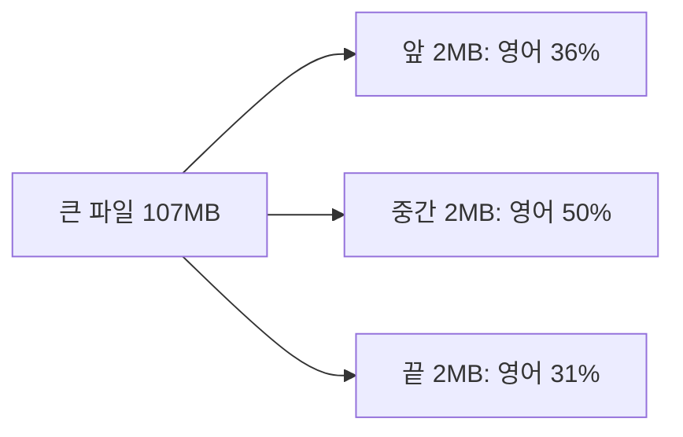
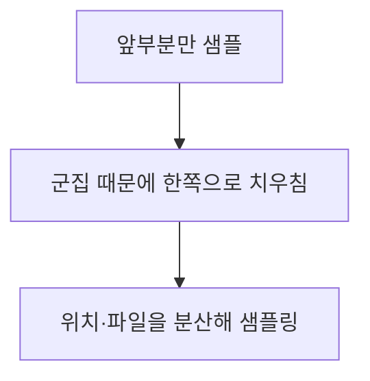

# 파일 앞부분 샘플의 편향

> 큰 파일의 **맨 앞 N바이트만 받아 샘플로 쓰면, 파일 안의 정렬·군집 때문에 전체를 대표하지 못할 수 있다.** 시험용으로는 괜찮지만 통계(언어 비율 등)를 말할 때는 여러 위치에서 뽑아야 한다.

## 쉽게 말하면
도서관 책장 맨 왼쪽 한 칸만 보고 "이 도서관은 영어책이 36%"라고 말하는 것과 같다. 책이 주제별로 꽂혀 있다면 다른 칸을 보면 숫자가 달라진다.

## 자세히
- 직접 실험(2026-11-27, `CC-MAIN-2024-10` WET 첫 파일, 107,022,614바이트에서 2MB 구간 세 곳을 Range 요청으로 받음. 각 구간에서 `WARC-Type: conversion` 레코드 수와 `WARC-Identified-Content-Language`, URL 최상위 도메인 비율 계산):
  | 구간 | 레코드 | 영어(eng) | 상위 언어 다음 | 주요 TLD |
  |---|---|---|---|---|
  | 앞(0~2MB) | 587 | 36% | 중국어 14%, 일본어 8% | com 45% |
  | 중간(53~55MB) | 689 | 50% | 러시아어 10%, 스페인어 8% | com 39% |
  | 끝(105~107MB) | 548 | 31% | 러시아어 16%, 일본어 9% | com 35%, `.рф`(xn--p1ai) 8% |
- 읽는 법: 영어 비율이 31%~50%로 구간마다 크게 달랐다. 표본 약 600개의 단순 오차는 ±4%p 안팎(정규 근사 계산)이므로 19%p 차이는 우연이 아니라 **파일 안에서 같은 언어·사이트가 모여 있기 때문**일 가능성이 크다(추정 — 군집 원인은 이번에 직접 확인하지 않음). 끝 구간에서만 `.рф` 도메인이 8%였다는 점도 같은 방향이다.
- 수집 날짜는 거의 같다: 모든 구간의 99% 이상이 2024-02-20. 이 한 파일은 크롤의 첫날 조각이므로 **파일 하나만으로 크롤 전체(2주, 90,000개 파일)를 대표할 수 없다**([크롤 ID 읽기](#cc-crawl-ids)).
- 레코드 길이도 달랐다: 평균 8,764바이트(앞), 7,856(중간), 11,235(끝). 구간별 문서 길이 분포가 다르면 토큰 수 추정도 흔들린다.
- 완화책(제안): ① 파일 여러 곳(앞·중간·끝)에서 구간 샘플링 ② 서로 다른 파일 여러 개에서 샘플링 ③ 레코드를 섞은 뒤 통계. 샘플 크기와 위치를 보고서에 적는다.
- 한계: 샘플이 파일 3곳(각 약 600개)뿐이라 어디서 어떻게 변하는지까지 말할 수는 없다.

## 그림으로 보기

## 예시
- 정제 파이프라인 시험은 앞 2MB로도 충분하지만, "이 크롤의 영어 비율"을 보고하려면 여러 위치·파일이 필요하다.
- 교육: "표본이 전체를 대표하는가?"라는 통계 기초를 실제 데이터로 시연.

## 헷갈리는 것과 비교
| 개념 | 차이 |
|---|---|
| 앞부분 샘플 | 싸고 빠르지만 편향 가능 |
| 구간 분산 샘플 | 위치별 변동을 줄임 |
| 무작위 레코드 샘플 | 전체를 읽어야 하거나 색인이 필요 |

## 더 읽을거리
- [Common Crawl: Get Started](https://commoncrawl.org/get-started) — 데이터 구조 안내.
- 직접 실행: Range 요청 3구간 비교(파이썬 zlib).
