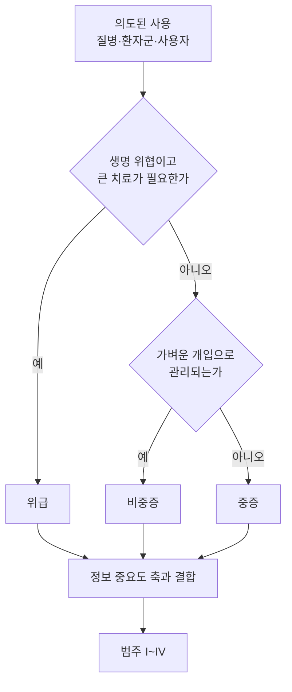
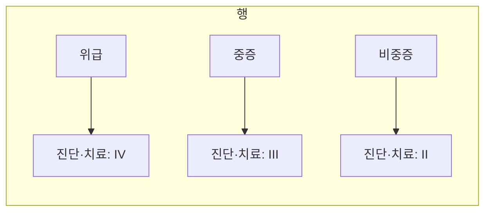

# 상황 심각도 축

> IMDRF의 SaMD 위험 분류에서 "소프트웨어가 쓰이는 병·상태가 얼마나 위중한가"를 위급(critical)·중증(serious)·비중증(non-serious) 3단계로 나누는 축. 정보 중요도 축과 곱해 범주 I~IV가 정해진다.

## 쉽게 말하면
같은 길 안내 앱이라도 동네 산책길을 안내하는 것과 응급실로 가는 구급차를 안내하는 것은 잘못됐을 때 결과가 다르다. 이 축은 소프트웨어 자체가 아니라 **그 소프트웨어가 개입하는 환자 상황**의 무게를 잰다. 병이 급하고 위중할수록, 사용자가 AI의 잘못된 출력을 알아채고 고칠 여유가 적을수록 높게 매긴다.

## 자세히
출처: FDA가 2019년 1월 Pre-Cert 문서에서 IMDRF N12 §5.2의 표를 재현한 부분(직접 열어 확인). N12 원문 PDF는 접속이 막혀 열지 못했으므로 공식 인용 전에는 원문 대조가 필요하다.

세 가지를 함께 보고 상황의 수준을 정한다: **질병·상태의 종류, 대상 환자군, 의도된 사용자.**

| 기준 | 위급 (Critical) | 중증 (Serious) | 비중증 (Non-serious) |
|---|---|---|---|
| 질병·상태 | 생명을 위협, 불치 상태 포함. 큰 치료 개입 필요. 경우에 따라 시간이 촉박 | 진행이 완만하고 대개 치료 가능. 큰 치료 개입은 불필요. 죽음·장기 장애를 피하려 즉시 개입해야 하는 건 보통 아님 | 진행이 느리고 예측 가능(가벼운 만성질환 포함). 완치 못 해도 관리 가능. 가벼운 개입만 필요 |
| 대상 환자군 | 취약(소아, 고위험군 등) | 취약하지 않음 | 꼭 환자가 아닐 수도 있음 |
| 사용자 | 전문 훈련을 받은 사용자 | 전문가 또는 일반인 | 전문가 또는 일반인 |

- 핵심 판단 기준은 **오류를 사용자가 감지할 수 있는가**다. 중증·비중증은 "사용자가 잘못된 권고를 알아챌 수 있다"고 전제하지만, 위급은 질환 진행 때문에 사용자가 출력을 곱씹을 여유가 없을 수 있다(주장이 아니라 표의 문구).
- 이 축 하나로 등급이 정해지지 않는다. 표의 행이 이 축이고 열이 [정보 중요도](#significance-of-information)다. 위급 행은 IV·III·II, 중증 행은 III·II·I, 비중증 행은 II·I·I.
- 같은 SaMD가 여러 상황에 쓰이면 **의도된 사용(intended use)** 으로 상황을 정해야 한다. 제조사가 "정의문(definition statement)"에 질병, 환자군, 사용자를 적는 이유다.
- FDA 문서에서 이 표는 미국 Pre-Cert 시범 프로그램(심사 간소화 제안)의 입력으로 쓰였다. 실제 FDA 법적 등급(I·II·III)과는 별개다.

## 그림으로 보기

## 예시
- 뇌졸중·패혈증 같은 시간 싸움의 응급 상황에서 영상을 읽어 치료 방향을 주는 AI: 상황 위급 + 진단 → IV.
- 약물 유발 경증 만성 질환(경증 고혈압 등)의 생활 습관 관리 앱: 상황 비중증 + 정보 제공 → I.
- 같은 폐 결절 검출 AI라도 소아 응급(취약군, 전문의 사용)이면 위급 쪽, 건강검진 보조면 중증 쪽으로 해석될 수 있다 — 이는 필자의 해석 예이며 규제기관 판정은 아니다.

## 헷갈리는 것과 비교
| 개념 | 차이 |
|---|---|
| 상황 심각도 축 | 환자 상태의 위중함. 가로(열)가 아닌 세로(행) |
| [정보 중요도](#significance-of-information) | 소프트웨어 출력이 임상 결정에 얼마나 결정적인가 |
| [SaMD 위험 분류](#samd-risk-categorization) | 두 축을 합친 전체 틀 |
| 의료 AI 환자 안전 | 오류의 결과가 얼마나 큰가의 일반 개념 |

## 더 읽을거리
- [FDA Software Precertification Program: Working Model v1.0 (2019)](https://www.fda.gov/media/119722/download) — N12 §5.1·5.2 표를 재현. 상황 세 단계 정의를 여기서 읽었다.
- [IMDRF/SaMD WG/N12 원문](https://www.imdrf.org/sites/default/files/docs/imdrf/final/technical/imdrf-tech-140918-samd-framework-risk-categorization-141013.pdf) — 원 문서(이번에 열지 못함)
