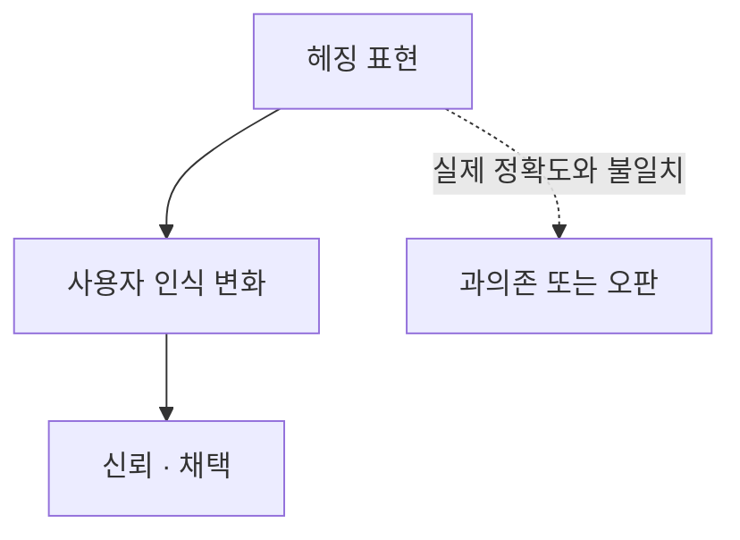

# 헤징 문구의 효과

> 헤징 문구는 "아마", "~일 수 있습니다" 같은 불확실성 표현으로, 사용자의 신뢰와 과의존에 영향을 주지만 모델이 실제로 얼마나 틀리는지와 어긋날 수 있다.

## 쉽게 말하면
의사가 "아마 괜찮을 겁니다"라고 말할 때 정말 불확실해서인지 말버릇인지 구분이 안 되면 곤란하다. 헤징도 보정되어야 쓸모가 있다.

## 자세히
검색으로 확인한 내용(2차 정리, 통제된 사용자 실험은 확인 못 함):
- 예시 보고: ChatGPT가 67% 틀리면서도 "it appears", "it's possible" 같은 헤징을 쓴 사례 → 표현이 실제 정확도를 반영하지 않을 수 있다.
- 헤징은 어떤 맥락에서는 신뢰도를 깎고, 다른 맥락에서는 "객관적이고 신중하다"는 인상을 준다(워크숍 논문).
- 2025 워크숍 논문: 인용과 말한 불확실성이 LLM 답의 채택에 큰 영향을 주는 단서.
- 설계 시사점: 헤징을 장식이 아니라 근거(출처 유무, 확신 수준)와 연결해 일관되게 쓰고, 과의존 완화 효과는 사용자 실험으로 확인한다.

## 그림으로 보기

## 예시
답변 UI에서 출처가 없는 주장에는 "확인되지 않음" 표시, 출처가 있는 주장은 단정형으로 구분.

## 헷갈리는 것과 비교
| 개념 | 차이 |
|---|---|
| 헤징 | 문장 표현 |
| [말로 표현한 확신](#verbalized-confidence) | 수치·구조화된 표현 |
| [AI 확신도 표시](#ai-confidence-display) | UI 전반 |

## 더 읽을거리
- [Improving Metacognition and Uncertainty Communication in LMs](https://arxiv.org/html/2510.05126v2) — 불확실성 전달 연구.
- [ConfTuner (arXiv 2508.18847)](https://arxiv.org/pdf/2508.18847) — 말로 확신을 표현하도록 학습.
- [Self-Generated Distractors (arXiv 2509.25532)](https://arxiv.org/html/2509.25532v1) — 말한 확신이 정확도보다 높다는 보고.
