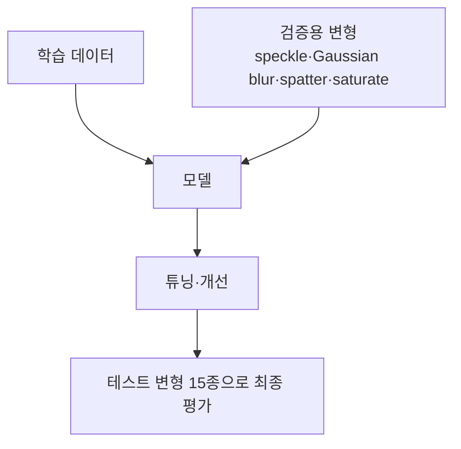
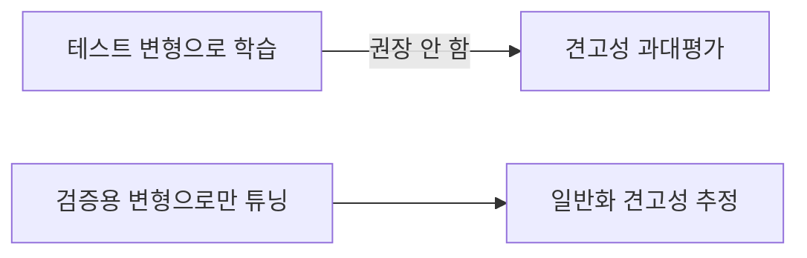

# 검증용 변형 분리

> 견고성 벤치마크에서 **테스트에 쓰는 변형과는 다른 종류의 변형을 별도로 떼어 두고**, 모델을 고치거나 튜닝할 때는 그 검증용 변형만 쓰도록 하는 규칙이다. 테스트 변형에 직접 맞춰 학습하면 견고성이 과대평가되기 때문이다.

## 쉽게 말하면
시험공부를 할 때 기출문제와 모의고사를 따로 두는 것과 같다. 본시험과 똑같은 문제로 연습하면 점수는 오르지만 실력은 모른다. 모의고사 문제(검증용)로 연습하고, 본시험(테스트)은 마지막에 한 번만 본다.

## 자세히
(Hendrycks & Dietterich, 「Benchmarking Neural Network Robustness to Common Corruptions and Perturbations」(ICLR 2019, arXiv 1903.12261) 4.1절과 부록 B를 PDF로 직접 읽어 확인.)
- **원칙(논문)**: ImageNet-C의 15개 손상으로 **학습하지 말 것**을 권한다. 평가 프로토콜은 "ImageNet 학습 셋과 연구자가 원하는 다른 학습 셋으로 학습하되, **이 손상들로 학습했는지 분명히 밝히고, 그 전략은 권장하지 않는다**"이다. 균일 노이즈 같은 다른 왜곡과 표준 증강(크롭·미러링)은 허용된다.
- **이유(논문)**: "ImageNet-C 손상에 직접 맞추면 연구자가 모델의 견고성을 **과대평가**하게 된다." 그래서 모델 검증을 단순하게 하도록 **범주별로 추가 손상 1개**를 제공한다.
- **검증용 4종(논문 부록 B)**: 노이즈 범주 = **speckle noise**(픽셀이 밝을수록 노이즈가 큰 가산 노이즈), 블러 = **Gaussian blur**(저역통과 필터), 날씨 = **spatter**(렌즈에 비·진흙), 디지털 = **saturate**(채도 증감). 저장소 https://github.com/hendrycks/robustness 에서 받는다.
- **같은 구조의 일반 원리(해석)**: 일반 머신러닝의 학습/검증/테스트 분할과 동일하되, 분할 단위가 데이터가 아니라 **변형의 종류**다. 테스트 변형에서 본 것을 일반화로 해석하려면 학습에 쓰지 않은 변형 유형이어야 한다.
- **ImageNet-P도 동일(논문)**: ImageNet-P에도 검증용 섭동이 따로 있다.
- **주의(해석)**: 검증용과 테스트용이 서로 너무 비슷하면(예: 같은 노이즈 계열) 분리 효과가 약하다. 유형 간 유사성을 확인해야 한다.

## 그림으로 보기

## 예시
- 오타 견고성 평가: 테스트에는 "인접 키 치환·글자 삭제"를, 튜닝에는 "글자 순서 바꿈"만 쓰고 최종 점수는 테스트에서 한 번만 본다.
- 교육 활동: "시험 문제 유출 vs 모의고사"를 비유로 벤치마크 오염 문제와 연결해 설명한다.

## 헷갈리는 것과 비교
| 개념 | 차이 |
|---|---|
| 검증용 변형 분리 | 변형 종류를 검증/테스트로 나눔 |
| 데이터 분할(train/val/test) | 샘플 단위로 나눔 |
| [변형 강도 단계](#perturbation-severity-levels) | 같은 변형의 강도를 단계화 |
| 데이터 증강 | 학습 시 변형을 넣어 일반화 개선 |

## 더 읽을거리
- [Benchmarking Neural Network Robustness to Common Corruptions and Perturbations (arXiv 1903.12261)](https://arxiv.org/abs/1903.12261) — 평가 프로토콜과 부록 B 검증용 손상(PDF 직접 확인).
- [hendrycks/robustness (GitHub)](https://github.com/hendrycks/robustness) — 데이터셋 다운로드·재생성 코드(논문 본문에서 링크 확인).
