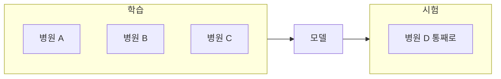
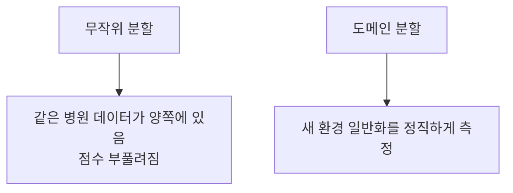

# 도메인 통째로 떼기

> 데이터를 무작위로 섞어 나누지 않고, **병원·지역·기간·촬영 장비 같은 도메인 단위로 통째로** 시험용에 떼어 두는 평가 설계다. 학습 때 본 적 없는 환경에서의 일반화를 정직하게 잰다.

## 쉽게 말하면
A·B·C 학교 문제로만 공부한 학생을 D학교 시험으로 평가하는 것이다. 각 학교 문제를 반씩 섞어 나눠 평가하면(무작위 분할) 같은 학교 출제 스타일을 이미 본 셈이라 점수가 부풀려진다.

## 자세히
- **WILDS의 분할 방식(논문 ar5iv 본문 직접 확인)**
  - **도메인 일반화**: 시험 도메인이 학습 도메인과 서로소. 예: Camelyon17-wilds는 일부 병원으로 학습하고 다른 병원으로 시험(병원 5곳, 클래스 균형 패치, 지표는 평균 정확도).
  - **소집단 변화**: 모든 시험 도메인이 학습에도 나타나지만 비율이 달라질 수 있다. 목표는 모든 시험 도메인에 걸친 최대 오류 최소화.
  - **혼합 예 FMoW-wilds**: 2013년 이전을 학습, 2013~2015년을 검증, 2016년 이후를 시험으로(시간 분할).
- **OOD 검증 vs ID 검증**: OOD 검증 세트는 조기 종료와 하이퍼파라미터 선택에 쓰며 "시험 세트와 비슷하지만 구별되는 분포 변화"를 반영한다. 대부분의 데이터셋은 ID(분포 내) 검증·시험 세트도 주지만 모델 선택이나 공식 평가에는 쓰지 않는다.
- **지표**: 평균이 아니라 최악 도메인 쪽을 본다. CivilComments는 8개 인구 집단 중 최저 정확도, FMoW는 최악 지역 정확도, PovertyMap은 도시·농촌 상관의 낮은 쪽, Amazon은 사용자별 정확도의 하위 10 백분위(논문 표 1 기준, 같은 표에서 CivilComments는 ID 평균 92.2 vs OOD 최악 집단 56.0).
- **실무 규칙(해석)**: 배포 환경이 새 병원·새 지역·미래 시점이면 분할도 그렇게 만든다. 데이터 누수(같은 환자가 학습·시험 양쪽에 있음) 점검이 같이 필요하다.
- **한계**: 도메인 수가 적으면(예: 병원 5곳) 어느 병원을 떼느냐에 따라 결과가 달라질 수 있다.

## 그림으로 보기

## 예시
- 여러 매장의 판매 예측: 2024년까지 학습, 2025년 시험(시간 분할), 새 지역 매장 일부는 통째로 시험.
- 교육 소재: 같은 모델을 무작위 분할과 도메인 분할로 평가해 점수 차이를 비교.

## 헷갈리는 것과 비교
| 개념 | 차이 |
|---|---|
| 무작위 분할 | 같은 분포, 낙관적 |
| 도메인 분할 | 새 환경 평가 |
| [WILDS 벤치마크](#wilds-benchmark) | 도메인 분할을 쓰는 표준 모음 |
| [분포 변화의 종류](#distribution-shift-types) | 무엇이 바뀌는지 분류 |

## 더 읽을거리
- [WILDS 논문 (ar5iv HTML)](https://ar5iv.labs.arxiv.org/html/2012.07421) — 분할·지표 설명(열어 확인, 앞 100,000자).
- [WILDS 공식 사이트](https://wilds.stanford.edu/) — v2.0에 8개 데이터셋 비라벨 데이터 추가(직접 확인).
