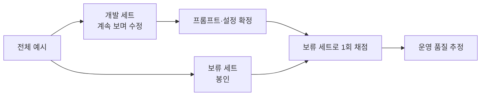
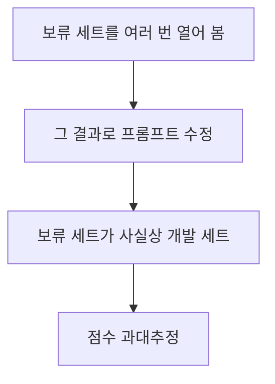

# 보류 평가 세트

> 보류 평가 세트(held-out eval set)는 프롬프트를 고치고 디버깅하는 동안 한 번도 쓰지 않고 따로 숨겨 둔 예시 모음이다. 개선이 끝난 최종본을 딱 한 번 채점해 "처음 보는 입력에서의 실제 품질"을 추정하는 데 쓴다.

## 쉽게 말하면
수험생이 기출문제로 공부하다가 실전 모의고사를 따로 하나 봉투에 넣어 두는 것과 같다. 기출을 반복해 풀면 점수는 오르지만 그것이 실력인지 암기인지 알 수 없다. 봉투를 마지막에 한 번만 열어야 진짜 실력이 보인다.

## 자세히
- **세트의 역할 분리**: 개발(dev) 세트는 계속 보면서 고치는 용도, 보류(holdout) 세트는 마지막 점수용이다. PromptLayer 용어집(열람)은 반복 작업과 분리해 보관하다 워크플로가 안정된 뒤 최종 채점에 쓰는 세트로 정의한다.
- **만드는 순서(같은 글)**: ① 반복을 시작하기 전에 예시 일부를 떼어 둔다 ② 프롬프트 설계·디버깅·중간 평가에 쓰지 않는다 ③ 개발 세트로 반복한다 ④ 안정되면 보류 세트로 최종본을 돌린다 ⑤ 이전 배포본과 같은 지표로 비교한다 ⑥ 접근 통제로 손대지 못하게 한다.
- **함정(같은 글)**: 시간이 지나 실제 사용과 멀어지는 낡음, 드문 사례가 빠지는 범위 공백, 표본이 적어 점수가 출렁임, 접근 통제가 없어 튜닝에 쓰이는 유출, 보류 점수가 좋아도 모든 운영 상황을 보장하지 않는 지표 불일치.
- **작은 개발 세트의 위험**: 검색 요약으로 접한 한 arXiv 논문(2608.00243)은 24개짜리 개발 세트로는 구분이 안 되던 두 프롬프트가 120개 보류 세트에서 8.34점 차이가 났다고 한다. 또 다른 논문(2610.19084)은 프롬프트 최적화에서 검증 향상이 평균 7.9점인데 테스트에서는 5.2점(약 66%)만 남았다고 보고한다고 정리됐다. 두 논문 본문은 열지 못했고(2610.19084 PDF는 텍스트 추출 실패) 요약에 의존한 수치다. 방향성으로만 본다.
- **같이 볼 원칙**: 선택은 검증 데이터로만 하고, 보류 세트는 최종 비교까지 봉인한다. 여러 번 열어 보면 보류 세트가 개발 세트가 된다.

## 그림으로 보기

## 예시
- 고객 문의 분류 프롬프트: 예시 200개 중 40개를 보류로 떼어 두고, 160개로 프롬프트를 고친 뒤 마지막 릴리스 전에 40개로 한 번 채점한다.
- 교육 활용: "점수가 올랐다"는 주장을 들으면 "그 점수는 어느 세트에서 나왔나?"를 묻는 습관을 가르친다.

## 헷갈리는 것과 비교
| 개념 | 차이 |
| --- | --- |
| [평가 세트 먼저 만들기](#eval-set-first) | 상위 원칙. 보류 세트는 그 세트를 둘로 나누는 운영 규칙 |
| 개발(검증) 세트 | 고치는 동안 계속 보는 세트 |
| 학습 세트 | 모델 가중치를 학습하는 데이터. 프롬프트 튜닝에선 예시 모음에 해당 |

## 더 읽을거리
- [PromptLayer: Holdout eval set](https://www.promptlayer.com/glossary/holdout-eval-set) — 정의·절차·함정
- [Beyond Aggregate Accuracy (arXiv 2610.19084)](https://arxiv.org/pdf/2610.19084) — 프롬프트 최적화의 검증-테스트 격차(본문 미확인, 검색 요약)
