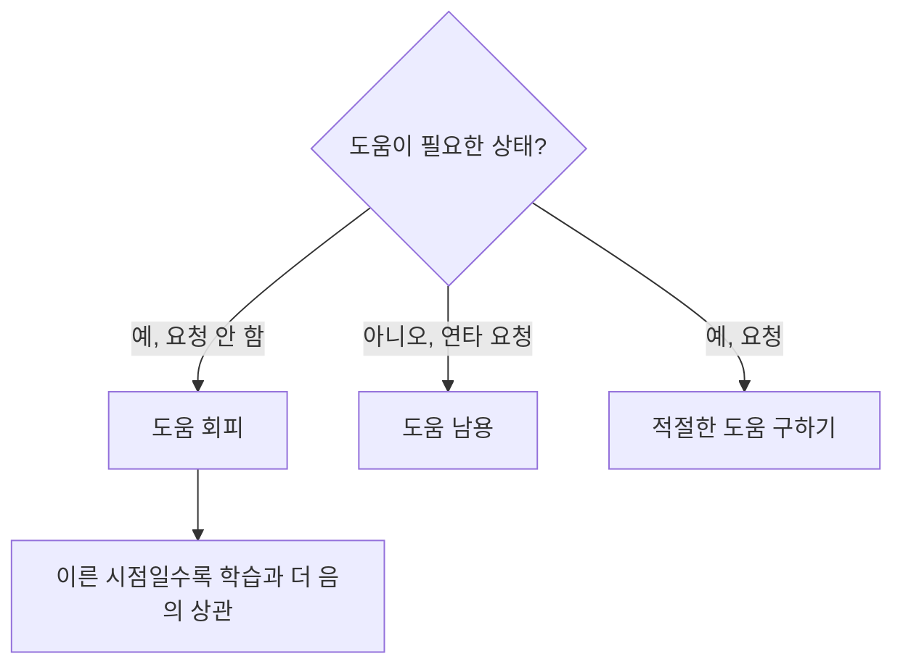

# 도움 회피(help avoidance)

> **도움이 필요한데도 도움을 요청하지 않는 행동**이다. 도움 남용(필요 없이 연타)의 반대편 오용이며, 이른 시점에 일어날수록 학습과 더 강하게 음의 상관을 보인다.

## 쉽게 말하면
모르는 문제 앞에서 질문하기 부끄러워 혼자 끙끙대다 시간만 쓰는 학생이다. 정답지를 베끼는 것(남용)만 문제가 아니라 필요한 순간에 손을 못 드는 것(회피)도 문제다.

## 자세히
(Almeda·Baker·Corbett, "Help Avoidance: When students should seek help, and the consequences of failing to do so" 원고 PDF와 Roll 외 2010 논문의 서론을 직접 읽었다. 원고라 최종 출판본과 다를 수 있다.)
- **정의(Almeda 외)**: 필요할 때 도움을 구하지 않는 것. Aleven 등의 도움 구하기 모델에서 필요 여부는 학생의 **해당 기술 숙달 추정치**에 크게 좌우된다. Roll 외는 도움 오용을 **회피(과소 사용)**와 **남용(과다 사용)** 두 갈래로 정리한다.
- **연구 설계**: Genetics Cognitive Tutor 두 모듈(3-factor cross, gene interaction) 로그. 숙달 추정 임계값을 0.05%~100%까지 바꿔 가며 "도움이 필요한 상황"을 정의하고, 학생별 회피 비율과 **견고한 학습**(retention·PFL·transfer 검사)의 피어슨 상관을 본다(탐색적).
- **결과(Almeda 외 초록)**: 아주 높거나 낮은 지식 구간을 빼면 회피는 **대체로 안정적으로 학습과 음의 상관**. 연습 순서가 **이를수록**(첫 문제) 상관이 더 음이고, 마지막 연습 기회에서는 0이거나 양이다. 한 단계에서 **첫 시도**에서의 회피가 이후 시도보다 더 해롭다. 예로 임계 45%에서 transfer 상관 −0.23, 60%에서 −0.39(한 모듈 그래프 기준).
- **시사점(저자)**: 도움이 필요하면 **첫 문제·첫 시도부터** 요청하도록 권장. 다만 Roll 등 다른 연구는 낮은 지식에서도 시도 후 도움을 구하는 것이 더 이로울 수 있다고 하여 관계가 단순하지 않다고 적는다.
- **Help Tutor 한계(Roll 외 2010)**: 도움 구하기 코칭 시스템이 바텀아웃 요청은 줄였지만 **도움 회피는 줄이지 못했다**는 보고. 회피하는 학생일수록 코칭 메시지의 영향을 덜 받을 수 있다고 논의한다.
- **한계**: 상관 연구이며 수학·유전학 튜터 데이터다.

## 그림으로 보기

## 예시
- 챗봇 튜터: 학생이 3분째 같은 오답이면 "힌트를 드릴까요?"를 먼저 제안(제안, 이 논문이 시험한 것은 아님).
- 로그 점검: 숙달 추정이 낮은 단계에서 힌트 없이 여러 번 오답을 내는 비율.

## 헷갈리는 것과 비교
| 개념 | 차이 |
|---|---|
| 도움 회피 | 필요한데 요청 안 함 |
| 도움 남용 | 필요 없는데 과다 요청 |
| [gaming the system](#gaming-the-system) | 시스템 허점을 이용한 우회 |
| [힌트 남용 탐지](#hint-abuse-detection) | 남용 쪽 탐지 방법 |

## 더 읽을거리
- [Almeda, Baker, Corbett — Help Avoidance](https://learninganalytics.upenn.edu/ryanbaker/Helpavoidance_TCRsubmission.pdf) — 직접 읽음(원고).
- [Roll et al. (2010) — Improving students' help-seeking skills using metacognitive feedback](https://www.cs.cmu.edu/~bmclaren/pubs/RollEtAl-ImprovingMetacogSkillsWithITS-LandI2010.pdf) — 도움 오용 분류(서론·논의 읽음).
