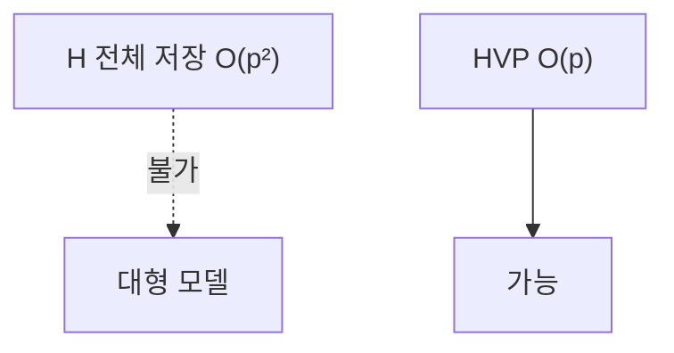

# 헤시안-벡터 곱

> 헤시안 행렬 자체를 만들지 않고 "헤시안 × 벡터" 결과만 기울기 계산과 비슷한 비용으로 구하는 기법이다. 영향 함수에서 H⁻¹v를 근사할 때 핵심 도구다.

## 쉽게 말하면
도시 전체 지도를 그리지 않고 "이 길로 한 걸음 가면 지형이 얼마나 휘는지"만 바로 계산하는 요령이다. 거대한 표를 저장하지 않아도 필요한 한 방향의 정보를 얻는다.

## 자세히
(Koh & Liang arXiv 1703.04730을 하위 에이전트가 원문으로 읽은 노트 기준. Pearlmutter 1994 원문은 인용만 확인.)
- **영향 함수**: 훈련점 z를 가중해 올릴 때 I_up,loss(z, z_test) = −∇L(z_test)ᵀ H⁻¹ ∇L(z). 헤시안 H를 직접 만들고 역행렬을 구하면 O(np² + p³)로 불가능.
- **트릭**: s_test = H⁻¹∇L(z_test)를 **한 번** 구해 두고 훈련점마다 −s_test·∇L(z)를 계산.
- **HVP**: [∇²L(z_i)]v를 **기울기와 같은 시간, 보통 O(p)** 로 계산(Pearlmutter 1994, 자동 미분 프레임워크가 지원).
- **H⁻¹v를 HVP만으로**: (a) **켤레 기울기법(CG)** — H⁻¹v = argmin_t{tᵀHt − vᵀt}, 각 Ht는 O(np), 정확하려면 p회지만 실제로는 더 적게. (b) **LiSSA** 확률적 추정 — 재귀 H̃ⱼ⁻¹v = v + (I − ∇²L(z_{sⱼ}))H̃ⱼ₋₁⁻¹v, t개 표본·r회 반복 평균, 전체 O(np + rtp). 손실을 ∇²L ⪯ I가 되게 스케일해야 하며 CG보다 빠르다.
- **검증**: MNIST 로지스틱 회귀(n=55,000)에서 영향 ≈ 하나 빼고 재학습(LOO). LiSSA r=10, t=5,000이 정확, r=1도 노이즈는 있어도 작동.
- **비볼록 모델**: 헤시안이 양의 정부호가 아니므로 감쇠(damping) 등을 쓴다(자세한 내용은 읽은 범위 밖).

## 그림으로 보기

## 예시
- 소형 분류기에서 의심스러운 예측에 가장 큰 영향을 준 훈련 샘플 10개를 찾기.
- 교육 활용: "표 전체 없이 필요한 곱만 계산"이라는 아이디어를 계산 비용 표로 설명.

## 헷갈리는 것과 비교
| 개념 | 차이 |
|---|---|
| HVP | H×v를 O(p)에 계산 |
| 헤시안 역행렬 | 계산·저장 불가능한 거대 연산 |
| [EK-FAC](#ek-fac) | 대형 모델용 헤시안 근사 |

## 더 읽을거리
- [Understanding Black-box Predictions via Influence Functions (arXiv 1703.04730)](https://arxiv.org/abs/1703.04730) — HVP·CG·LiSSA.
