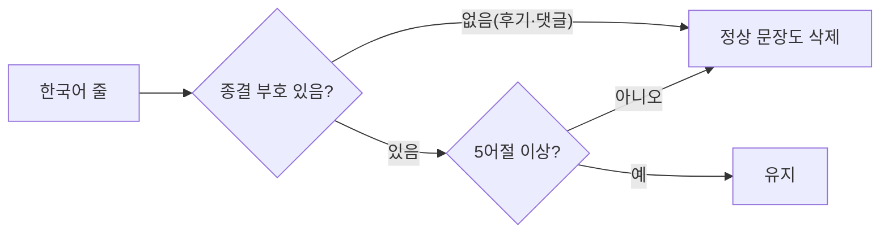
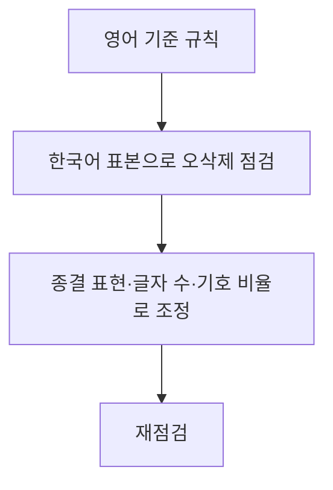

# 한국어 코퍼스 휴리스틱

> C4의 "마침표로 끝나는 줄만, 5단어 이상 줄만" 같은 **영어 기준 규칙을 한국어에 그대로 쓰면 정상 문장이 지워지고 메뉴 줄이 살아남는다.** 종결 부호·어절 수·언어 판정을 한국어에 맞게 조정해야 한다.

## 쉽게 말하면
영어 맞춤 체를 한국어에 쓰면 구멍 크기가 안 맞는다. 한국어 문장은 마침표 없이 끝나기도 하고, 띄어쓰기 단위(어절)가 영어 단어와 길이 감각이 다르기 때문이다.

## 자세히
(C4 규칙은 T5 논문 arXiv 1910.10683 2.2절, [C4 규칙](#c4-filter-rules)에 정리. 아래는 그 두 규칙을 한국어 줄 7개에 직접 적용한 실험이며 예시이지 통계가 아니다)
| 줄 | 종결 부호 | 5어절↑ | C4 규칙 결과 |
|---|---|---|---|
| 오늘은 서울에 비가 많이 내렸습니다. | O | 5 | 유지 |
| 배터리 수명이 길고 화면이 선명해서 만족합니다 | **X** | 6 | **삭제**(정상 후기 문장) |
| 정말 좋아요! | O | **2** | 삭제(짧은 감탄) |
| 가격 대비 성능이 훌륭하다고 생각해요~ | **X**(물결표) | 5 | **삭제** |
| 김치찌개 만드는 법: … 끓입니다. | O | 9 | 유지 |
| 회원가입 \| 로그인 \| 고객센터 | X | 5(`\|`이 어절로 셈) | 삭제(의도대로, 그러나 어절 수만으로는 통과) |
| 이 글은 … 2026-11-01 입니다. | O | 7 | 유지 |
- 관찰: ① 한국어 후기·댓글은 마침표를 안 쓰거나 `~`, `ㅎㅎ`로 끝내는 경우가 많아 종결 부호 규칙이 **정상 문장을 대량 삭제**할 수 있다 ② 어절 수는 조사·어미가 붙어 영어 단어 수와 의미가 다르다. "정말 좋아요!"는 2어절이라 삭제된다 ③ 메뉴 줄(`회원가입 | 로그인 | 고객센터`)은 구분자 `|`가 어절로 세어져 5 이상이 되므로 규칙만 믿으면 안 되고 기호 비율 등 별도 규칙이 필요하다. 이 설정에서는 종결 부호 때문에 삭제됐다.
- 언어 판정: 위 한국어 문단 5줄을 합쳐 langdetect로 판정하니 `ko 1.0`이었다. 한국어는 문자 체계가 뚜렷해 감지가 쉬운 편이지만 한영 혼합에서는 영어 부분만 보고 판정될 수 있다([언어 감지 임계값](#langdetect-threshold)).
- 조정안(제안): 종결 부호에 `다.`뿐 아니라 `요`, `다`, `죠`, `!`, `?`, `~`, `ㅎㅎ` 등 구어 종결과 따옴표를 허용 / 최소 길이를 어절 대신 **글자 수**(예: 20자)로 / 기호 비율·반복 문자 규칙 추가 / 한국어는 별도 임계값으로 제외 표본 점검([제외 문서 저장](#exclusion-writer)).

## 그림으로 보기



## 예시
```python
import re
END = re.compile(r'(다|요|죠|네|까|[.!?~"\'])$')   # 제안: 구어 종결 허용
ok = bool(END.search(line)) and len(line) >= 20
```
- 쇼핑몰 후기 데이터에서 규칙 적용 전후 삭제 비율과 삭제 표본을 비교.
- 교육: 영어로 만든 도구를 다른 언어에 쓸 때의 점검 습관.

## 헷갈리는 것과 비교
| 개념 | 차이 |
|---|---|
| 영어 C4 규칙 | 마침표·5단어 기준 |
| 한국어 휴리스틱 | 종결 표현·글자 수·기호 비율 |
| 모델 기반 품질 필터 | 규칙 대신 분류기 사용 |

## 더 읽을거리
- [T5 논문 (arXiv 1910.10683)](https://arxiv.org/abs/1910.10683) — C4 규칙 원문(PDF 본문 읽음).
