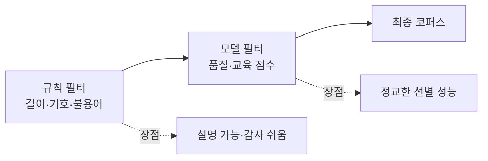
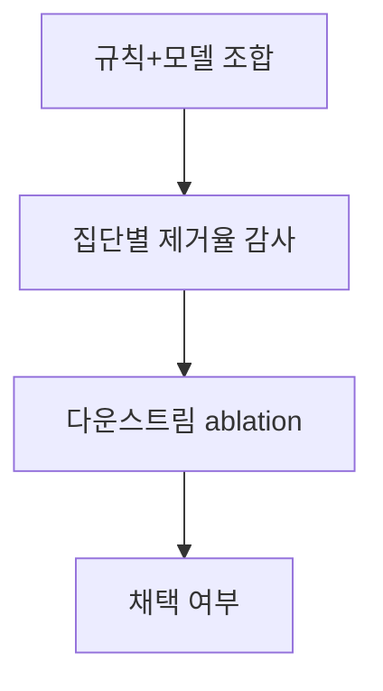

# 규칙 필터 vs 모델 필터

> 학습 데이터 품질 필터에는 **사람이 정한 규칙(휴리스틱)**을 쓰는 방식과 **학습된 모델(분류기)의 점수**를 쓰는 방식이 있다. 규칙은 설명이 쉽고 편향 위험이 눈에 보이며, 모델은 더 정교하지만 편향과 라벨 의존이 숨어 있다.

## 쉽게 말하면
입사 서류 심사를 "자격증 2개 이상"(규칙)으로 할지, "합격자 데이터로 학습한 AI 점수"(모델)로 할지의 차이다. 규칙은 왜 떨어졌는지 설명이 쉽고, AI 점수는 더 잘 가려내지만 무엇을 보고 판단했는지 알기 어렵다.

## 자세히
- **규칙 필터의 근거(Gopher 논문, arXiv 2112.11446 부록 A.1, PDF 직접 읽음)**: MassiveWeb에서 "편향 가능성을 최소화하려고 단순하고 이해하기 쉬운 휴리스틱 필터"를 썼다. 단어 수 50~10만, 평균 단어 길이 3~10자, 기호 비율, 글머리표·말줄임표 줄 비율, 알파벳 단어 80%, 불용어 2개 이상([불용어 필터](#stop-word-filter)). 5GB 하위 표본으로 1.4B 모델을 단계별로 학습한 절제 실험에서 단순 휴리스틱 품질 필터를 더하면 downstream 성능이 "크게" 개선됐다고 한다.
- **FineWeb 데이터셋 카드(직접 읽음)**: 기본 FineWeb에서는 "gold" 출처와의 유사도에 기반한 품질 필터나 독성 분류기를 피했다고 밝힌다. 소수 방언을 과하게 지우거나 특정 사회 정체성 관련 내용을 과도하게 걸러 낼 위험 때문이다. URL 수준 필터링 후에도 유해 문서가 상당수 남는다는 한계도 적었다.
- **모델 필터의 근거 1(FineWeb-Edu, arXiv 2406.17557)**: 교육 가치 점수 분류기로 걸러 MMLU 33%→37%, ARC 46%→57%(350B 토큰, 1.71B 모델, 논문 보고)를 얻었다([단계별 규모 검증](#staged-validation)).
- **모델 필터의 근거 2(DataComp-LM, arXiv 2406.11794, 초록 직접 읽음)**: "모델 기반 필터링이 고품질 학습 세트를 만드는 열쇠"라고 주장하고, DCLM-Baseline 7B(2.6T 토큰)가 5-shot MMLU 64%에 도달했다고 보고한다([모델 기반 필터링](#model-based-filtering)).
- **모델 필터의 편향 증거**: 독성 분류기·점수 기반 필터가 AAE 등 소수 방언을 더 많이 걸러낼 수 있다는 연구가 있다([분류기 기반 독성 필터](#classifier-toxicity-filter)).
- **선택 기준(제안)**: ① 설명 가능성·감사 용이성이 중요하면 규칙 ② 성능이 우선이고 검증 인력이 있으면 모델(교육 가치·품질 점수) ③ 둘을 조합: 규칙으로 명백한 쓰레기를 거른 뒤 모델 점수로 선별 ④ 어느 쪽이든 집단별 제거율 감사와 다운스트림 ablation으로 검증([제외 데이터 보고](#excluded-data-report), [ablation 실험 설계](#ablation-experiment-design)).
- 한계: 두 방식이 같은 조건에서 직접 비교된 실험은 이번에 확인하지 못했다. 위 수치는 서로 다른 논문·설정의 결과라 우열을 단정할 수 없다.

## 그림으로 보기

## 예시
| 방식 | 사례 | 보고된 결과 |
|---|---|---|
| 규칙 | Gopher MassiveWeb | 품질 필터로 downstream 크게 개선(논문) |
| 모델 | FineWeb-Edu | MMLU 33→37%, ARC 46→57% |
| 모델 | DCLM-Baseline 7B | 5-shot MMLU 64%(논문 주장) |
- 업무 장면: 사내 문서 정제에서 길이·중복 같은 규칙으로 1차 정리한 뒤, 소량 사람 라벨로 학습한 품질 분류기로 상위 30%를 선별하고 부서별 제거율을 점검한다.

## 헷갈리는 것과 비교
| 개념 | 차이 |
|---|---|
| 규칙 필터 | 사람이 정한 조건, 투명 |
| 모델 필터 | 학습된 점수, 정교하나 편향이 숨음 |
| [Gopher 품질 휴리스틱](#gopher-quality-heuristics) | 규칙 필터의 대표 묶음 |
| [모델 기반 필터링](#model-based-filtering) | 모델 필터를 다룬 노드 |

## 더 읽을거리
- [Gopher (arXiv 2112.11446)](https://arxiv.org/abs/2112.11446) — 휴리스틱 필터 규칙과 효과(PDF 직접 읽음).
- [DataComp-LM (arXiv 2406.11794)](https://arxiv.org/abs/2406.11794) — 모델 기반 필터링 주장(초록 직접 읽음).
- [FineWeb 데이터셋 카드](https://huggingface.co/datasets/HuggingFaceFW/fineweb) — 분류기 필터를 피한 이유(README 직접 읽음).
