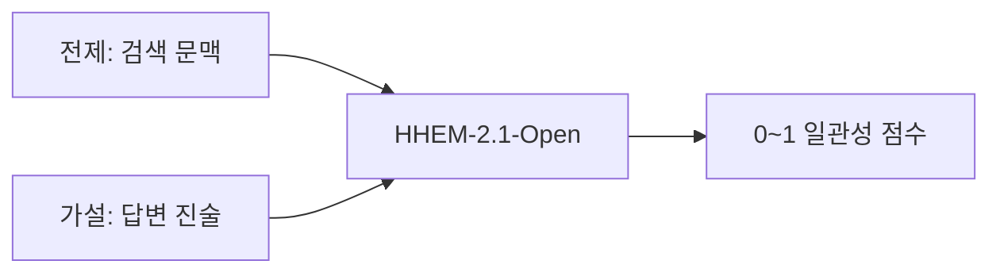

# HHEM 환각 분류기

> Vectara가 공개한 **작은 오픈소스 모델**로, (전제, 가설) 쌍에서 가설이 전제로 뒷받침되는지 0~1 점수로 알려 준다. LLM 판정자 대신 충실도 평가에 쓸 수 있다.

## 쉽게 말하면
큰 심사위원(GPT-4 같은 LLM) 대신 빠르고 값싼 전담 감별사를 두는 것이다. "이 요약이 원문에서 나온 말인가?"만 전문으로 본다.

## 자세히
(Hugging Face의 HHEM-2.1-Open 모델 카드와 RAGAS 문서를 직접 읽었다.)
- **버전**: HHEM-1.0(최대 512토큰), **HHEM-2.1-Open**(컨텍스트 길이 제한 없음, 이 글의 대상), **HHEM-2.3**(Vectara 플랫폼 전용 상용, 다국어).
- **규모**: 약 **0.1B 파라미터**, google/flan-t5-base 기반. 메모리 600MB 미만(32비트), 2k 토큰 입력에 현대 x86 CPU로 약 1.5초.
- **입력·출력**: (premise, hypothesis) 쌍 → **0~1 점수**(0은 전혀 지지 안 됨, 1은 완전 지지). 모델 카드는 판정 임계값을 정하지 않는다. 언어는 영어로 표기.
- **정확도(모델 카드, 균형 정확도)**: AggreFact-SOTA 76.55%(GPT-4 제로샷 73.78%, HHEM-1.0은 78.87%), RAGTruth-Summ 64.42%(GPT-4 62.62%), RAGTruth-QA 74.28%(GPT-4 74.11%). 비교 대상은 GPT-3.5-Turbo·GPT-4뿐이다.
- **사용**: `AutoModelForSequenceClassification`에 `trust_remote_code=True`로 불러 `model.predict(pairs)` 호출(`model(pairs)` 직접 호출 금지).
- **RAGAS 연동**: `FaithfulnesswithHHEM`이 검증 단계를 HHEM으로 대체. 기본 CPU, 배치 10.
- **한계(모델 카드)**: **비대칭** — "I visited the United States"가 전제면 "I visited Iowa"는 환각이지만 반대 방향은 일관. 사실이지만 전제에 없는 주장도 환각으로 표시될 수 있다. AggreFact 벤치마크는 구형 모델(T5·BART·Pegasus) 결과다.

## 그림으로 보기

## 예시
- 한국어 서비스에는 영어 전용 모델이라 그대로 쓰기 어렵다. 한국어는 별도 검증이 필요(모델 카드 기준 해석).
- 비용이 문제일 때 판정 호출을 LLM에서 HHEM으로 바꿔 CPU로 배치 평가(제안).

## 헷갈리는 것과 비교
| 개념 | 차이 |
|---|---|
| HHEM | 소형 전용 분류기 |
| LLM 판정자 | 범용·유연·비용 큼 |
| [NLI 함의 검사](#nli-entailment-check) | HHEM과 같은 계열(T5 기반 판정) |

## 더 읽을거리
- [vectara/hallucination_evaluation_model](https://huggingface.co/vectara/hallucination_evaluation_model) — 모델 카드(직접 읽음).
- [RAGAS — Faithfulness](https://docs.ragas.io/en/stable/concepts/metrics/available_metrics/faithfulness/index.md) — HHEM 변형(직접 읽음).
