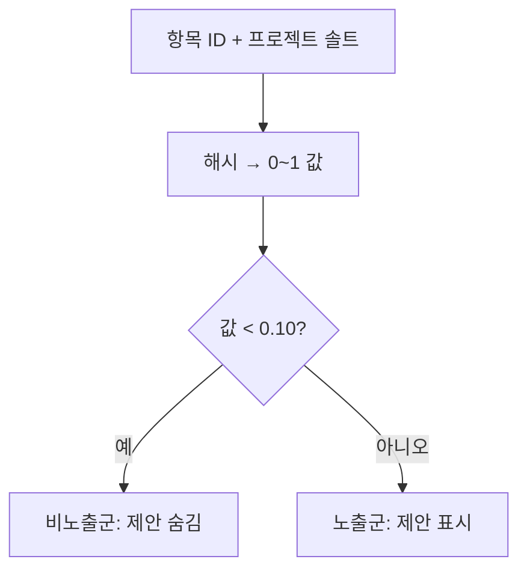
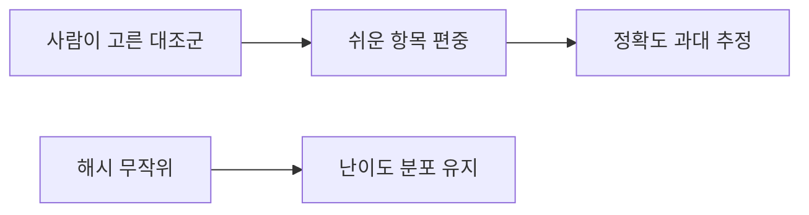

# 비노출군 무작위 배정

> 모델 제안을 숨기고 라벨링할 "비노출군"을 **사람이 고르지 않고 해시 같은 무작위 규칙으로 정하는 것**이다. 사람이 고르면 쉬운 항목만 뽑히거나 일정한 패턴이 생겨, 노출군과 비노출군을 공정하게 비교할 수 없다.

## 쉽게 말하면
반 학생 중 일부에게만 새 교재를 주고 효과를 비교하는데, 교사가 "잘하는 학생"만 뽑아 새 교재를 주면 비교가 무의미해진다. 제비뽑기처럼 누가 봐도 공정한 규칙으로 정해야 두 집단이 비슷해진다.

## 자세히
(LinkedIn 엔지니어링 블로그의 변형 배정 설명을 직접 열어 확인하고, 해시 배정과 수동 선택의 차이는 직접 시뮬레이션.)
- **해시 기반 배정(LinkedIn 블로그, A/B 실험 맥락)**: 실험마다 고유한 **솔트(salt)**를 두고, 대상 ID와 솔트를 이어 붙여 해시(블로그는 MD5)한 뒤 [0,1) 값으로 바꾸고, 구간을 변형별 비율대로 나눠 배정한다. 같은 ID는 언제나 같은 변형을 받는다(재현성). 실험마다 솔트가 달라 동시에 도는 실험 간 배정이 서로 독립이다. 이 글은 서비스 운영 관점이므로 라벨링에 적용하는 것은 제안이다.
- **라벨링 적용(제안)**: 항목 ID와 프로젝트 솔트를 해시해 값이 0.10 미만이면 비노출군. 이점: ① 사람이 개입하지 않음 ② 같은 항목은 재실행해도 같은 군 ③ 배정 기록을 따로 안 남겨도 재계산 가능 ④ 솔트를 바꾸면 새로 무작위화.
- **직접 시뮬레이션(항목 4,000건, 난이도 0~1 균등, 사람 단독 정확도 = 0.98 − 0.2×난이도, 비노출 10%)**
  | 선택 방식 | 비노출군 크기 | 평균 난이도 | 비노출군 정확도 |
  |---|---|---|---|
  | 전체 | 4,000 | 0.495 | 0.881 |
  | 해시 무작위(솔트 s1) | 424 | 0.493 | 0.881 |
  | 해시 무작위(솔트 s2) | 413 | 0.501 | – |
  | 사람이 "쉬운 항목" 선택 | 400 | 0.047 | 0.971 |
  해시 배정은 전체와 거의 같은 난이도 분포를 유지하지만, 사람이 쉬운 것만 고르면 비노출군 정확도가 0.971로 부풀려져 "제안이 오히려 해롭다" 같은 잘못된 결론이 나온다. 같은 ID·솔트는 반복 실행해도 같은 결과(True)였다. 솔트 200개로 반복한 배정률은 평균 0.0997, 표준편차 0.0046(이항 분포 기대값 0.0047과 일치).
- **주의(제안)**: ① 배정 단위(항목 단위인지 라벨러 단위인지)를 정한다 — 같은 항목의 여러 라벨러 결과가 섞이지 않게 ② 소수 클래스는 층화(클래스별로 같은 비율 보장) ③ 솔트·비율·배정 규칙을 사전에 기록하고 중간에 바꾸지 않기 ④ 배정률이 목표(10%)에서 크게 벗어나면 규칙 오류를 점검(표본 비율 불일치 검사) ⑤ 프로세스를 아는 사람이 대조군을 의도적으로 조작하지 못하게 솔트는 비공개.

## 그림으로 보기

## 예시
- 문의 분류 라벨링에서 문의 ID와 "2026Q4-hidden"를 솔트로 해시해 10%를 비노출군으로 지정하고, 월말에 노출/비노출 정확도·제안 수용률을 비교.
- 교육 소재: "공정한 비교의 핵심은 무작위 배정"을 위 표(0.881 대 0.971)로 설명.

## 헷갈리는 것과 비교
| 개념 | 차이 |
|---|---|
| 비노출군 무작위 배정 | 대조군을 규칙으로 공정하게 뽑기 |
| [제안 비노출 대조 표본](#suggestion-hidden-control-sample) | 대조군을 두는 방법 전체 |
| [노출 여부 비공개 배정](#labeler-blind-assignment) | 라벨러가 노출 여부를 모르게 하기 |
| [자동 통과분 표본 점검](#auto-pass-sampling) | 자동 통과분에서 표본을 뽑아 점검 |

## 더 읽을거리
- [LinkedIn: A/B testing variant assignment](https://www.linkedin.com/blog/engineering/ab-testing-experimentation/a-b-testing-variant-assignment) — 솔트+ID 해시 배정의 원리와 장점(직접 확인).
