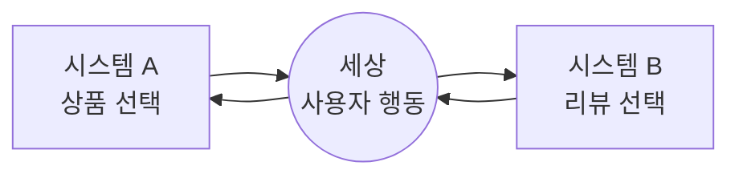
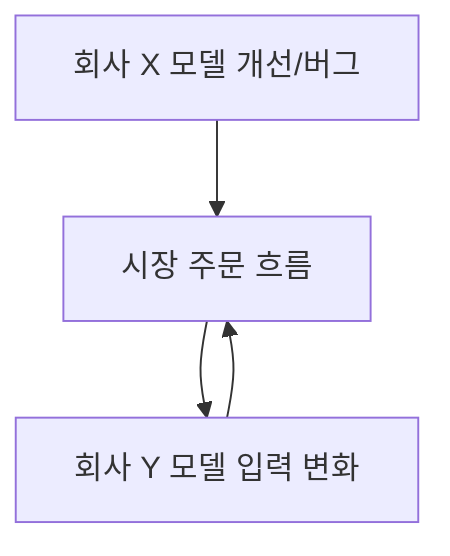

# 숨은 피드백 고리

> 서로 **직접 연결되지 않은 두 시스템**이 세상(사용자 행동·시장)을 통해 간접적으로 서로에게 영향을 주는 순환이다. 한쪽을 개선하거나 한쪽에 버그가 생기면 다른 쪽 입력이 바뀐다.

## 쉽게 말하면
한 가게는 가격표를 AI로 정하고, 옆 가게도 AI로 가격을 정한다. 둘은 연락하지 않지만 서로의 가격을 보고 반응한다. 한쪽 AI가 가격을 조금 내리면 다른 쪽이 따라 내리고, 다시 앞쪽이 내려서 둘 다 예상 못한 곳까지 간다. 연결선은 코드에 없지만 세상이 선 역할을 한다.

## 자세히
(Sculley 외, NIPS 2015, 4절을 PDF에서 직접 읽었다.)
- **정의(논문)**: "two systems influence each other indirectly through the world." [직접 피드백 고리](#direct-feedback-loop)는 통계적 문제라 연구자가 다루기 자연스럽지만, 숨은 고리는 더 어렵다고 말한다.
- **논문의 예 ①**: 웹 페이지의 한 면을 두 시스템이 각자 결정한다(하나는 보여 줄 상품, 다른 하나는 관련 리뷰). 한쪽을 개선하면 사용자가 다른 구성요소를 더 누르거나 덜 누르게 되어 다른 시스템의 입력 분포가 바뀐다.
- **논문의 예 ②**: 서로 다른 두 투자회사의 주가 예측 모델처럼 **완전히 분리된 시스템 사이에도** 생길 수 있다. 한쪽의 개선 — 더 무서운 경우엔 **버그** — 가 상대의 매수·입찰 행동에 영향을 준다.
- **왜 위험한가**: 코드·데이터 의존성 그래프에 선이 없어서 검색·테스트로 못 찾는다. 두 팀이 서로의 존재를 모를 수도 있다. 업데이트 주기가 길면 변화가 서서히 쌓여 더 늦게 발견된다(논문의 일반 서술).
- **방어(일반 원칙, 논문 문장 아님)**: 같은 화면·같은 사용자·같은 시장을 공유하는 시스템 목록화, 한 시스템 변경 시 이웃 지표 모니터링, 변경을 동시에 배포하지 않기, 모델 영향이 없는 홀드아웃 유지.
- 논문은 이런 고리가 [ML 분석 부채](#ml-analysis-debt)의 원인이라고 묶어 설명한다.

## 그림으로 보기

## 예시
- 상품 추천 + 리뷰 정렬 모델: 추천이 바뀌어 클릭 대상이 달라지면 리뷰 모델의 학습 데이터가 변한다.
- 교육 소재: "두 AI가 서로 모른 채 같은 사람을 상대할 때"를 가격 경쟁 시나리오로 토론.

## 헷갈리는 것과 비교
| 개념 | 차이 |
|---|---|
| 숨은 피드백 고리 | 서로 다른 시스템이 세상을 통해 간접 영향 |
| [직접 피드백 고리](#direct-feedback-loop) | 한 모델이 자기 학습 데이터에 직접 영향 |
| [ML 분석 부채](#ml-analysis-debt) | 이 고리들이 만드는 예측 곤란 |

## 더 읽을거리
- [Hidden Technical Debt in Machine Learning Systems (NIPS 2015)](https://proceedings.neurips.cc/paper/2015/file/86df7dcfd896fcaf2674f757a2463eba-Paper.pdf) — 4절 Feedback Loops 원문(직접 읽음).
