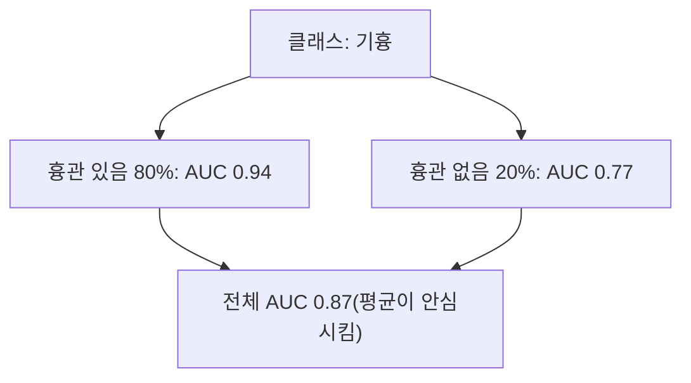
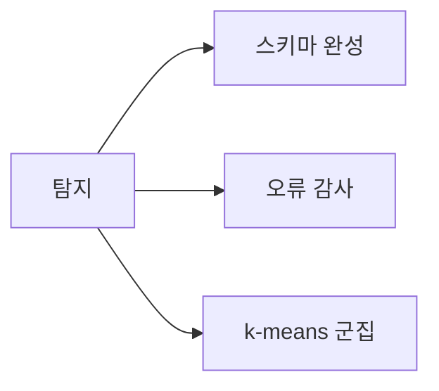

# 숨은 계층화

> 하나의 라벨(클래스) 안에 라벨에는 드러나지 않은 임상적으로 다른 하위 집단이 있어서, 큰 하위 집단이 평균 지표를 좌우해 안심하게 만들지만 작은 하위 집단에서는 모델이 크게 실패하는 현상이다.

## 쉽게 말하면
"기흉 있음"이라는 한 라벨 안에 "흉관 삽입한 환자"와 "흉관 없는 환자"가 섞여 있다. 쉬운 쪽만 잘 맞혀도 평균은 높은데, 어려운 쪽 환자에게는 위험한 모델이 된다.

## 자세히
(Oakden-Rayner 외, arXiv 1909.12475 전문을 하위 에이전트가 읽은 노트 기준. ML4H 2019 확장 초록.)
- **정의**: 클래스 안에 라벨에 없는 임상적으로 다른 하위 집합이 있어 큰 하위 집합이 정확도·민감도·AUC 등 집계 지표를 지배한다. 하위 집단 간 성능 차이가 임상적으로 중요한 부분에서 **최대 20%**에 이른다고 주장. 원인: 낮은 유병률, 라벨 품질 불량, 미묘한 특징, 허위 상관.
- **고관절 골절(Royal Adelaide, DenseNet, 전체 AUC 0.994)**: 전체 민감도 0.981, 미묘한 골절 0.900(38건, 6%), 경부 골절 0.911(81건, 13%) — 모두 유의하게 낮음(p<0.01).
- **MURA(DenseNet-169, 학습 13,942·시험 714)**: 전체 AUC 0.91, 하드웨어 0.98, 골절 0.86, 퇴행성 0.76.
- **CXR14 기흉(112,120장, 환자 30,805명)**: 전체 AUC 0.87, **흉관(drain) 있음 0.94 vs 없음 0.77**. 시험 세트 기흉의 80%가 흉관 보유. PPV 0.90(흉관) vs 0.60(없음). 흉관은 치료 결과로 생긴 비인과적 허위 상관이며 치료 전 환자가 정작 위험하다.
- **탐지 방법 3가지**: 스키마 완성(하위 집단 정의), 오류 감사(틀린 사례 검토), 알고리즘적 측정(사전 softmax 특징에 k-means, k=2~5). CXR14에서 흉관 하위 집단 비율은 고오류 군집 0.17 vs 저오류 군집 0.84(전체 0.80). MURA에서는 군집이 잘 분리되지 않았다.

## 그림으로 보기

## 예시
- 얼굴 인식·의료 영상 모델 검증 시 라벨 아래 하위 집단(촬영 장비·치료 여부·질환 아형)별 성능 표 작성.
- 교육 활용: 평균 지표 하나가 안전을 보장하지 않는다는 임상 사례.

## 헷갈리는 것과 비교
| 개념 | 차이 |
|---|---|
| 숨은 계층화 | 라벨에 없는 하위 집단의 성능 격차 |
| [소집단 변화](#subpopulation-shift) | 집단 비율이 달라지는 분포 변화 |
| 데이터 누수 | 시험 정보의 학습 유입(다른 문제) |

## 더 읽을거리
- [Hidden Stratification (arXiv 1909.12475)](https://arxiv.org/abs/1909.12475) — 사례·측정 방법.
