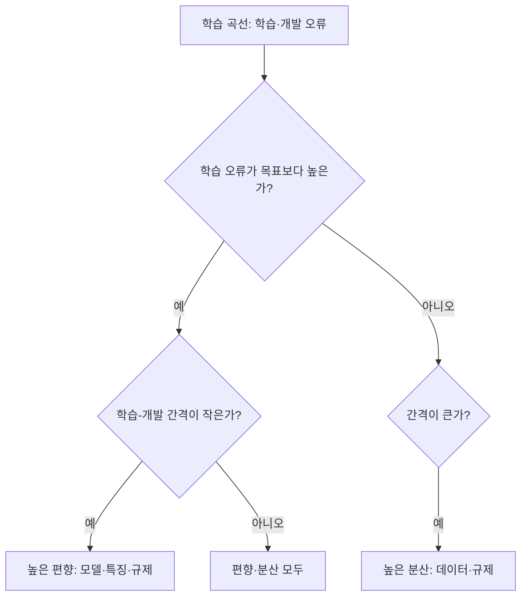
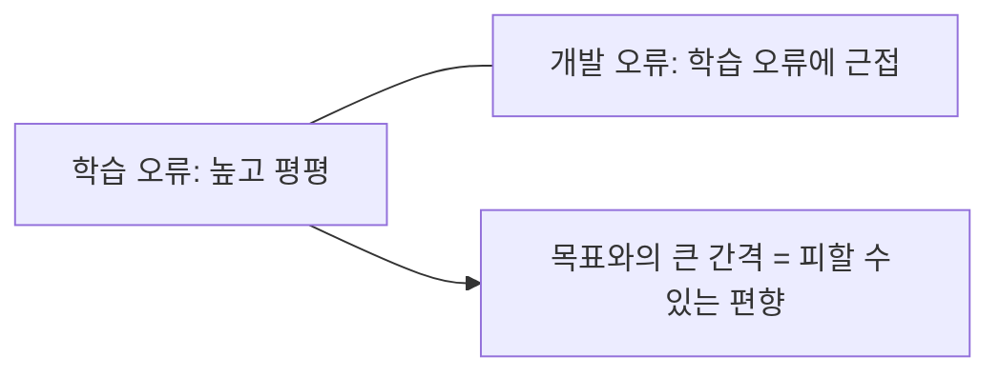

# 높은 편향 학습 곡선

> 학습 데이터를 늘려 가며 그린 **학습 오류와 개발(검증) 오류가 모두 높은 값 근처에서 서로 가까워지며 평평해지는** 곡선. 데이터를 더 모아도 소용없고 모델·특징·문제 정의를 바꿔야 하는 신호다.

## 쉽게 말하면
교재를 아무리 많이 풀어도 기출 정답률이 70%에서 늘지 않고 새 문제 정답률도 68%에 붙어 있다면, 문제는 문제 수가 아니라 풀이 방법(모델)이 그 이상을 못 하는 것이다.

## 자세히
(Andrew Ng, Machine Learning Yearning 초안 28~31장, 본문 확인)
- **학습 곡선**: 학습 세트 크기를 달리해(예: 1,000개가 있으면 100, 200, …, 1,000개로 학습) 개발 오류를 그린 것. 데이터가 늘수록 개발 오류는 내려가야 한다. 여기에 **원하는 오류율**(사람 수준, 제품 목표, 경험적 기대)을 선으로 더한다.
- **개발 오류만 보면 외삽이 어렵다(Ng)**: 개발 오류 곡선이 평평하게 **정체(plateau)** 되었다면 데이터를 더해도 목표에 닿지 못한다. 하지만 개발 세트가 작으면 곡선이 잡음이 커서 정확한 외삽은 어렵다. 그래서 **학습 오류 곡선을 함께** 그린다.
- **학습 오류의 두 가지 성질(Ng)**: ① 데이터를 더하면 학습 오류는 **같거나 높아질 뿐**(외우기 어려워져서) ② 개발 오류는 보통 학습 오류보다 높다. 따라서 학습 오류가 이미 **목표 오류율보다 높다면** 데이터를 더해도 개발 오류가 목표까지 내려갈 가능성은 거의 없다.
- **교과서적 높은 편향 곡선(Ng)**: 가장 큰 학습 크기에서 **학습 오류와 목표(최적) 오류 사이의 간격이 크다**(= 피할 수 있는 편향이 큼). **학습 오류와 개발 오류의 간격은 작다**(= 분산이 작음). 두 곡선이 가깝게 붙어 높은 곳에서 평평하다.
- **처방**: 데이터 추가는 효과가 작다. **모델 크기 확대, 특징 추가, 규제 완화, 구조 변경**을 시도한다([피할 수 있는 편향 vs 분산](#avoidable-bias-vs-variance)). 사람이 해당 입력을 맞힐 수 있는지(정보가 충분한가)와 라벨 품질도 점검한다([라벨 모호함](#label-ambiguity-ceiling)).
- **다른 곡선 모양(Ng 31장)**
  | 학습 오류 | 개발−학습 간격 | 진단 |
  |---|---|---|
  | 낮음 | 큼 | **높은 분산**: 데이터 추가가 간격을 줄일 가능성 |
  | 목표보다 높음 | 큼 | **편향·분산 모두 큼**: 둘 다 줄여야 함 |
  | 목표보다 높음 | 작음 | **높은 편향**(이 글) |
- **곡선 그리기 요령(Ng 32장)**: 작은 크기에서는 곡선이 **잡음**이 크다(운 나쁜 소표본 등). ① 같은 크기로 여러 번(3~10) 무작위 추출해 평균 ② 불균형·다중 클래스면 **클래스 비율을 맞춘** 부분집합 ③ 학습이 비싸면 선형 간격 대신 1,000·2,000·4,000·6,000·10,000처럼 **간격을 넓게**([로그 간격](#log-spaced-sample-sizes)). 10,000개 넘고 분포가 심하게 치우치지 않으면 이런 기법은 대개 불필요.
- **한계**: 시험 잡음이 커서 평평해 보이는 것일 수 있으므로 [구간](#independent-test-ci)을 확인한다.

## 그림으로 보기



## 예시
```python
from sklearn.model_selection import learning_curve
sizes, tr, va = learning_curve(model, X, y, train_sizes=[0.1, 0.2, 0.4, 0.7, 1.0], cv=5)
train_err, dev_err = 1 - tr.mean(1), 1 - va.mean(1)
# train_err가 목표(예: 5%)보다 높고 dev_err와 간격이 작다 → 높은 편향
```
- 고객 이탈 예측: 학습·검증 정확도가 모두 72%에서 평평하면 특징이 이탈 신호를 못 담았을 가능성이 높으므로 새 특징을 먼저 찾는다.

## 헷갈리는 것과 비교
| 곡선 | 두 오류 | 의미 |
|---|---|---|
| 높은 편향 | 높고 가까움 | 모델 한계 |
| 높은 분산 | 학습 낮고 개발 높음 | 일반화 부족 |
| 좋은 곡선 | 둘 다 낮고 가까움 | 목표 도달 |
| [점근 오류](#asymptotic-error) | 곡선이 눕는 높이 | 정량화 |

## 더 읽을거리
- [Andrew Ng, Machine Learning Yearning(초안 PDF) 28~32장](https://home-wordpress.deeplearning.ai/wp-content/uploads/2022/03/andrew-ng-machine-learning-yearning.pdf) — 학습 곡선 해석(본문 열어 확인).
