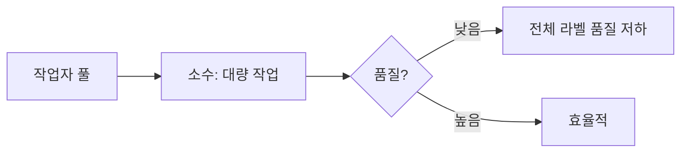
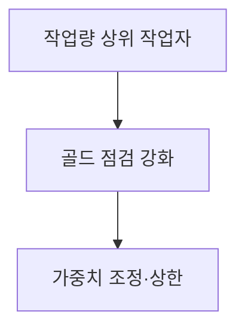

# 고물량·저품질 작업자

> 크라우드 작업에서는 소수의 작업자가 과제의 큰 몫을 처리하는 경향이 있어, 그중 품질이 낮은 사람이 있으면 전체 라벨 품질이 크게 흔들린다. 작업량이 많다고 믿을 만한 것은 아니다.

## 쉽게 말하면
식당 한 곳 일손의 대부분을 한 명이 맡는데 그 사람이 대충 일하면 맛 전체가 떨어진다. 많이 일하는 사람일수록 품질 점검 대상 1순위다.

## 자세히
(Snow 외 EMNLP 2008을 직접 읽고 확인. 다른 문헌은 미확인.)
- **관찰(Snow 외)**: 대부분의 AMT 데이터 수집에서 **상대적으로 적은 수의 작업자가 과제의 큰 부분을 한다**. 작업자별 신뢰도 편차가 크며, 논문은 "고물량이지만 저품질인 작업자를 식별할 가능성"에 주목해 작업자 품질을 통제할 필요를 말한다(5절, 작업자별 정확도 그림). 작업량과 품질의 **수치 상관은 논문에 없다**.
- **대응(같은 논문)**: 소량 골드로 작업자 혼동 행렬을 추정하는 Dawid-Skene식 편향 보정과 로그 우도비 가중 투표. 평균 +0.6%, RTE +4.0%, 사건 순서 +3.4% 향상([MTurk 비전문가 라벨링 연구](#mturk-annotation-2008)).
- **미확인 항목**: Kittur 외 CHI'08에서 무효 응답이 약 절반 가까이였다는 수치(슬라이드 스니펫 약 49%)는 원문을 못 열어 확인하지 못했다. Toloka·Appen 사기 방지 문서에서 작업량과 품질을 직접 연결한 출처도 찾지 못했다.
- **운영 지침(제안)**: 작업량 상위 10% 작업자를 우선 골드 점검, 응답 시간 이상치 확인, 작업자별 최대 비중 상한을 두어 한 사람의 편향이 데이터셋을 지배하지 않게.

## 그림으로 보기

## 예시
- 작업자 100명 중 5명이 60%를 처리 → 그 5명의 골드 정답률을 우선 확인하고 한 사람 비중을 20%로 제한.
- 교육 활용: 크라우드 데이터의 "소수 지배" 위험을 분포 그래프로 시각화.

## 헷갈리는 것과 비교
| 개념 | 차이 |
|---|---|
| 고물량·저품질 | 작업량과 품질이 반비례할 수 있음 |
| 스패머 | 의도적으로 무작위 답 |
| [골드 문항](#gold-question-ratio) | 이들을 가려내는 방법 |

## 더 읽을거리
- [Cheap and Fast—But is it Good? (ACL D08-1027)](https://aclanthology.org/D08-1027.pdf) — 5절 작업자 분석.
