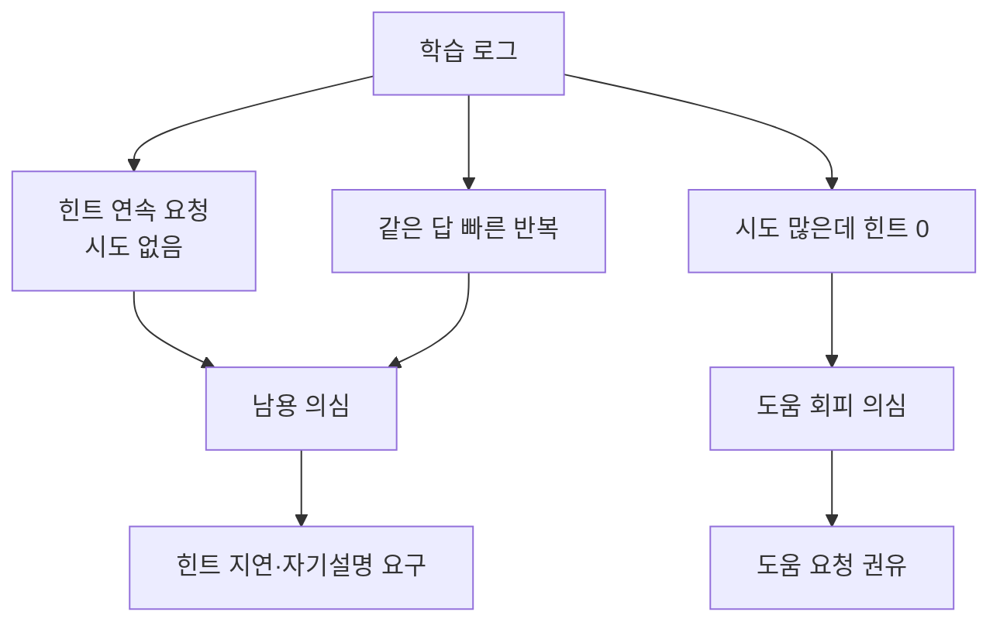
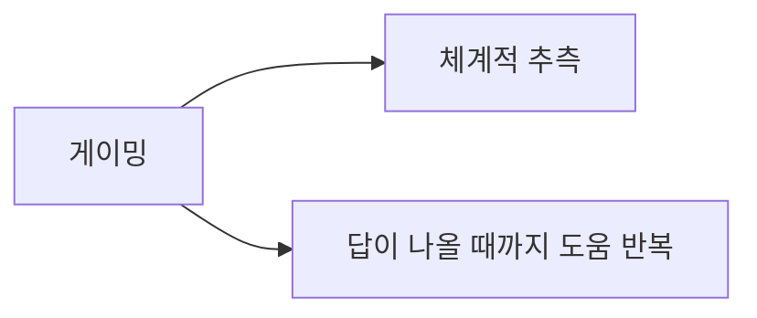

# 힌트 남용 탐지

> 학생이 문제를 풀어 보려는 시도 없이 힌트를 연달아 눌러 정답만 빼 가는 패턴을 로그에서 찾아내는 일. 학습 연구에서는 "시스템 속이기(gaming the system)"의 한 갈래로 다룬다.

## 쉽게 말하면
시험 대비 문제집에서 풀이를 읽지 않고 해답지부터 펴는 습관이다. 선생님은 "몇 번 풀어 보다 해답지를 봤나, 처음부터 봤나"를 기록으로 구분하고 싶어 한다.

## 자세히
- **정의(Baker 등)**: 학습 환경을 오용해 배우지 않고 문제를 넘기는 행동. 대표 형태는 체계적 추측과, 답이 나올 때까지 도움을 반복 요청하는 것. 후속 연구는 같은 답이나 빈 답을 빠르게 반복해 답을 끌어내는 것도 help abuse로 설명한다. 이 탐지기는 CTAT 튜터용으로 공개되어 실시간·사후 적용이 가능하고, 새 학생과 새 레슨에도 전이된다고 보고된다(검색 요약 기준, 논문 본문은 열지 않음). 게이밍은 낮은 학습 성과와 상관이 있다는 보고도 있다.
- **로그로 쓸 수 있는 신호(PMC6310403 논문을 열어 읽음)**: 바텀아웃 힌트 횟수와 힌트 쓴 문제 수(정답만 얻고 이해는 없을 수 있음), 일반 힌트 대 바텀아웃 힌트 비율, 시도 횟수 과다(추측 가능), 시도가 많은데 힌트 요청은 없음(도움 회피), 이탈. 문제 체류 시간은 노이즈가 커서(몇 달이 되는 값도 있음) 윈저화 같은 보정이 필요했다.
- **한계**: 이 논문은 탐지기를 만들지 않고 탐지에 쓸 수 있는 측정만 제안했으며 검증도 안 했다. 너무 빠른 응답의 임계값도 정의하지 않는다. 해석은 마감·학년·사전지식에 따라 달라진다.
- **도움 회피도 문제**: 가장 도움이 필요한 학생이 도움을 덜 찾는다는 선행 연구가 인용된다. 남용과 회피를 함께 본다.
- Aleven의 help-seeking 모델은 내용을 직접 읽지 못해 다루지 않는다.

## 그림으로 보기

## 예시
- LLM 튜터 설계: 학생 시도 없이 "다음 힌트"만 3번 요청하면 "먼저 한 줄이라도 써 볼까요?"로 되묻기. 규칙은 직접 정해야 하며 정답 기준은 없다.
- 교육 실습: 가상 로그 10줄에서 남용, 회피, 정상 패턴을 구분해 표시.

## 헷갈리는 것과 비교
| 개념 | 차이 |
|---|---|
| 힌트 남용 | 힌트로 정답만 얻으려는 사용 |
| 도움 회피 | 필요한데도 도움을 안 씀 |
| [힌트 상승 규칙](#hint-escalation-rule) | 단계를 올리는 조건 |
| [바텀아웃 힌트](#bottom-out-hint) | 남용의 대상이 되는 정답 단계 |

## 더 읽을거리
- [Hints in an online learning system (PMC6310403)](https://pmc.ncbi.nlm.nih.gov/articles/PMC6310403) — 로그 기반 측정 제안(열람)
- [Baker 외, 일반화 가능한 게이밍 탐지기 (BCKR2005)](https://learninganalytics.upenn.edu/ryanbaker/BCKR2005Final.pdf) — 검색 결과로 확인, 본문은 열지 않음
